<div align="center">

# 💳 XAI 기반 대안신용평가 시스템

**금융 기록이 얇아도, 이유와 함께 공정하게 심사받도록**

씬파일러를 위한 설명 가능한 대안신용평가 - 동양미래대학교 코디세이 WebApp PBL · 팀 신용불량단

[](#-1-한눈에-보기)
[](docs/report_draft.md)
[](#-10-실행-방법)


</div>

> **본 시스템은 교육 목적으로 개발되었으며, 실제 금융 의사결정에 사용할 수 없습니다.**
>
> 같은 문구가 대시보드 모든 페이지(사이드바 하단), API 응답의 `disclaimer` 필드, 실험 리포트에 들어 있습니다.

---

## 📑 목차

1. [🎬 한눈에 보기](#-1-한눈에-보기)
2. [❓ 문제](#-2-문제)
3. [💡 해결](#-3-해결)
4. [🏗️ 아키텍처](#️-4-아키텍처)
5. [🧗 기술적 도전](#-5-기술적-도전)
6. [📊 성과](#-6-성과)
7. [🚧 한계와 다음 단계](#-7-한계와-다음-단계)
8. [👥 팀과 역할](#-8-팀과-역할)
9. [🧰 기술 스택 · 문서](#-9-기술-스택--문서)
10. [🚀 실행 방법](#-10-실행-방법)
11. 부록: [데이터 · 점수 기준](#-부록-데이터--점수-기준) · [상세 실행 방법](#-부록-상세-실행-방법) · [디렉토리 구조](#디렉토리-구조) · [환경 변수](#환경-변수-설명)

---

## 🎬 1. 한눈에 보기

대출 심사 담당자가 고객 정보를 넣으면 **승인 · 거절과 신용 점수**, **왜 그런 결과가 나왔는지(거절 사유 5가지)**, **무엇을 바꾸면 승인되는지**를 한 화면에서 봅니다.

| ✅ 일반 고객 - 승인 (A등급 · 536점) | ❌ 씬파일러 - 거절 (E등급 · 393점) |
| --- | --- |
| 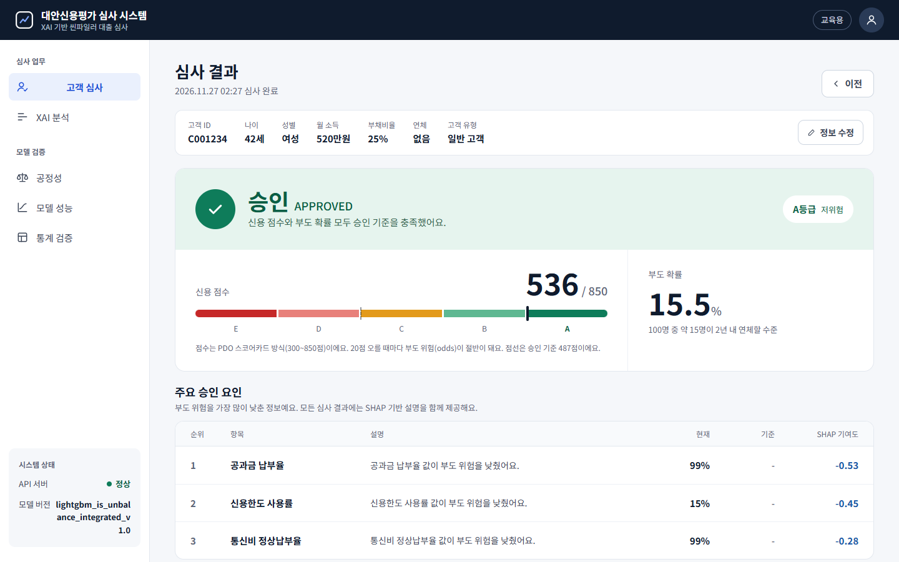 | 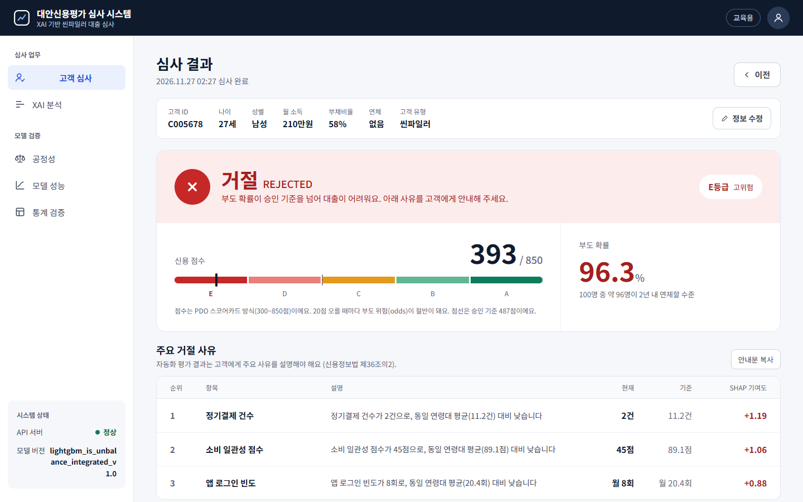 |

| 🧠 왜 거절됐나 - 거절 사유 Top 5 (SHAP) | 🔁 무엇을 바꾸면 승인되나 - 승인 조건 |
| --- | --- |
| 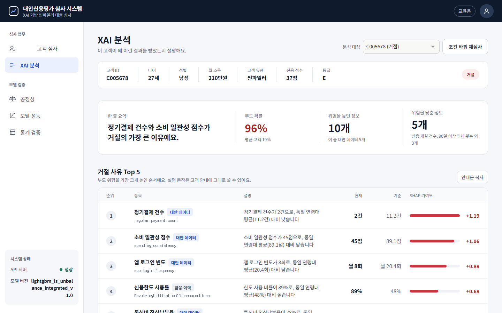 | 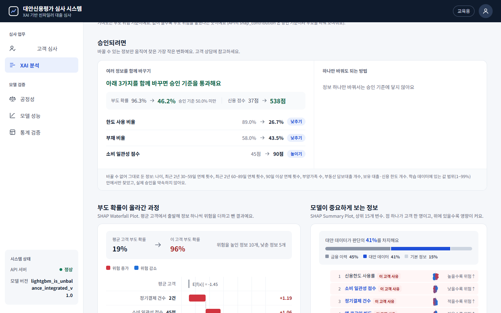 |

<sub>화면은 모두 `docker compose up`으로 띄운 실제 대시보드에서 캡처했습니다. 고객 정보는 예시 고객입니다.</sub>

---

## ❓ 2. 문제

> **금융 기록이 없으면, 성실하게 살아도 대출을 받을 수 없을까요?**

| 수⁠치&nbsp;·&nbsp;사⁠실 | 내용 |
| :---: | --- |
| 👥&nbsp;**약&nbsp;1,107⁠만&nbsp;명** | 국내 금융이력부족자(씬파일러) - 주부 · 사회초년생 · 프리랜서 등 |
| 📄&nbsp;**금⁠융&nbsp;기⁠록⁠만&nbsp;본⁠다** | 기존 신용평가(CB)는 대출 · 카드 기록으로 점수를 매겨, 기록이 얇으면 판단할 근거가 없어 거절되기 쉽다 |
| ⚖️&nbsp;**이⁠유⁠를&nbsp;설⁠명⁠해⁠야&nbsp;한⁠다** | AI로 심사받은 고객은 결과의 이유를 요구할 수 있다 (신용정보법 제36조의2) |
| 🚫&nbsp;**차⁠별⁠하⁠면&nbsp;안&nbsp;된⁠다** | 성별 · 나이 등으로 대출 조건을 차별할 수 없다 (금융소비자보호법 제15조, 금융분야 AI 가이드라인) |

<sub>출처: 금융위원회 보도자료 「데이터 경제 활성화를 위한 신용정보산업 선진화 방안」(2018.11.21) · 신용정보법 · 금융소비자보호법 · 금융위원회 「금융분야 인공지능(AI) 가이드라인」(2021.7.8)</sub>

그래서 필요한 것은 세 가지입니다. **금융 기록 밖의 데이터로 평가하고**, **그 이유를 설명하고**, **차별하지 않았음을 증명하는 것**.

---

## 💡 3. 해결

금융 정보 10개에 **대안 데이터 5개**(통신비 정상납부율 · 공과금 납부율 · 소비 일관성 · 정기결제 건수 · 앱 로그인 빈도)를 더해 부도 확률을 예측하고, 결과마다 **SHAP 설명**과 **공정성 점검**을 함께 보여 줍니다.

| 영⁠역 | 기능 | 하는 일 |
| :---: | --- | --- |
| 🧾&nbsp;**심⁠사** | 고객&nbsp;심사 | 고객 ID로 불러오거나 새로 입력 → 승인 · 거절, 신용 점수, A\~E 등급, 부도 확률. 심사 이력 저장 |
| 🧠&nbsp;**설⁠명** | 거절&nbsp;사유&nbsp;Top&nbsp;5 | SHAP으로 결과에 가장 크게 영향을 준 정보 5개를 고르고, 동일 연령대 평균과 비교한 안내 문장 생성 |
| | 승인&nbsp;조건 | 바꿀 수 있는 정보만 한 칸씩 움직여 승인 기준을 넘는 변화를 찾아 제안 (Counterfactual) |
| ⚖️&nbsp;**공⁠정⁠성** | 성별&nbsp;·&nbsp;나이&nbsp;점검 | 집단별 승인율 비율(DI Ratio)과 Equalized Odds 계산, 기준을 넘으면 집단별 승인 기준선 조정 |
| ✅&nbsp;**검⁠증** | 모⁠델&nbsp;성⁠능&nbsp;·&nbsp;통⁠계&nbsp;검⁠증 | Test AUC · KS · PSI · 씬파일러 AUC 향상, 성능 차이가 우연이 아닌지 ANOVA와 Tukey HSD |
| 📡&nbsp;**모⁠니⁠터⁠링** | 데이터&nbsp;변화&nbsp;탐지 | 점수 분포(PSI)와 입력 칸별 분포(CSI)로 데이터가 바뀌었는지 경고 |

> 아래 화면도 모두 실제 대시보드에서 캡처했습니다. 제목을 누르면 펼쳐집니다.

<details>
<summary>📉 <b>SHAP Waterfall · Summary</b> - 평균 고객 19%에서 이 고객 96%까지, 정보 하나씩 더한 위험</summary>

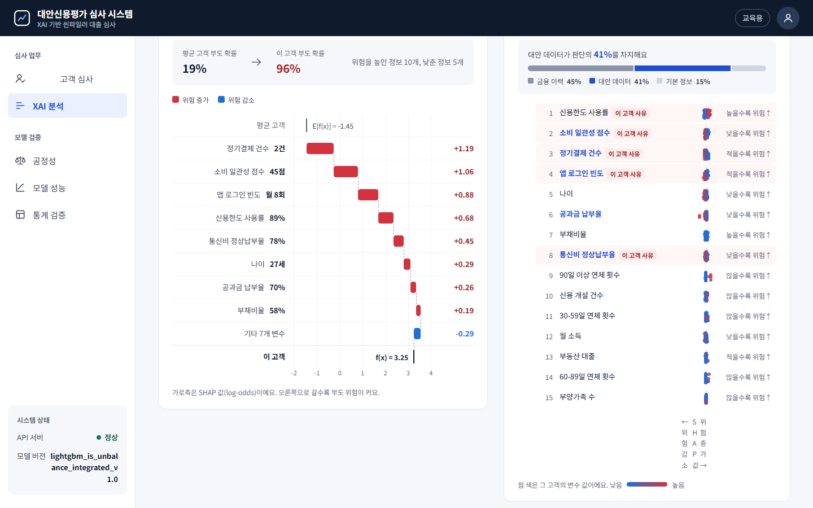

</details>

<details>
<summary>⚖️ <b>공정성</b> - 성별 · 연령대 승인율과 4개 항목 점검</summary>

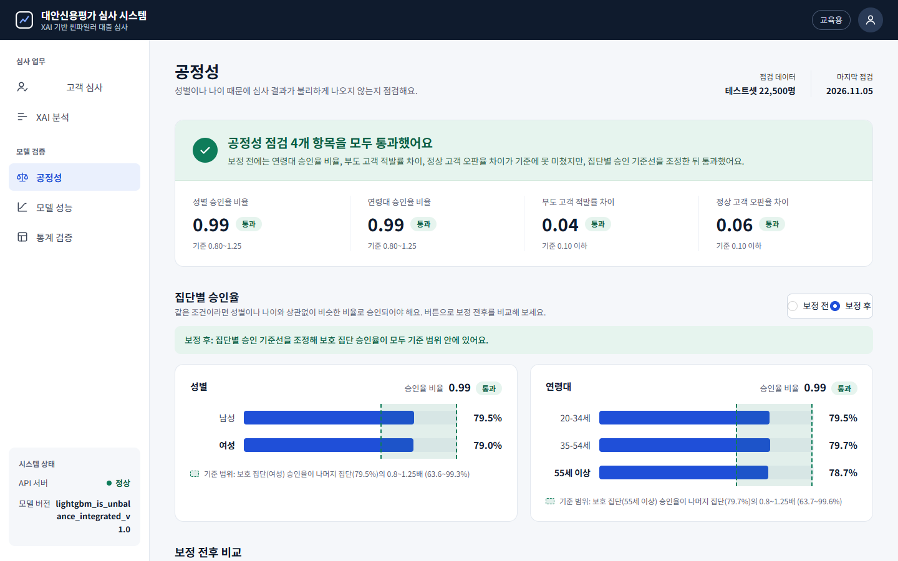

</details>

<details>
<summary>🔧 <b>공정성 보정 전후</b> - 연령대 승인율 비율 1.254(미달) → 0.99(통과)</summary>

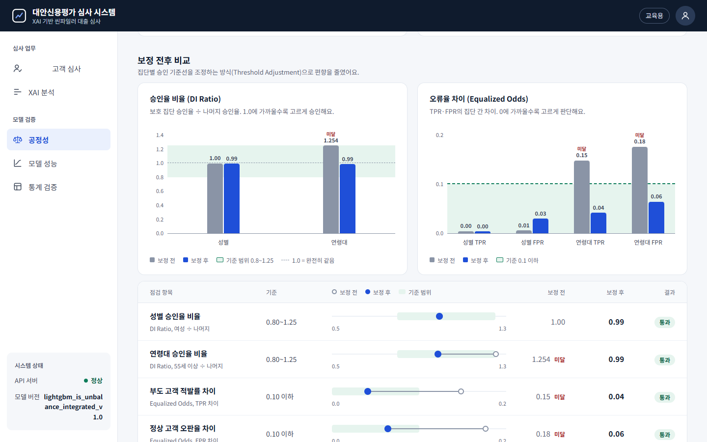

</details>

<details>
<summary>📈 <b>모델 성능</b> - 성능 목표 4개 달성, ROC · PR 곡선</summary>

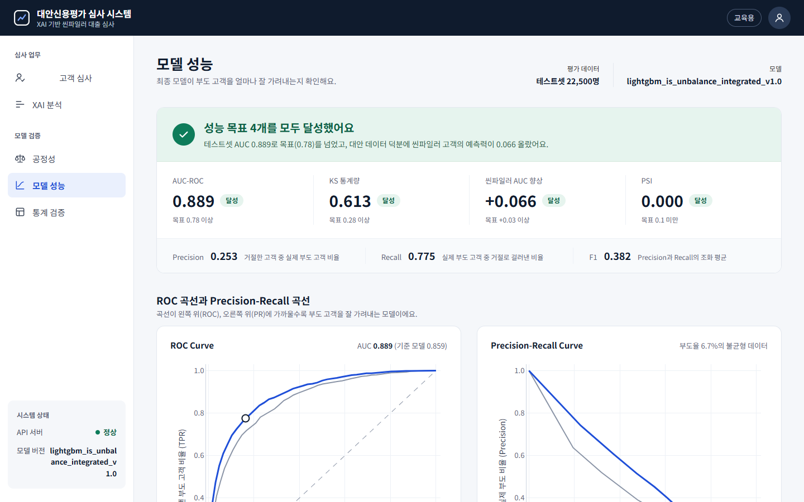

</details>

<details>
<summary>📡 <b>데이터 변화 탐지</b> - 시나리오별 점수 PSI와 칸별 CSI</summary>

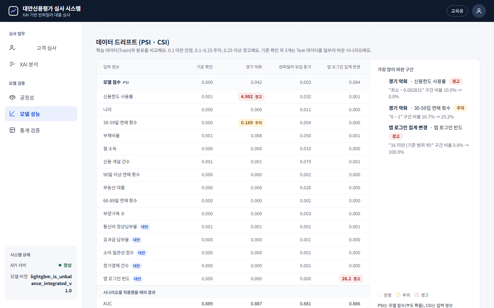

</details>

<details>
<summary>📊 <b>통계 검증</b> - 두 ANOVA 모두 p < 0.001, Tukey HSD</summary>

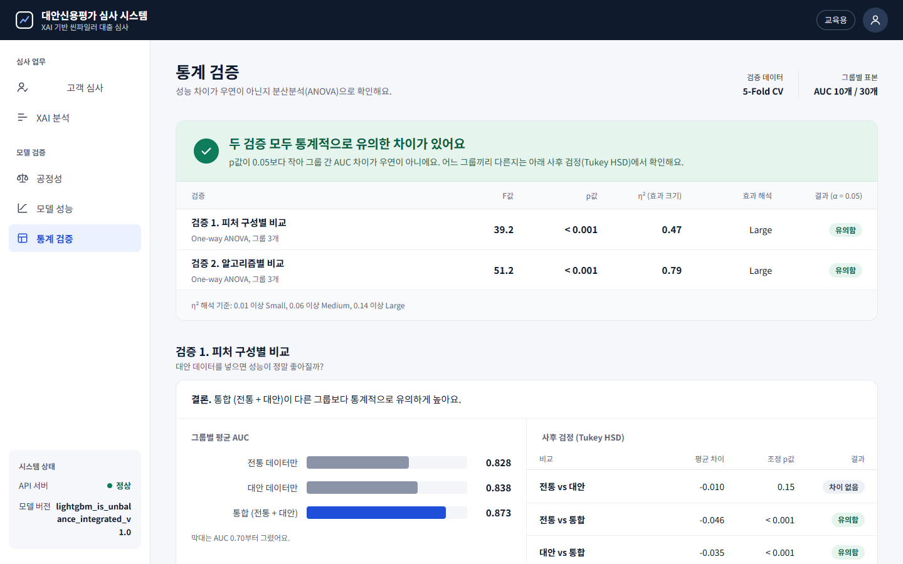

</details>

---

## 🏗️ 4. 아키텍처

학습 파이프라인이 만든 모델과 검증 결과를 API가 제공하고, 대시보드는 **모델 파일을 직접 읽지 않고 API로만** 결과를 받습니다 (MSA 구조).

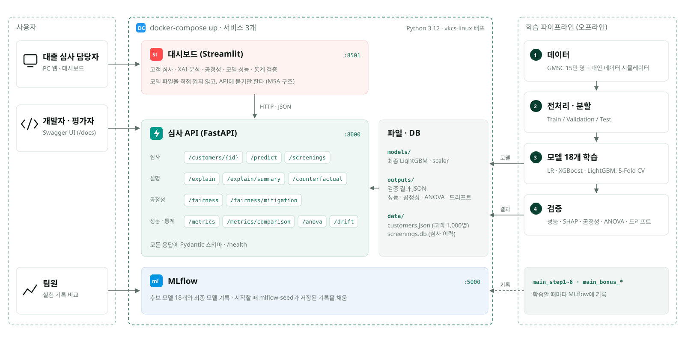

| 서⁠비⁠스 | 주소 | 역할 |
| --- | --- | --- |
| 🔌&nbsp;API&nbsp;(FastAPI) | `localhost:8000/docs` | `/predict` · `/explain` · `/counterfactual` · `/fairness` · `/metrics` · `/anova` · `/drift` · `/screenings` 등, 모든 응답에 Pydantic 스키마 |
| 🖥️&nbsp;대⁠시⁠보⁠드&nbsp;(Streamlit) | `localhost:8501` | 고객 심사 · XAI 분석 · 공정성 · 모델 성능 · 통계 검증 5개 페이지 |
| 🧪&nbsp;MLflow | `localhost:5000` | 후보 모델 18개와 최종 모델 기록 |

---

## 🧗 5. 기술적 도전

> 만들면서 부딪힌 문제를 **문제 → 해결 → 결과** 순서로 정리했습니다. 자세한 근거는 [실험 리포트](docs/report_draft.md)에 있습니다.

### ① 대안 데이터 점수가 너무 좋았다

- 🔍 **문제**<br>처음 만든 대안 변수 5개는 각자 정답에서 따로 신호를 받아, 합치면 잡음이 상쇄됐습니다. 통합 모델 Test AUC가 **0.981**로, 금융 데이터만 쓴 모델(0.87)과 비교해 현실과 거리가 멀었습니다.
- 🛠️ **해결**<br>다섯 변수가 공통 "상환 성실도" 요인을 함께 받도록 시뮬레이터를 다시 만들었습니다. 섞는 비율은 Test가 아니라 Train+Validation 교차검증으로 골랐습니다.
- ✅ **결과**<br>Test AUC **0.981 → 0.889**. 금융만 모델보다 0.02\~0.03 높은, 대안 데이터가 금융 정보를 보완하는 수준이 되었습니다.

### ② 과제 정의대로면 씬파일러가 0명

- 🔍 **문제**<br>과제 정의(연체 칸 2개 이상 결측 · 카드 이력 12개월 미만)를 GMSC에 적용하면 해당자가 0명이었습니다. 연체 칸에 결측이 없고 카드 이용 기간 정보도 없기 때문입니다.
- 🛠️ **해결**<br>정의의 취지("금융 이력이 부족해 평가가 어려운 사람")를 살려 **보유 대출 · 신용 한도 1개 이하 + 담보대출 0개 + 연체 0회**를 대체 기준으로 정했습니다.
- ✅ **결과**<br>씬파일러 **4,110명**을 찾았고, 일반 고객보다 연체율이 높고 젊은 층이 많아 "사회초년생"과 성격이 비슷했습니다.

### ③ 씬파일러 효과 측정이 흔들렸다

- 🔍 **문제**<br>Test의 씬파일러는 625명(연체 42명)뿐이라, 대안 데이터 효과가 **+0.001**(95% 구간 -0.051 \~ +0.053)로 분할 시드만 바꿔도 크게 흔들렸습니다.
- 🛠️ **해결**<br>Train+Validation의 씬파일러 3,485명(연체 253명)으로 5-Fold 교차검증을 하고, 부트스트랩 1,000회로 구간을 같이 보고했습니다.
- ✅ **결과**<br>씬파일러 AUC **0.749 → 0.815 (+0.066, 95% 구간 +0.042 \~ +0.089)**. 구간의 아래 끝도 목표 +0.03을 넘습니다.

### ④ 나이대 승인율 차이가 기준을 넘었다

- 🔍 **문제**<br>AUC가 현실적인 0.89로 내려가자 틀리는 경우가 늘고, 그 오류가 나이대에 따라 달랐습니다. 20\~34세 승인율 64%, 55세 이상 90%로 **DI Ratio 1.254**, TPR · FPR 차이 0.15 · 0.18로 기준을 넘었습니다.
- 🛠️ **해결**<br>두 가지 Bias Mitigation을 비교했습니다. **Threshold Adjustment**(나이대마다 승인 기준선을 Validation으로 정함)와 **Reweighting**(학습할 때 집단별 가중치).
- ✅ **결과**<br>둘 다 기준 안으로 들어왔습니다. Threshold Adjustment는 **DI 0.988**, TPR · FPR 차이 0.04 · 0.06이고, 전체 승인율은 약 79% 그대로입니다.

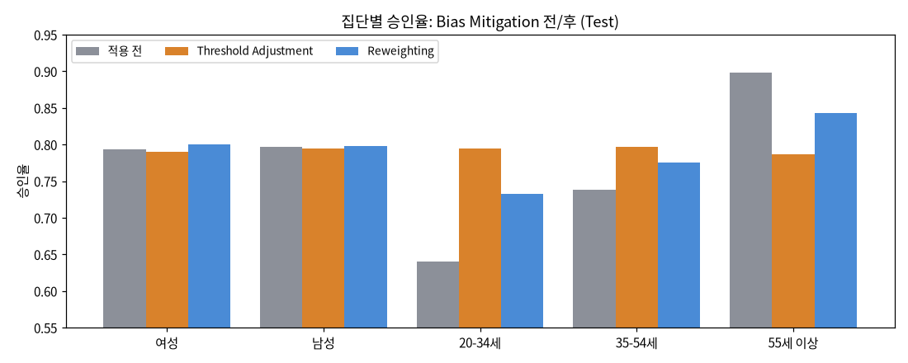

### ⑤ 점수 분포(PSI)만으로는 데이터 변화를 놓쳤다

- 🔍 **문제**<br>경기 악화 시나리오에서 승인율이 79.5%에서 74.1%로 떨어졌는데도 점수 PSI는 0.042로 "안정"이었습니다.
- 🛠️ **해결**<br>입력 칸마다 분포 변화를 재는 **CSI**를 더해, 어느 칸의 어느 구간이 바뀌었는지 경고하게 했습니다.
- ✅ **결과**<br>바뀐 칸(신용한도 사용률 CSI 4.992)을 정확히 짚었습니다. 다만 씬파일러가 5배 늘어난 시나리오는 PSI · CSI 모두 놓쳐, 운영에서는 **세그먼트 비율**도 함께 봐야 한다는 것을 확인했습니다.

---

## 📊 6. 성과

> 아래 숫자는 모두 **학습에 쓰지 않은 Test 22,500명**에서 한 번만 잰 값입니다 (씬파일러 향상은 위 ③의 교차검증 값).

### 과제 성공 기준

| 항⁠목 | 목표 | 결과 | 판정 |
| --- | :---: | :---: | :---: |
| 🎯&nbsp;Test&nbsp;AUC-ROC | 0.78 이상 | **0.889** | 통과 |
| 📏&nbsp;Test&nbsp;KS | 0.28 이상 | **0.613** | 통과 |
| 🧊&nbsp;PSI&nbsp;(Train&nbsp;vs&nbsp;Test) | 0.1 미만 | **0.0004** | 통과 |
| 🌱&nbsp;씬⁠파⁠일⁠러&nbsp;AUC&nbsp;향⁠상 | +0.03 이상 | **+0.066** | 통과 |
| ⚖️&nbsp;공⁠정⁠성&nbsp;(DI&nbsp;Ratio&nbsp;·&nbsp;Equalized&nbsp;Odds) | 0.8\~1.25 · 0.10 이하 | **0.988 · 0.04 / 0.06** (보정 후) | 통과 |
| 📊&nbsp;ANOVA | 1개 이상 p < 0.05 | **두 검증 모두 p < 0.001** | 통과 |
| ⏱️&nbsp;`/predict`&nbsp;응⁠답&nbsp;시⁠간 | 2초 이내 | **첫 호출 0.92초, 이후 0.1초 이하** | 통과 |
| 🧪&nbsp;pytest | 10개 이상 · 80% 통과 | **179개 모두 통과** | 통과 |

### 추가 과제 5개

| 과⁠제 | 결과 |
| --- | --- |
| 🔍&nbsp;LIME과&nbsp;SHAP&nbsp;비⁠교 | 고객 200명의 상위 5개 변수 평균 일치율 **0.405** (거절 고객 0.472). 두 기법이 보는 관점이 다름을 확인 |
| 🔁&nbsp;승⁠인&nbsp;조⁠건&nbsp;제⁠안&nbsp;(Counterfactual) | 바꿀 수 없는 정보(나이 · 과거 연체 등)는 고정하고, 승인 기준을 넘는 변화를 단계적으로 찾아 제안 - `POST /counterfactual` |
| 📊&nbsp;이⁠원&nbsp;분⁠산⁠분⁠석 | 대안 데이터 효과가 씬파일러(**+0.070**)에서 일반 고객(+0.027)보다 큼 - 교호작용 F = 15.58, p < 0.001 |
| 📡&nbsp;PSI&nbsp;·&nbsp;CSI&nbsp;데⁠이⁠터&nbsp;변⁠화&nbsp;탐⁠지 | 시나리오 4개로 점수 PSI와 칸별 CSI 비교 (위 ⑤) - `GET /drift` |
| 🏦&nbsp;기⁠존&nbsp;신⁠용⁠평⁠가&nbsp;모⁠델⁠과⁠의&nbsp;비⁠교&nbsp;실⁠험&nbsp;모⁠의&nbsp;시⁠행 | 같은 승인율(76.8%)에서 부도율 **2.07% → 1.72% (-16.5%)**, 부도 357명 → 298명 |

<details>
<summary>📈 모델 18개 비교 · ANOVA 그림 보기</summary>

**데이터 3종 × 알고리즘 3종 × 불균형 처리 2종 = 18개 모델의 Validation AUC** - 통합 데이터 · LightGBM · `is_unbalance`가 최종 모델

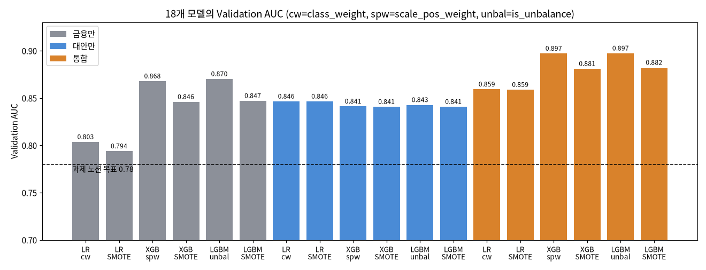

**ANOVA** - 데이터를 합쳤을 때만 점수가 오르고(검증 1), XGBoost와 LightGBM은 차이가 없음(검증 2)

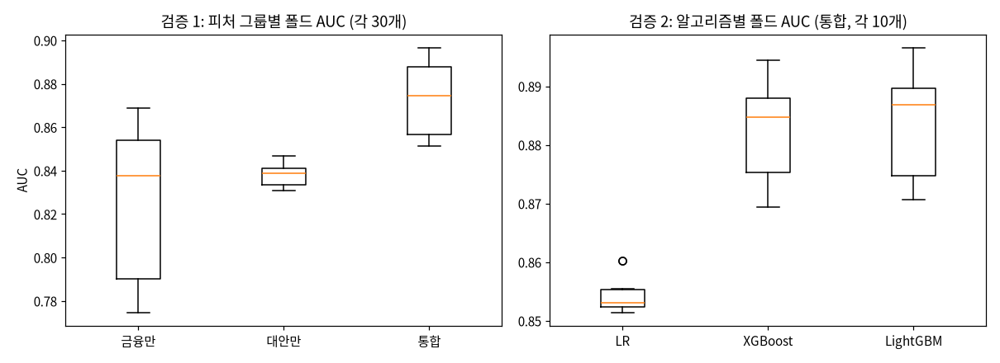

</details>

---

## 🚧 7. 한계와 다음 단계

학생 프로젝트로는 넘기 어려웠던 한계 3가지입니다.

#### 🧪 대안 데이터가 실제 값이 아니다

- **지금** - 통신비 · 공과금 기록은 실제 데이터가 아니라 시뮬레이터로 만든 값이고, 정답을 일부 써서 만들었습니다.
- **왜** - 개인의 실제 납부 기록은 공개 데이터로 구할 수 없습니다.
- **넘으려면** - 통신사 · 공공기관의 실제 납부 기록으로 다시 검증

#### 🎚️ 부도 확률이 실제보다 높게 나온다

- **지금** - 불균형 처리(`is_unbalance`) 때문에 Test 평균 부도 확률이 0.28로, 실제 부도율 6.7%보다 높습니다. 순위(AUC)는 맞지만 확률 자체는 보정되지 않았습니다.
- **왜** - 연체자를 놓치지 않는 쪽(Recall 0.775)을 택한 대가입니다.
- **넘으려면** - 확률 보정 후 점수 · 등급 구간을 다시 정함

#### 📋 씬파일러 기준이 과제 정의와 다르다

- **지금** - 데이터에 카드 이용 기간이 없어 "12개월 미만" 기준을 쓸 수 없었고, 보유 계좌 수 기준으로 대신했습니다.
- **왜** - GMSC는 이미 대출을 가진 사람들의 데이터라 금융 기록이 완전히 없는 사람이 거의 없습니다.
- **넘으려면** - 카드 이용 기간이 있는 데이터로 기준을 다시 확인

---

## 👥 8. 팀과 역할

🎓 동양미래대학교 · 코디세이 WebApp PBL · 팀 **신용불량단**

#### 👑 이윤아 &nbsp;`팀장` `프론트엔드`

- 화면 설계, Streamlit 대시보드 5개 페이지 (고객 심사 · XAI 분석 · 공정성 · 모델 성능 · 통계 검증)
- 추가 과제 결과 화면 (승인 조건 · 데이터 변화 · 비교 실험 · 이원 분산분석)
- GitHub 저장소 · Docker 초기 구성

#### 🧮 이재희 &nbsp;`데이터` `모델`

- 데이터 로드, 대안 데이터 시뮬레이터, 전처리 · 분할 (`main_step1`)
- 모델 18개 학습 · 5-Fold 교차검증 · 최종 모델 선택 (`main_step2`)
- 학습 파이프라인에 칸별 CSI 판정 기록

#### ⚙️ 이하늘 &nbsp;`백엔드` `인프라`

- API · DB 설계, FastAPI · Pydantic 스키마
- 심사 이력 · 데이터 변화 API, 신용 점수 산식
- Docker Compose, 팀 MLflow 서버

#### 🔬 남궁명진 &nbsp;`모델 분석` `XAI · 공정성`

- 성능 비교, SHAP 해석 · 거절 사유, 공정성 · Bias Mitigation, ANOVA (`main_step3~6`)
- 추가 과제 5종 (`main_bonus_*`), 승인 조건 API
- 실험 리포트

<sub>통합 테스트 · 버그 수정, 문서, 발표는 전원이 함께 했습니다.</sub>

---

## 🧰 9. 기술 스택 · 문서

### 기술 스택

| 분⁠류 | 기술 |
| --- | --- |
| 🧮&nbsp;**데⁠이⁠터&nbsp;·&nbsp;모⁠델** |      -555555) |
| 🧠&nbsp;**설⁠명&nbsp;(XAI)** |   |
| ⚖️&nbsp;**공⁠정⁠성&nbsp;·&nbsp;통⁠계** |  -8CAAE6?logo=scipy&logoColor=white) |
| 🔌&nbsp;**API&nbsp;·&nbsp;화⁠면** |     |
| 🐳&nbsp;**실⁠험&nbsp;·&nbsp;배⁠포** |    |

정확한 버전은 [`requirements.txt`](requirements.txt)에 있습니다.

### 문서

| 문⁠서 | 내용 |
| --- | --- |
| 📝&nbsp;[실⁠험&nbsp;리⁠포⁠트](docs/report_draft.md) | 문제 정의 · EDA · 시뮬레이터 · 모델 비교 · XAI · 공정성 · ANOVA · 결론 |
| 📐&nbsp;[칸&nbsp;이⁠름&nbsp;·&nbsp;단⁠위](docs/column_spec.md) | 입력 15개 칸의 이름 · 단위 · 월소득 환산(PPP) |
| 🧪&nbsp;[대⁠안&nbsp;데⁠이⁠터&nbsp;시⁠뮬⁠레⁠이⁠션](docs/alt_data_simulation.md) | 시뮬레이터 설계와 보정 실험 |
| 📦&nbsp;[모⁠델&nbsp;기⁠록](models/README.md) | 최종 모델 · 스케일러 변경 이력 |
| 🌿&nbsp;[Git&nbsp;규⁠칙](docs/git_conventions.md) | 브랜치 · 커밋 · PR 규칙 |

---

## 🚀 10. 실행 방법

Docker만 있으면 명령 세 줄로 API · 대시보드 · MLflow가 함께 뜹니다. `.env` 없이도 실행됩니다.

```bash
git clone https://github.com/Dongyang-Mirae-University-software/xai-credit-scoring.git
cd xai-credit-scoring
docker compose up --build     # 처음 한 번은 이미지 빌드에 몇 분 걸림
```

| 열⁠기 | 주소 |
| --- | --- |
| 🖥️&nbsp;대⁠시⁠보⁠드 | http://localhost:8501 - 고객 심사 화면 오른쪽 "일반 고객" · "씬파일러" 예시부터 눌러 보세요 |
| 🔌&nbsp;API&nbsp;문⁠서&nbsp;(Swagger) | http://localhost:8000/docs |
| 🧪&nbsp;MLflow | http://localhost:5000 |

고객 심사 3/3 화면은 서류 · 신용정보 · 대안정보를 출처별 카드로 보여 줍니다. 대안정보는 원천 기록 형태로 환산해 보여 줘요 (예: 통신비 정상납부율 78% → 통신요금 19 / 24개월). 모델 입력값과 데이터는 그대로입니다.

로컬 실행, 파이프라인 재실행, 테스트는 [상세 실행 방법](#-부록-상세-실행-방법)에 있습니다.

---

## 📎 부록: 데이터 · 점수 기준

### 데이터
| 항⁠목 | 값 |
|---|---|
| 원⁠본 | GMSC `data/raw/cs-training.csv` 150,000명 |
| 부⁠도⁠율&nbsp;(2⁠년&nbsp;내&nbsp;90⁠일&nbsp;이⁠상&nbsp;연⁠체⁠) | 6.68% (Positive:Negative ≈ 1:14) |
| 대⁠안&nbsp;변⁠수&nbsp;5⁠개 | 통신비 정상납부율, 공과금 납부율, 소비 일관성, 정기결제 건수, 앱 로그인 빈도 (`src/data/simulator.py`) |
| 씬⁠파⁠일⁠러 | 4,110명 (2.74%) |
| 분⁠할 | Train / Validation / Test = 70 : 15 : 15 (stratify, 시드 42) |

**씬파일러 판정 기준** (`label_thin_filer`): 과제 기준인 "연체 컬럼 2개 이상 결측"은 GMSC에 해당자가 없어서, 아래 기준을 함께 씁니다 (기준 1 OR 기준 2).
- 기준 1: 연체 컬럼 2개 이상 결측
- 기준 2: 보유 대출·신용 한도 1개 이하 **이고** 부동산 담보대출 0개 **이고** 연체 기록 0회

### 점수와 등급 기준
신용 점수는 PDO 스코어카드 방식입니다 (이슈 #157, `src/api/model.py` `credit_score`).

`Score = Offset + Factor × ln(odds)`, odds = (1 - 부도 확률) ÷ 부도 확률, `Factor = PDO ÷ ln2`, `Offset = 기준점수 - Factor × ln(기준 odds)`

| 설정 | 값 | 뜻 |
|---|---|---|
| 기준점수&nbsp;@&nbsp;기준&nbsp;odds | 600점 @ 50:1 | 모델 확률(보정 전) 기준 부도 확률 약 2% 이면 600점 |
| PDO | 20 | 20점 오를 때마다 odds 2배 (부도 위험 절반) |
| 범위 | 300 ~ 850 | 바깥은 잘라냄 |

600점 @ 50:1, PDO 20 은 스코어카드 교과서에서 흔히 쓰는 관례 값입니다 (기관마다 다름). 응답의 `score_method`(`pdo-600-50-20`)로 어떤 식인지 알 수 있습니다.

| 등급 | 점수 | 위험도 | 심사 결과 | 부도 확률 |
|---|---|---|---|---|
| A | 527 이상 | 저위험 | 승인 | 0.2 미만 |
| B | 505 ~ 526 | 저위험 | 승인 | 0.2 ~ 0.35 |
| C | 487 ~ 504 | 중위험 | 승인 | 0.35 ~ 0.5 |
| D | 463 ~ 486 | 고위험 | 거절 | 0.5 ~ 0.7 |
| E | 463 미만 | 고위험 | 거절 | 0.7 이상 |

등급 경계 463 · 487 · 505 · 527점은 이전 부도 확률 경계(0.7 · 0.5 · 0.35 · 0.2)를 새 점수식에 넣은 값입니다. 그래서 승인 여부와 등급의 뜻은 이전과 같고, Test 데이터로 기준을 정하지 않았습니다. 50:1은 보정 전 모델 확률 기준이라 실제 부도율의 odds와 다릅니다 (590\~610점 고객의 실제 부도율은 Test 0.07%, Validation 0.34%). 지금 모델(LightGBM is_unbalance)은 부도 확률이 실제보다 높게 나와서(test 평균 0.28, 실제 부도율 6.7%) 점수가 400~650점대에 몰리고 C·D 구간이 좁습니다. 확률을 보정하면 구간을 다시 정합니다.

승인은 점수가 아니라 부도 확률로 정합니다: `APPROVAL_THRESHOLD`(기본 0.5) 미만이면 승인이고, 이에 해당하는 점수가 487점입니다 (`approval_score`). 등급 구간·점수 범위·승인 기준 점수는 `src/api/model.py` 한 곳에서 정하고, 대시보드는 `/health` 의 `grade_scale`·`score_range`·`approval_score` 로 받아 등급 막대(다섯 칸 같은 폭, 칸 안에서 점수 비율)와 점선을 그립니다.
저장된 예전 심사 점수는 `python scripts/rescore_screenings.py`(기본은 출력만, `--apply` 면 백업 후 반영)로 다시 계산합니다.

### 모델과 검증
- 모델: Logistic Regression · XGBoost · LightGBM × 불균형 처리(class_weight / SMOTE) × 데이터(전통 / 대안 / 통합), 5-Fold Stratified CV
- 최종 모델 선택: Validation AUC 최고 모델 → Test에서 1회만 평가 (현재 결과는 [`models/README.md`](models/README.md))
- 검증: 성능(AUC·KS·PSI·씬파일러 AUC 향상), SHAP 전역·지역 해석과 거절 사유, 공정성(DI Ratio·Equalized Odds, 편향 완화 전/후), ANOVA 2종 + Tukey HSD

## 🔧 부록: 상세 실행 방법

### 1. Docker Compose (권장)

```bash
git clone https://github.com/Dongyang-Mirae-University-software/xai-credit-scoring.git
cd xai-credit-scoring
docker compose up --build     # .env 없이도 뜬다. 처음 한 번은 이미지 빌드에 몇 분 걸림
```

| 서⁠비⁠스 | 주소 | 설명 |
|---|---|---|
| API | http://localhost:8000/docs | Swagger UI. 화면별 태그로 엔드포인트 확인 |
| 대⁠시⁠보⁠드 | http://localhost:8501 | 고객 심사 / XAI 분석 / 공정성 / 모델 성능 / 통계 검증 |
| MLflow&nbsp;UI | http://localhost:5000 | 실험 `credit-scoring-metadata`에 모델 18개(5-Fold 평균 AUC·KS 등)와 최종 모델(`integrated/LightGBM/is_unbalance`의 Test AUC·KS·PSI) 기록, Model Registry에 `xai-credit-model` Staging 등록 (아래 참고) |

- 최종 모델·스케일러는 `models/`에 들어 있어서 clone 직후 바로 `/predict`·`/explain`이 동작합니다.
- `/metrics`·`/fairness`·`/anova`·`/explain/summary`는 `outputs/`의 검증 결과 JSON을 돌려줍니다. 최종 모델로 만든 결과 JSON 6개가 저장소에 들어 있어서 clone 직후에도 실제 숫자가 나옵니다. 파일이 없으면 내장 예시(`src/api/examples/`)를 돌려주며, `GET /health`의 `reports`에서 어느 쪽인지 확인할 수 있습니다.
- MLflow 기록은 `mlflow-seed`(일회성 서비스)가 `up`할 때마다 `models/model_metadata.json`을 읽어 채웁니다. **실제 학습 run이 아니라 기록을 옮긴 것**이며(tag `source=model_metadata`), 팀 서버(`mlflow.gosky.kr`)의 진짜 학습 기록과는 별개입니다. 재학습해서 메타데이터가 바뀌면 다음 `up`에서 자동으로 갱신됩니다.
- 로컬 compose MLflow 에도 `xai-credit-model` Staging 으로 등록 (#165): 최종 run 에 `models/`의 모델·스케일러 파일을 올리고 버전 1을 Staging(alias `staging`)으로 둡니다. 다시 `up`해도 버전이 쌓이지 않고, 직접 등록한 같은 이름의 모델이 있으면 건드리지 않고 멈춥니다.
- 모델을 다시 학습했다면 결과 JSON도 아래 `main_step3~5`로 다시 만들어 함께 커밋합니다.

### 2. 로컬 실행 (Python 3.12 권장, Docker 이미지와 같은 버전)

```bash
pip install -r requirements.txt

# 터미널 1 - API
uvicorn src.api.main:app --port 8000

# 터미널 2 - 대시보드
streamlit run src/dashboard/app.py
```

대시보드는 API 응답만 보여 줍니다. 파이프라인(step3~5) 결과가 아직 없는 페이지는 "데이터 없음" 안내와 실행할 명령을 보여 줍니다.

### 3. 파이프라인 (데이터 → 모델 → 검증)

```bash
python main_step1.py   # 데이터 로드 · 대안 데이터 생성 · 전처리 · 분할 → data/splits/
python main_step2.py   # 알고리즘 3 × 불균형 처리 2 × 데이터 3 = 18개 학습, Val AUC로 최종 모델 선택 → models/
python main_step3.py --model models/lightgbm_is_unbalance_integrated_v1.0.joblib \
    --baseline-model models/lightgbm_is_unbalance_financial_only_v1.0.joblib   # 성능 · SHAP → outputs/evaluation/
python main_step4.py --model models/lightgbm_is_unbalance_integrated_v1.0.joblib --reweighting   # 공정성 → outputs/fairness/
python main_step5.py   # ANOVA (MLflow의 폴드별 AUC 사용) → outputs/statistics/
python main_step6.py   # 검증 결과 요약(쉬운 영어) → outputs/mlflow_summary/  (--upload 를 주면 MLflow 서버에 올림)
```

- `--baseline-model`(전통 데이터만 쓴 모델)은 저장소에 없고 `main_step2.py`를 실행하면 생깁니다.
- 실험 기록 위치는 `MLFLOW_TRACKING_URI`로 정합니다. 비워 두면 로컬 `./mlruns`에 기록하고, Docker Compose의 MLflow UI(5000)에서 보려면 `MLFLOW_TRACKING_URI=http://localhost:5000`으로 실행합니다.
- `main_step2.py`는 `.env`를 읽습니다. `.env`에 팀 서버 주소가 있으면 팀 서버에 기록되니, 개인 실험은 위처럼 로컬 주소를 지정합니다.

### 4. 테스트

```bash
pytest
```

## 디렉토리 구조

```
xai-credit-scoring/
├── main_step1.py ~ main_step6.py   # 파이프라인 단계별 실행 스크립트 (위 "파이프라인" 참고)
├── data/
│   ├── raw/                 # GMSC 원본 (cs-training.csv, Data Dictionary.xls)
│   ├── intermediate/        # step1 중간 결과 (01_loaded.csv, 02_simulated.csv) - git 미포함
│   └── splits/              # Train/Validation/Test 분할 CSV - git 미포함
├── src/
│   ├── data/                # loader.py(로드) · simulator.py(대안 데이터·씬파일러) · preprocessor.py(결측·스케일링·분할)
│   ├── models/              # train.py(9개 조합 학습·5-Fold CV·최종 선택)
│   ├── explainer/           # performance.py(AUC·KS·PSI·씬파일러 향상) · shap_explainer.py · reasons.py(거절 사유 문장)
│   ├── fairness/            # metrics.py(DI Ratio·Equalized Odds) · mitigation.py(편향 완화) · library_check.py(Fairlearn 교차 확인)
│   ├── statistics/          # anova.py(One-way ANOVA 2종 + Tukey HSD)
│   ├── tracking/            # MLflow 기록 도우미 (run 설명·REST)
│   ├── api/                 # FastAPI: main.py · routers/ · schemas.py · model.py · reports.py · examples/
│   └── dashboard/           # Streamlit: app.py · views/(5개 페이지) · components/ · api_client.py · config.py
├── models/                  # 최종 모델 · 스케일러 · model_metadata.json (변경 이력은 models/README.md)
├── outputs/                 # step3~6 결과 (API가 읽는 JSON 6개만 저장소에 있음, 그림·나머지는 실행하면 생김)
├── notebooks/01_eda.ipynb   # 탐색적 데이터 분석
├── docs/                    # report_draft.md(실험 리포트 초안) · column_spec.md(칸 이름·단위)
├── tests/                   # pytest 단위 테스트
├── scripts/                 # add_dashboard_fields.py (대시보드 시안용 고객 예시·결과 JSON 추가 필드 생성, #116),
│                            # add_customer_identity.py (고객 조회용 가짜 이름 · 주민등록번호, 예: 최민은 810408-2182892)
├── mlflow/                  # 팀 MLflow 서버 배포 설정 (서버용, 로컬 실행에는 필요 없음)
├── docker-compose.yml       # api(8000) · dashboard(8501) · mlflow(5000) · mlflow-seed(기록 채우기, 일회성)
├── Dockerfile
├── requirements.txt
└── .env.example
```

## 환경 변수 설명

`.env.example`을 `.env`로 복사해서 씁니다. **`.env`는 git에 올리지 않고, 비밀번호는 `.env`에만 적습니다.** 모든 값에 기본값이 있어 `.env` 없이도 실행됩니다.

### `.env.example`에 있는 값
| 변⁠수 | 기본값 | 설명 |
|---|---|---|
| `API_PORT` | 8000 | Docker Compose에서 API를 열 PC 포트 |
| `DASHBOARD_PORT` | 8501 | Docker Compose에서 대시보드를 열 PC 포트 |
| `MLFLOW_PORT` | 5000 | Docker Compose에서 MLflow UI를 열 PC 포트 |
| `MLFLOW_TRACKING_URI` | (없음 → 로컬 `./mlruns`) | 실험을 기록·조회할 MLflow 서버 주소 |
| `MLFLOW_TRACKING_USERNAME` | (없음) | MLflow 서버 로그인 아이디 |
| `MLFLOW_TRACKING_PASSWORD` | (없음) | MLflow 서버 비밀번호. `.env`에만 적기 |
| `MLFLOW_EXPERIMENT_NAME` | `xai-credit-scoring` | 실험 이름 (`main_step5.py`가 이 실험에서 폴드별 AUC를 읽음) |

시뮬레이터 설정(씬파일러 비율·편향·시드)은 환경 변수가 아니라 `main_step1.py`에 고정되어 있습니다: `thin_filer_ratio=None`, `bias_ratio=0`, `random_seed=42`.

<details>
<summary><b>코드 안 기본값</b> - 대시보드 · API · 공통 기준값 · 검증 스크립트 (모두 환경 변수로 바꿀 수 있음)</summary>

**대시보드 (`src/dashboard/config.py`)**
| 변⁠수 | 기본값 | 설명 |
|---|---|---|
| `API_BASE_URL` | `http://localhost:8000` | 대시보드가 부를 API 주소 (Docker Compose에서는 자동으로 `http://api:8000`) |
| `API_TIMEOUT` / `HEALTH_TIMEOUT` | 5 / 2 | API 응답 대기 시간(초) |
| `COUNTERFACTUAL_TIMEOUT` | 15 | `POST /counterfactual` 응답 대기 시간(초). 후보를 여러 번 계산해 다른 API보다 느림 |
| `CB_LOADING_SECONDS` | 7.2 | 고객 심사 2/3 → 3/3 사이 기관별 신용정보 · 대안정보 불러오기 연출 시간(초). 0 이면 연출 없음 |
| `SCREENING_LOADING_SECONDS` | 3 | 고객 심사 3/3 '심사 실행' → 결과 사이 '심사를 진행하고 있어요' 연출의 최소 시간(초). 실제 심사가 더 걸리면 그만큼 길어짐 |
| `API_LOG` | (끔) | 대시보드의 API 호출을 터미널에 기록. `1` 은 `POST /predict 200 (24ms)` 한 줄, `body` 는 요청·응답 JSON 까지 (목록은 한 건씩 한 줄) |
| `API_LOG_BODY_MAX` | 600 | `API_LOG=body` 에서 한 줄 최대 글자 수. `0` 이면 자르지 않음 |
| `HEALTH_CACHE_TTL` | 10 | 서버 상태 카드 새로고침 간격(초) |
| `XAI_RISK_HIGH` / `XAI_RISK_MID` | 0.7 / 0.4 | 거절 사유 카드의 고·중위험 표시 기준 (SHAP 값) |
| `WATERFALL_MAX_DISPLAY` | 8 | Waterfall에 따로 보여 줄 변수 수 |
| `ADDITIVITY_TOLERANCE` | 0.005 | SHAP 가법성 검증 허용 오차 |

**API (`src/api/`)**
| 변⁠수 | 기본값 | 설명 |
|---|---|---|
| `MODEL_PATH` | `models/lightgbm_is_unbalance_integrated_v1.0.joblib` | 최종 모델 파일 |
| `SCALER_PATH` | `models/preprocess_scaler_v1.0.joblib` | 전처리 스케일러 파일 |
| `MODEL_STAGE` | `Staging` | `/health`에 표시할 모델 단계 |
| `OUTPUTS_DIR` | `outputs` | 검증 결과 JSON을 읽을 폴더 |

**공통 기준값 (API·대시보드·검증)**
| 변⁠수 | 기본값 | 설명 |
|---|---|---|
| `APPROVAL_THRESHOLD` | 0.5 | 부도 확률이 이 값 미만이면 승인 |
| `INCOME_KRW_PER_UNIT` | 816.33 | 월소득(원) ÷ 이 값 = 모델 단위(국제달러). World Bank 한국 GDP PPP 2025 (PA.NUS.PPP). 자세한 내용은 `docs/column_spec.md` §9 |
| `TARGET_AUC` / `TARGET_KS` / `TARGET_PSI` / `TARGET_THIN_UPLIFT` | 0.78 / 0.28 / 0.1 / 0.03 | 성능 목표 (과제 기준) |
| `FAIRNESS_DI_MIN` / `FAIRNESS_DI_MAX` / `FAIRNESS_EO_MAX` | 0.8 / 1.25 / 0.10 | 공정성 기준 (DI Ratio 범위, Equalized Odds 차이) |
| `FAIRNESS_PROTECTED_GENDER` / `FAIRNESS_PROTECTED_AGE` | `female` / `55+` | DI Ratio 계산 시 보호 집단 |
| `ANOVA_ALPHA` / `ANOVA_N_FOLDS` | 0.05 / 5 | ANOVA 유의수준, 폴드 수 |

**검증 스크립트 (`main_step3~6`, `src/explainer`)**
| 변⁠수 | 기본값 | 설명 |
|---|---|---|
| `SPLITS_DIR` | `data/splits` | 분할 CSV 폴더 |
| `RAW_DATA` | `data/intermediate/02_simulated.csv` | 거절 사유 문장에 쓸 원래 값 |
| `BASELINE_MODEL` | (없음) | 씬파일러 AUC 향상 비교용 모델 (`--baseline-model`과 같음) |
| `SHAP_SAMPLE` | 2000 | SHAP 계산에 쓸 Test 표본 수 |
| `UPLIFT_BOOTSTRAP` | 1000 | 씬파일러 AUC 향상 신뢰구간 부트스트랩 횟수 |
| `REFERENCE_TRIM` | 0.01 | "동일 연령대 평균" 계산 시 양끝 제외 비율 |
| `ANOVA_TEST2_DATA_TYPE` | `integrated` | ANOVA 검증 2(알고리즘별)에 쓸 데이터 |
| `EVAL_OUTPUT_DIR` / `FAIRNESS_OUTPUT_DIR` / `ANOVA_OUTPUT_DIR` / `MLFLOW_SUMMARY_DIR` | `outputs/…` | 결과 저장 폴더 |
| `PLOT_FONT` | (자동 탐색) | 그림의 한글 글꼴 경로 |

</details>
