# XAI 기반 대안신용평가 시스템 - 실험 리포트 (초안 뼈대)

> 신용불량단 (이윤아 · 이재희 · 이하늘 · 남궁명진) · Codyssey 과제 37
> 최종 제출: `docs/experiment_report.pdf`, 20페이지 이상
> 과제 노션 요구 내용: 「문제 정의, EDA, 모델 비교, XAI 분석, 공정성 검증, ANOVA 통계 검증, 결론」
> 표시: ✅ 본문 작성 · 🟡 재료 있음 · ⏳ 최종 숫자로 교체 필요 · ✍️ 아직 없음
> 진행: 이슈 #44 · 작성 남궁명진 · 주 1회 반영 (중간 PR은 `Refs #44`, PDF 완성 PR만 `Closes #44`)
> 마지막 반영: 2026-10-16 (develop b0d5fc5) · 1~9장 본문, 8장 Fairlearn 교차 확인·9장 해석 보강, 11장 초안. 10장은 API(#80)·대시보드(#48) 이후
> 그림: 1~5번 `notebooks/figures/` (EDA 노트북), 6~9번 `docs/figures/` (최종 모델 결과)

본 시스템은 교육 목적으로 개발되었으며, 실제 금융 의사결정에 사용할 수 없습니다.

---

## 페이지 계획 (합계 22쪽 목표)

| 장 | 제목 | 쪽수 | 팀원에게 받을 것 | 상태 |
|---|---|---|---|---|
| 1 | 문제 정의 | 1 | - | ✅ |
| 2 | 데이터와 EDA | 3 | - | ✅ |
| 3 | 대안 데이터 시뮬레이터 | 2 | - | ✅ |
| 4 | 씬파일러 판정 기준 | 1.5 | - | ✅ |
| 5 | 전처리와 분할 | 1 | - | ✅ |
| 6 | 모델 학습과 비교 (MLflow) | 3 | - | ✅ |
| 7 | XAI 분석 (SHAP, 거절 사유) | 3 | - | ✅ |
| 8 | 공정성 검증과 Bias Mitigation | 3 | - | ✅ |
| 9 | ANOVA 통계 검증 | 2 | - | ✅ |
| 10 | 시스템 구성 (API · 대시보드 · Docker) | 1.5 | API 목록·실행 방법 (이하늘), 화면 캡처 (이윤아) | ✍️ |
| 11 | 한계와 결론 | 1.5 | - | 🟡 (API 기준 2개는 #80 이후) |
| 부록 | 팀 결정 기록, 재현 방법 | 1 | - | ✅ |

---

## 1. 문제 정의 (1쪽) ✅

### 1.1 배경

금융 거래 기록이 적은 사람은 기존 신용평가(CB) 모델로 신용도를 판단하기 어렵다. 과제 노션은 이런 사람을 씬파일러(Thin-filer)로 정의한다: 「금융 이력이 부족하여 기존 CB(신용평가) 모델로는 적절한 신용평가가 어려운 개인. 사회초년생, 프리랜서, 주부 등이 해당된다.」 과제 노션에 따르면 국내 금융이력부족자는 약 1,100만 명이며, 일부 인터넷은행은 이미 통신비·공과금 납부 같은 비금융 기록으로 이들을 심사하고 있다.

대안신용평가는 이런 비금융 기록(대안 데이터)으로 신용을 평가하는 방법이다. 다만 금융 의사결정에 AI를 쓰려면 결과를 설명할 수 있어야 하고(설명가능성), 특정 집단을 차별하지 않아야 한다(공정성). 과제 노션은 금융위원회 금융분야 AI 가이드라인과 대출 거절 사유 고지 의무를 그 근거로 든다.

### 1.2 목표와 범위

이 프로젝트는 다음을 하나의 시스템으로 만든다.

1. Kaggle 신용 데이터에 대안 데이터 5개를 시뮬레이션으로 더해 신용평가 모델을 학습한다.
2. 대안 데이터가 씬파일러 평가에 실제로 도움이 되는지 측정한다.
3. SHAP으로 모델 판단을 설명하고, 거절 사유를 문장으로 만든다.
4. 성별·연령대에 대한 공정성을 검증하고, 편향을 줄이는 방법을 적용한다.
5. 모델 간 성능 차이가 통계적으로 의미 있는지 ANOVA로 확인한다.
6. 결과를 FastAPI(심사 API)와 Streamlit(심사역 대시보드)으로 제공하고, 모든 학습을 MLflow로 기록한다.

### 1.3 성공 기준 (과제 노션)

| 항목 | 기준 |
|---|---|
| Test Set AUC-ROC | ≥ 0.78 |
| Test Set KS Statistic | ≥ 0.28 |
| 씬파일러 집단 AUC 향상 (대안 데이터 포함 vs 미포함) | ≥ +0.03 |
| PSI (Train/Test 분포 안정성) | < 0.1 |
| DI Ratio | 0.8 ~ 1.25 (벗어나면 WARNING) |
| Equalized Odds (TPR 차이, FPR 차이) | ≤ 0.10 |
| ANOVA | 최소 1개 이상 검증에서 p < 0.05 |
| API 응답 시간 | `/predict` 2초 이내 |

각 기준의 결과는 6~10장에서 보이고, 11장에서 한 번에 정리한다.

## 2. 데이터와 EDA (3쪽) ✅

> 재료: `notebooks/01_eda.ipynb` (이슈 #83). 그림은 `notebooks/figures/`.

### 2.1 데이터

과제 노션의 기본 데이터셋인 Kaggle **Give Me Some Credit**(`data/raw/cs-training.csv`)을 쓴다. 150,000명, 입력 10개 칸과 정답 1개 칸으로 이루어진다.

| 칸 | 뜻 |
|---|---|
| `SeriousDlqin2yrs` (정답) | 2년 안에 90일 이상 연체했으면 1 |
| `RevolvingUtilizationOfUnsecuredLines` | 신용카드·신용한도 사용 비율 |
| `age` | 나이 |
| `NumberOfTime30-59DaysPastDueNotWorse` | 최근 2년 30~59일 연체 횟수 |
| `NumberOfTime60-89DaysPastDueNotWorse` | 최근 2년 60~89일 연체 횟수 |
| `NumberOfTimes90DaysLate` | 90일 이상 연체 횟수 |
| `DebtRatio` | 월 부채 상환액 ÷ 월소득 |
| `MonthlyIncome` | 월소득 |
| `NumberOfOpenCreditLinesAndLoans` | 보유 대출·신용 한도 개수 |
| `NumberRealEstateLoansOrLines` | 부동산 담보대출 개수 |
| `NumberOfDependents` | 부양가족 수 |

### 2.2 정답 분포: 불균형 데이터

연체자는 10,026명(**6.68%**)이다. 모든 사람을 "상환한다"고만 예측해도 정확도가 93%가 되므로, 정확도 대신 AUC·KS로 평가하고 학습할 때 불균형 처리(class_weight, SMOTE 등)를 한다 (6장).

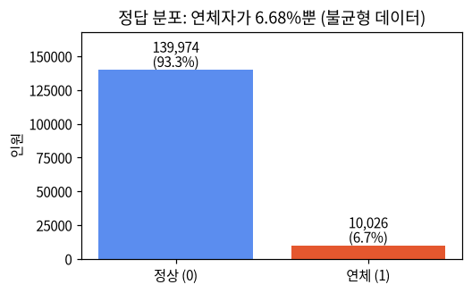

### 2.3 결측치: 월소득은 "소득 없음"이 아니라 "소득 모름"

과제 노션은 「결측치 처리 로직이 구현되어 있다 (중앙값/평균값 대체 또는 삭제)」를 요구한다. 빈칸은 두 칸에만 있다: `MonthlyIncome` 29,731명(19.82%), `NumberOfDependents` 3,924명(2.62%).

| 월소득 | 인원 | 비율 | 연체율 | DebtRatio 중앙값 |
|---|---|---|---|---|
| 빈칸 | 29,731 | 19.8% | 5.61% | 1,159.00 |
| 0 | 1,634 | 1.1% | 4.04% | 930.00 |
| 1~100 | 667 | 0.4% | 2.70% | 455.50 |
| 101 이상 | 117,968 | 78.6% | 7.01% | 0.29 |

- 소득이 0인 사람이 따로 있으므로, 빈칸은 소득이 없는 사람이 아니라 **소득을 적지 않은 사람**으로 본다. 빈칸인 사람은 연체율이 오히려 낮다(5.61%).
- 빈칸 행을 지우면 데이터의 20%가 사라지고 연체율이 다른 집단이 빠져 치우치므로, **중앙값으로 채운다**. 월소득은 일부 고소득자 때문에 평균(6,670)이 중앙값(5,400)보다 커서, "보통 사람"에 가까운 중앙값을 쓴다.
- 한계: 중앙값으로 채우면 "모름"이라는 정보가 사라진다 (11장).

### 2.4 부채비율 단위 문제

월소득이 빈 사람은 `DebtRatio` 칸에 비율이 아니라 **금액**이 들어 있다(중앙값 1,159). 나눌 소득이 없기 때문이다. 전처리에서 이 행만 월소득 중앙값으로 나눠 비율로 바꾼다(이슈 #29). 바꾼 뒤 `DebtRatio` 99% 지점이 4,979에서 266으로 줄었다.

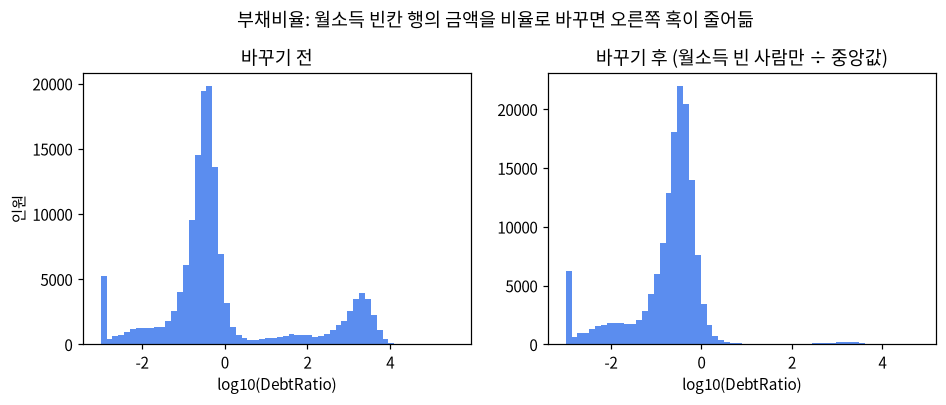

월소득이 0이거나 아주 작은 사람도 같은 이유로 금액이 남아 있으며(월소득 0~100이면서 `DebtRatio` 10 초과 2,020명), 현재 전처리는 빈칸인 사람만 바꾸므로 그대로 둔다 (11장).

### 2.5 이상값

과제 노션에 이상값 정리 요구는 없으며, 팀 결정으로 **지우거나 고치지 않고** 그대로 학습한다.

| 이상값 | 인원 |
|---|---|
| 연체 칸에 96·98 코드 (자료 오류로 보이는 값) | 269 |
| 신용한도 사용 비율 10 초과 | 241 |
| 월소득 0 또는 1 | 2,239 |
| 나이 0세 / 100세 초과 | 1 / 13 |

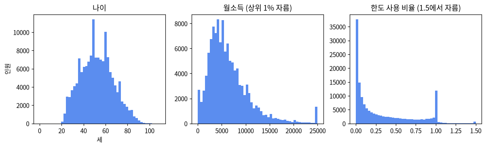

### 2.6 이 데이터의 특징

Give Me Some Credit은 이미 대출을 가진 사람들의 데이터라 금융 기록이 완전히 없는 사람이 거의 없다. 그래서 과제 노션의 씬파일러 정의를 그대로 쓰면 0명이 되며, 4장에서 이 데이터에 맞는 기준을 따로 정했다. 또 연령대별 연체율 차이가 크다(20-34세 11.18%, 35-54세 8.32%, 55세 이상 3.73%). 이 차이는 8장 공정성 검증에서 연령대 승인율 차이의 원인이 된다.

## 3. 대안 데이터 시뮬레이터 (2쪽) ✅

### 3.1 요구 사항 (과제 노션)

- 「시뮬레이터가 다음 5개 대안 변수를 생성한다: `telecom_payment_rate`(통신비 정상납부율), `utility_payment_rate`(공과금 납부율), `spending_consistency`(소비 일관성 점수), `regular_payment_count`(정기결제 건수), `app_login_frequency`(앱 로그인 빈도)」
- 「생성된 대안 변수와 Target 변수 간 상관계수가 0.3 ~ 0.5 범위 내에 있음을 `df.corr()` 또는 리포트에서 확인할 수 있다.」
- 「시뮬레이터 함수에 `thin_filer_ratio` 파라미터가 존재하고, 이 값을 조정하면 씬파일러 비율이 변경된다.」
- 「시뮬레이터 함수에 `bias_ratio` 파라미터가 존재하고, 이 값을 조정하면 성별/연령대별 승인율 편향이 변경된다.」

### 3.2 만드는 방법

과제 노션이 제시한 접근 방법 중 **방법 1(공분산 행렬 기반 생성)**을 쓴다 (`src/data/simulator.py`).

1. 5개 변수 사이의 상관을 담은 공분산 행렬로 다변량 정규분포에서 값을 뽑는다.
2. 정답(연체 여부)과의 상관을 맞추기 위해 `Y = r·X + √(1−r²)·Z` 꼴로 정답 신호와 잡음을 섞는다. 변수마다 목표 상관 r은 0.35~0.45 사이에서 정한다.
3. 각 변수를 정해진 범위로 자른다: 납부율 2개는 0~1, 소비 일관성 0~100, 정기결제 건수 0~20, 앱 로그인 빈도 0~30.
4. 무작위 값은 모두 시드 42 하나로 만들어, 누가 실행해도 같은 데이터가 나온다 (이슈 #75, PR #76).

**방향 결정 (팀 결정 A안, 이슈 #36)**: 과제 노션 예시 코드 `np.clip(0.85 - 0.2 * target + noise, 0, 1)`와 거절 사유 예시 「통신비 정상납부율이 78%로, 동일 연령대 평균(92%) 대비 낮습니다」처럼 **연체자일수록 값이 낮게** 만든다. 그래서 상관계수의 부호는 음수이고, 과제 노션의 0.3~0.5는 **크기(절댓값)**로 맞춘다. 정상 상환자의 납부율 평균이 0.9 근처가 되도록 수준도 현실에 맞췄다.

### 3.3 결과 (`df.corr()`, 시드 42)

| 변수 | 상관계수 | 크기 0.3~0.5 | 정상 평균 | 연체 평균 |
|---|---|---|---|---|
| 통신비 정상납부율 | -0.436 | ✅ | 0.906 | 0.804 |
| 공과금 납부율 | -0.400 | ✅ | 0.858 | 0.732 |
| 소비 일관성 | -0.433 | ✅ | 88.718 | 83.727 |
| 정기결제 건수 | -0.383 | ✅ | 11.365 | 10.265 |
| 앱 로그인 빈도 | -0.345 | ✅ | 20.766 | 19.220 |

5개 모두 과제 노션 기준 안에 있고, 모두 연체자 평균이 더 낮다.

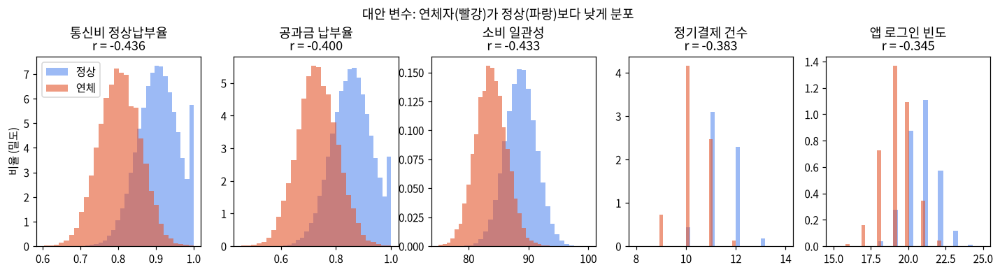

### 3.4 두 가지 실험 설정 (손잡이)

| 설정 | 기본값 | 값을 주면 | 과제 노션 |
|---|---|---|---|
| `thin_filer_ratio` | `None` (판정 기준대로만) | 연체 기록이 0인 일반 고객 일부의 연체 칸 3개를 지워, 과제 노션 판정식(연체 칸 2개 이상 결측)으로 씬파일러가 되게 함. 0.1 → 15,000명, 0.3 → 45,000명 (이슈 #61, PR #77) | ✅ 비율이 바뀜 |
| `bias_ratio` | `0` (편향 없음) | 남성·55세 이상 일부의 연체 표시를 1로 바꾸고, 남성의 앱 로그인 빈도를 `round(30 × bias_ratio)`만큼 높임(성별을 짐작하게 하는 대리 변수). 모델 성별 승인율 차이 0.010 → 0.045(0.1) → 0.189(0.2) (이슈 #41, PR #78) | ✅ 승인율 편향이 바뀜 |

본 결과(6~9장)는 **기본값(None, 0)**으로 만든 데이터를 쓰고, 두 설정은 실험에서만 바꾼다. `bias_ratio`를 0보다 크게 하면 연체율이 6.7%에서 13.5%(0.1), 20.2%(0.2)로 늘고 대안 변수 상관계수가 0.3 아래로 내려가므로(0.1에서 -0.26 ~ -0.30), 공정성 검사용으로 **일부러 기준을 벗어난 데이터**임을 밝혀 둔다.

### 3.5 한계

과제 노션의 요구대로 대안 변수를 정답과 연결해 만들었기 때문에, 연체율 6.7%에서 상관 0.4인 변수 하나만으로도 연체자를 상당히 잘 구분한다. 그래서 대안 데이터를 쓴 모델의 AUC가 실제보다 높게 나올 수 있다 (6장, 11장, 이슈 #26).

## 4. 씬파일러 판정 기준 (1.5쪽) ✅

### 4.1 과제 노션 정의와 이 데이터의 문제

과제 노션 정의: 「금융 연체 관련 컬럼 2개 이상 결측치이거나 신용카드 거래 이력이 12개월 미만인 고객」

- 연체 칸 3개에 결측이 있는 사람이 **0명**이다.
- 카드 사용 기간 칸이 데이터에 없다.

따라서 이 정의를 그대로 적용하면 씬파일러가 0명이라 「대안 데이터 포함 모델 vs 미포함 모델의 AUC uplift」를 측정할 수 없다. 팀은 과제 노션 정의의 취지(「금융 이력이 부족하여 … 적절한 신용평가가 어려운 개인」)를 이 데이터에서 **대신하는** 기준을 정했다 (이슈 #15). 과제 노션 정의와 같다고 주장하지 않는다.

### 4.2 팀 기준

다음 세 조건을 **모두** 만족하면 씬파일러로 본다 (`label_thin_filer`, 과제 노션 「씨파일러 판정 함수가 명시적으로 구현되어 있어야 한다」).

1. 보유 대출·신용 한도 1개 이하 (`NumberOfOpenCreditLinesAndLoans` ≤ 1)
2. 부동산 담보대출 0개 (`NumberRealEstateLoansOrLines` = 0)
3. 연체 기록 0 (연체 칸 3개 합 = 0)

과제 노션 판정식(연체 칸 2개 이상 결측)도 코드에 그대로 두어, `thin_filer_ratio`로 연체 칸을 지우면 그 판정식이 실제로 작동한다 (3.4).

### 4.3 근거

연체 기록과 담보대출이 없는 사람만 놓고, 보유 계좌 수에 따른 연체율을 보면 계좌가 적을수록 연체율이 뚜렷하게 높고 2개부터는 거의 평평하다.

| 보유 대출·신용 한도 | 인원 | 연체율 |
|---|---|---|
| 0개 | 992 | 13.0% |
| 1개 | 3,118 | 5.3% |
| 2개 | 4,296 | 2.9% |
| 3개 이상 | 35,504 | 2.6% |

즉 1개 이하인 사람은 금융 기록만으로 위험을 가늠하기 어려운 집단이다. 업계에서도 활성 계좌 수가 적은 사람을 씬파일러로 분류한다(예: Experian은 활성 계좌가 몇 개 이하인 고객을 thin file로 봄).

### 4.4 결과

| | 씬파일러 | 일반 |
|---|---|---|
| 인원 | 4,110 (2.74%) | 145,890 (97.26%) |
| 연체율 | 7.18% | 6.67% |
| 35세 미만 비율 | 38.7% | 12.1% |
| Train / Validation / Test | 2,892 / 593 / 625 | |

씬파일러는 일반 고객보다 연체율이 높고 젊은 층이 많아, 과제 노션이 예로 든 「사회초년생」과 성격이 비슷하다. Test의 씬파일러 625명(그중 연체 42명)으로 대안 데이터 효과를 측정한다 (6장).

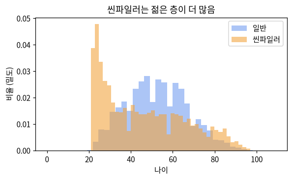

### 4.5 바뀐 과정

초기 시뮬레이터는 `thin_filer_ratio=0.3`으로 전체의 30%를 무작위로 씬파일러로 표시해, 씬파일러의 약 86%가 금융 기록이 충분한 일반인이었다. 이 상태로는 대안 데이터 효과를 제대로 잴 수 없어 기본값을 `None`(판정 기준대로만)으로 바꿨고(이슈 #16), 이후 손잡이를 쓸 때도 표시만 붙이는 대신 실제로 연체 칸을 지우도록 고쳤다(이슈 #61).

### 4.6 한계

- 카드 사용 기간 조건은 데이터에 칸이 없어 쓰지 못했다.
- 씬파일러가 4,110명(Test 625명, 연체 42명)으로 적어, 대안 데이터 효과는 부트스트랩 95% 구간과 함께 보고한다 (6장).

## 5. 전처리와 분할 (1쪽) ✅

> 코드: `src/data/preprocessor.py`, `main_step1.py`. 숫자는 시드 42 기준.

### 5.1 전처리 순서

1. **부채비율 고치기**: 월소득이 빈칸인 사람의 `DebtRatio`는 비율이 아니라 금액이므로, 월소득 중앙값(5,400)으로 나눠 비율로 바꾼다 (2장).
2. **결측치 처리**: 과제 노션 「결측치 처리 로직이 구현되어 있다 (중앙값/평균값 대체 또는 삭제)」에 따라 중앙값으로 채운다. 월소득 29,731명(19.82%)은 중앙값 5,400, 부양가족 수 3,924명(2.62%)은 중앙값 0으로 채운다. 행은 지우지 않는다.
3. **글자 칸 처리**: 입력 칸이 모두 숫자라 One-Hot Encoding을 적용할 칸은 없다. 코드는 글자 칸이 생길 때를 대비해 남겨 둔다.
4. **StandardScaler**: 입력 15개 칸을 평균 0, 표준편차 1로 맞춘다. 학습에 쓴 StandardScaler는 `models/preprocess_scaler_v1.0.joblib`에 저장해, API가 새 고객을 같은 기준으로 바꾸게 한다.

### 5.2 분할

| | Train | Validation | Test |
|---|---|---|---|
| 비율 | 70% | 15% | 15% |
| 인원 | 105,000 | 22,500 | 22,500 |
| 연체율 | 6.68% | 6.68% | 6.68% |
| 씬파일러 | 2,892 | 593 | 625 |

`stratify=y`로 나눠 세 묶음의 연체율이 같다. 역할은 다음과 같이 나눈다 (이슈 #25).

- **Train**: 모델 학습과 5-Fold 교차검증
- **Validation**: 18개 모델 중 최종 모델 고르기, 공정성 기준값(Threshold Adjustment) 정하기
- **Test**: 최종 모델 성능을 **마지막에 한 번만** 잰다. 과제 노션 「테스트 데이터의 라벨을 학습에 사용하는 것을 금지한다.」

분할 파일에는 성별·연령대·씬파일러 표시·고객 번호 칸도 남겨 공정성 검증과 씬파일러 분석에 쓴다. 이 칸들은 **모델 입력 15개에는 넣지 않는다** (이슈 #33).

### 5.3 남은 개선

지금은 중앙값과 StandardScaler를 **나누기 전 전체 데이터**로 계산한다. Test 데이터의 값이 평균·중앙값 계산에 조금 섞이는 셈이라, Train 데이터만으로 계산하도록 바꾸는 작업이 진행 중이다 (PR #82). Train만으로 계산하면 월소득 중앙값이 5,400에서 5,382로 바뀌는 정도라 결과 숫자는 거의 같을 것으로 보고, 반영되면 6~9장 숫자를 다시 확인한다.

## 6. 모델 학습과 비교 (3쪽) ✅

> 코드: `main_step2.py`, `src/models/train.py`. 기록: 팀 MLflow 서버, Model Registry `xai-credit-model`.

### 6.1 실험 설계

과제 노션은 「대안 데이터 포함 모델 vs 미포함 모델」을 비교하라고 한다. 이를 위해 세 가지 조건을 모두 조합해 **18개 모델**을 학습했다.

| 조건 | 선택지 |
|---|---|
| 데이터 | 금융만(10칸) / 대안만(5칸) / 통합(15칸) |
| 알고리즘 | Logistic Regression / XGBoost / LightGBM |
| 불균형 처리 | 가중치(`class_weight`, `scale_pos_weight`, `is_unbalance`) / SMOTE |

연체자가 6.68%뿐이라(2장) 아무 처리 없이 학습하면 모델이 대부분을 "정상"으로 답한다. 그래서 연체자에 가중치를 주는 방법과, 연체자 데이터를 늘리는 SMOTE를 비교했다. SMOTE는 교차검증의 학습 부분에만 적용해 검증 부분에 가짜 데이터가 섞이지 않게 했다.

각 모델은 Train에서 5-Fold Stratified 교차검증을 하고, AUC·KS·Precision·Recall·F1을 MLflow에 기록했다 (폴드별 값 `fold_k_roc_auc` 포함, 9장 ANOVA에 사용).

### 6.2 결과: 18개 모델 비교

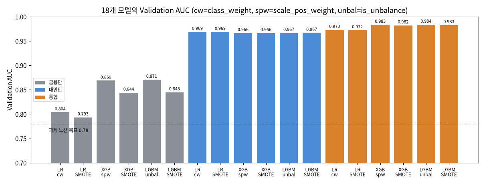

| 데이터 | 알고리즘 | 불균형 처리 | CV AUC | CV KS | Val AUC | Val KS |
|---|---|---|---|---|---|---|
| 금융만 | LR | class_weight | 0.790 | 0.436 | 0.804 | 0.463 |
| 금융만 | LR | SMOTE | 0.781 | 0.417 | 0.793 | 0.442 |
| 금융만 | XGBoost | scale_pos_weight | 0.859 | 0.567 | 0.869 | 0.584 |
| 금융만 | XGBoost | SMOTE | 0.836 | 0.520 | 0.844 | 0.542 |
| 금융만 | LightGBM | is_unbalance | 0.862 | 0.571 | 0.871 | 0.597 |
| 금융만 | LightGBM | SMOTE | 0.838 | 0.522 | 0.845 | 0.540 |
| 대안만 | LR | class_weight | 0.969 | 0.816 | 0.969 | 0.813 |
| 대안만 | LR | SMOTE | 0.969 | 0.816 | 0.969 | 0.813 |
| 대안만 | XGBoost | scale_pos_weight | 0.966 | 0.809 | 0.966 | 0.804 |
| 대안만 | XGBoost | SMOTE | 0.965 | 0.806 | 0.966 | 0.803 |
| 대안만 | LightGBM | is_unbalance | 0.966 | 0.810 | 0.967 | 0.805 |
| 대안만 | LightGBM | SMOTE | 0.966 | 0.807 | 0.967 | 0.805 |
| 통합 | LR | class_weight | 0.973 | 0.832 | 0.973 | 0.832 |
| 통합 | LR | SMOTE | 0.973 | 0.831 | 0.972 | 0.830 |
| 통합 | XGBoost | scale_pos_weight | 0.982 | 0.865 | 0.983 | 0.872 |
| 통합 | XGBoost | SMOTE | 0.982 | 0.863 | 0.982 | 0.867 |
| **통합** | **LightGBM** | **is_unbalance** | **0.982** | **0.868** | **0.984** | **0.870** |
| 통합 | LightGBM | SMOTE | 0.982 | 0.866 | 0.983 | 0.866 |

읽는 법:

- **데이터 차이가 가장 크다.** 금융만 0.79~0.87, 대안만 약 0.97, 통합 0.97~0.98이다.
- **알고리즘**: 금융 데이터에서는 트리 모델(XGBoost, LightGBM)이 LR보다 0.06 이상 높다. 통합 데이터에서는 차이가 0.01 정도로 줄어든다.
- **불균형 처리**: 금융 데이터에서는 가중치 방식이 SMOTE보다 AUC가 0.02~0.03 높다. SMOTE는 Precision이 높고 Recall이 낮은 쪽으로 기울었다(통합 LightGBM 기준 CV Precision 0.72 / Recall 0.83, 가중치 방식 0.53 / 0.92).
- CV와 Validation 값이 거의 같아, 특정 데이터에만 맞춘 모델(과적합)은 보이지 않는다.

### 6.3 최종 모델 선택과 Test 결과

Validation AUC가 가장 높은 **통합 · LightGBM · is_unbalance**(0.9836)를 최종 모델로 골랐다. 2위 XGBoost(0.9835)와의 차이는 매우 작고, 9장에서 두 알고리즘 차이가 통계적으로 의미 없음을 확인했다. 이 모델로 Test를 **한 번** 평가한 결과는 다음과 같다.

| 과제 노션 기준 | 목표 | 결과 | 통과 |
|---|---|---|---|
| Test AUC-ROC | ≥ 0.78 | **0.9807** | ✅ |
| Test KS Statistic | ≥ 0.28 | **0.8587** | ✅ |
| PSI (점수 분포, Train vs Test) | < 0.1 | **0.0005** | ✅ |
| PSI (칸별 최댓값) | < 0.1 | 0.0009 (통신비 정상납부율) | ✅ |

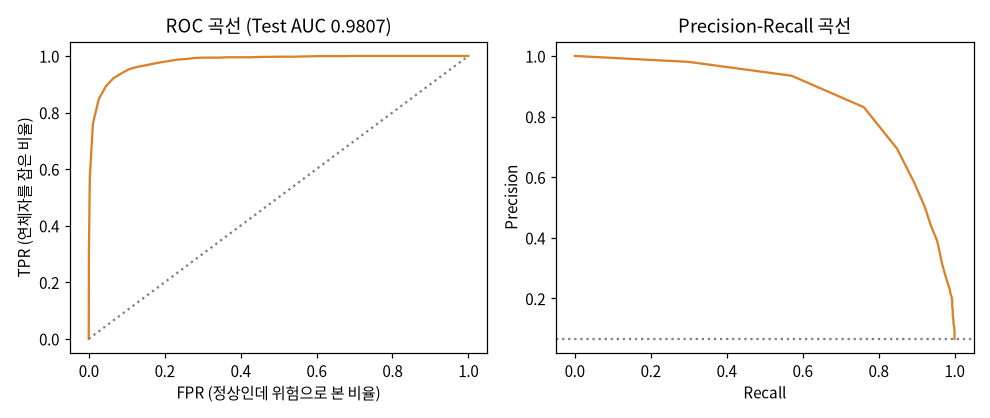

기준값 0.5에서의 혼동행렬 (Test 22,500명, 연체 1,504명):

| | 연체로 예측 (거절) | 정상으로 예측 (승인) |
|---|---|---|
| 실제 연체 | 1,376 | 128 |
| 실제 정상 | 1,231 | 19,765 |

Recall 0.915(연체자 10명 중 9명을 거절), Precision 0.528(거절한 사람 중 절반이 실제 연체)이다. 연체자를 놓치는 비용이 더 크다고 보고 Recall이 높은 쪽(`is_unbalance`)을 그대로 두었다. 전체 승인율은 88.4%이다.

### 6.4 씬파일러 AUC uplift

과제 노션 기준 「대안 데이터 포함 모델 vs 미포함 모델의 AUC uplift」(+0.03 이상)를 Test의 씬파일러 625명(연체 42명)으로 쟀다. 두 모델은 데이터만 다르고 알고리즘·불균형 처리는 같다.

| | 미포함 (금융만 LightGBM) | 포함 (통합 LightGBM) | uplift | 95% 구간 (부트스트랩 1,000회) |
|---|---|---|---|---|
| 씬파일러 AUC | 0.8074 | 0.9811 | **+0.1737** | +0.1174 ~ +0.2368 |

95% 구간의 아래 끝(+0.117)도 목표 +0.03보다 크므로, 표본이 작아도 "대안 데이터가 씬파일러 평가에 도움이 된다"는 결론은 흔들리지 않는다 ✅.

### 6.5 MLflow 기록

- 팀 MLflow 서버의 실험 하나에 run 20개: 모델 18개 + Validation 선택표(`model_selection_val`) + Test 1회 평가(`final_test`)
- 각 모델 run: params(데이터·알고리즘·불균형 처리), metrics(CV AUC·KS·F1과 폴드별 값), artifacts(모델 파일)
- `final_test` run: Test AUC·KS, PSI(점수·칸별), 씬파일러 uplift와 구간
- 최종 모델은 Model Registry `xai-credit-model`에 등록하고 Staging 단계로 두었다 (이슈 #32)

### 6.6 주의할 점

- **AUC가 매우 높은 이유**: 대안 변수는 과제 노션 요구(상관 0.3~0.5)대로 정답을 이용해 만들었다(3장). 그래서 대안 변수가 들어간 모델의 AUC(0.97~0.98)는 실제 데이터에서 기대할 수 있는 값보다 높다. 실제 데이터 성능에 가까운 숫자는 금융만 모델의 0.87 정도로 본다 (이슈 #26, 11장).
- **배운 점**: 10/8~10/9 기록은 옛 설정(`bias_ratio=0.1`)으로 만든 데이터로 학습되어, 금융만 LightGBM AUC가 0.69까지 떨어졌다(깨끗한 데이터에서는 0.87). 편향 실험용 설정이 기본 데이터를 망가뜨린 것이라 기본값을 0으로 바꿨다 (이슈 #16).

## 7. XAI 분석 (3쪽) ✅

> 코드: `main_step3.py`, `src/explainer/`. 그림은 `outputs/evaluation/shap/`를 `docs/figures/`에 복사해 썼다.

### 7.1 방법

최종 모델이 트리 모델(LightGBM)이므로 SHAP **TreeExplainer**를 쓴다. SHAP 값은 "이 칸 때문에 연체 쪽으로 얼마나 기울었는가"를 나타낸다. **양수면 연체 위험을 높이고, 음수면 낮춘다.** 그림의 칸 값은 StandardScaler를 적용한 값(평균 0, 표준편차 1)이다.

### 7.2 전체 중요도 (Summary Plot)

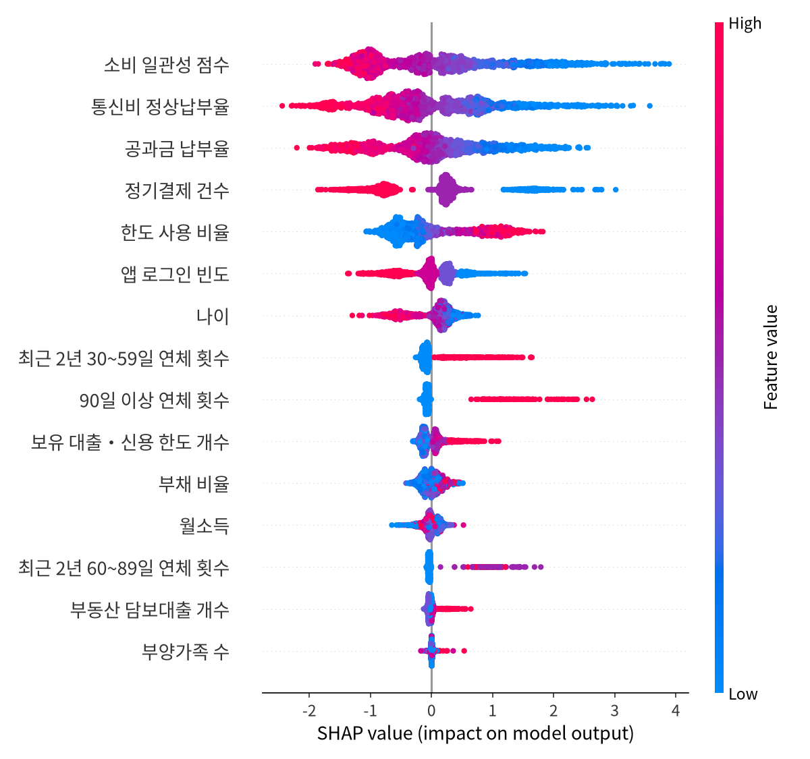

Test 표본 2,000명의 평균 |SHAP| 순위:

| 순위 | 칸 | 평균 \|SHAP\| | 종류 |
|---|---|---|---|
| 1 | 소비 일관성 점수 | 0.890 | 대안 |
| 2 | 통신비 정상납부율 | 0.761 | 대안 |
| 3 | 공과금 납부율 | 0.651 | 대안 |
| 4 | 정기결제 건수 | 0.637 | 대안 |
| 5 | 한도 사용 비율 | 0.543 | 금융 |
| 6 | 앱 로그인 빈도 | 0.317 | 대안 |
| 7 | 나이 | 0.291 | 금융 |
| 8 | 최근 2년 30~59일 연체 횟수 | 0.174 | 금융 |
| 9 | 90일 이상 연체 횟수 | 0.146 | 금융 |
| 10 | 보유 대출·신용 한도 개수 | 0.139 | 금융 |

읽는 법:

- 상위 4개가 모두 대안 변수다. 대안 변수 5개가 정답과 상관 0.3~0.5로 만들어졌기 때문이다 (6.6).
- 대안 변수는 **빨간 점(값이 큼)이 왼쪽(위험 낮춤)**에 있다. 납부율·소비 일관성이 높을수록 위험이 낮다는 뜻으로, 팀 결정 A안(연체자일수록 값이 낮게, 이슈 #36)과 같은 방향이다.
- 금융 변수는 한도 사용 비율과 연체 횟수가 **클수록 위험이 높다**. 신용평가 상식과 맞는다.
- 나이는 많을수록 위험이 낮다. 2장의 연령대별 연체율(20-34세 11.18% → 55세 이상 3.73%)과 같은 방향이다.

### 7.3 칸 하나의 영향 (Dependence Plot)

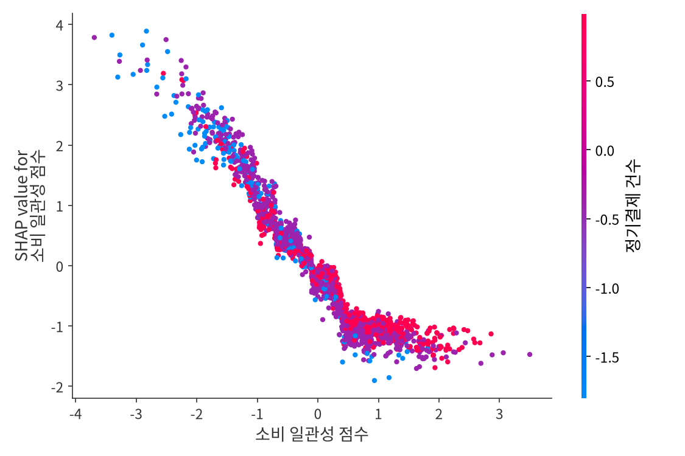

소비 일관성 점수가 평균보다 낮을수록 SHAP 값이 크게 올라가고(최대 약 +4), 평균보다 0.5 표준편차 이상 높으면 약 −1.5에서 더 내려가지 않는다. **낮은 점수는 위험을 크게 올리지만, 높은 점수의 효과는 일정 수준에서 멈춘다**는 뜻이다.

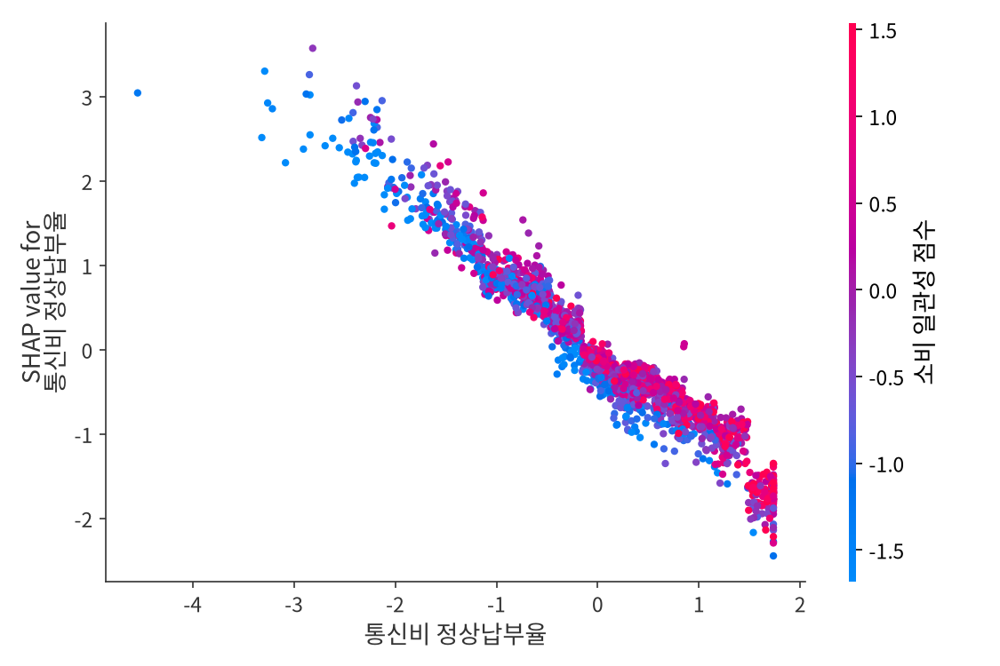

통신비 정상납부율은 값과 SHAP 값이 거의 직선으로 반비례한다. 색(소비 일관성 점수)이 섞여 있어 두 칸이 서로의 효과를 크게 바꾸지는 않는다.

### 7.4 한 사람의 설명 (Waterfall Plot)과 거절 사유

Test에서 거절된 고객 한 명의 Waterfall Plot이다.

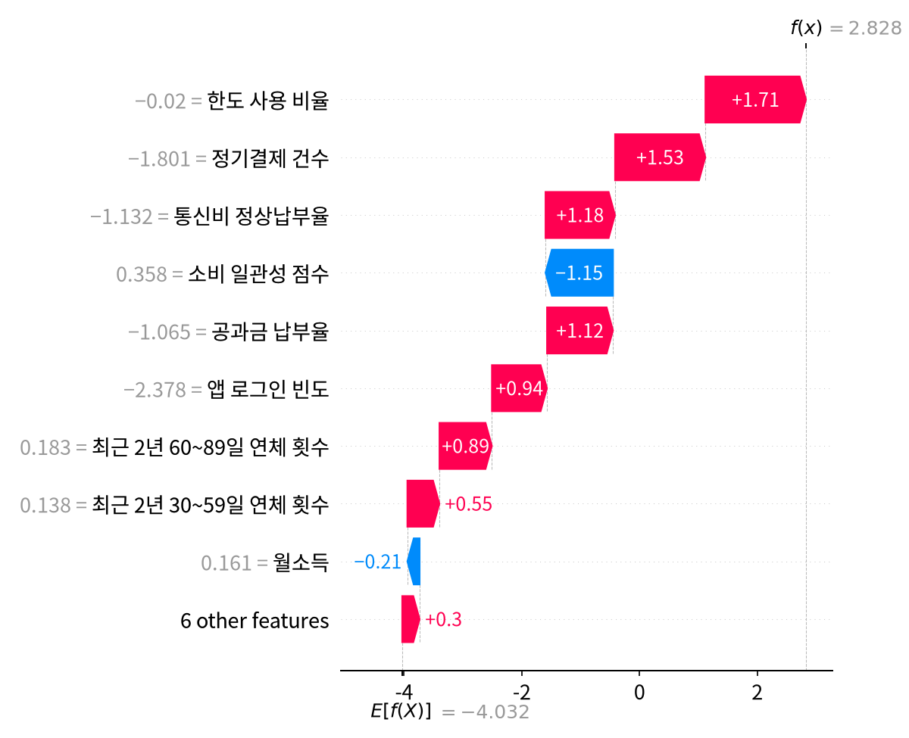

기준값 E[f(X)] = −4.03(연체 확률 약 1.7%)에서 시작해, 칸별 SHAP 값을 더한 결과가 f(x) = 2.83(연체 확률 약 94%)이다. 한도 사용 비율(+1.71), 정기결제 건수(+1.53), 통신비 정상납부율(+1.18)이 위험을 가장 많이 올렸고, 소비 일관성 점수(−1.15)는 위험을 낮췄다.

이 SHAP 값으로 과제 노션 형식 「통신비 정상납부율이 78%로, 동일 연령대 평균(92%) 대비 낮습니다」의 거절 사유 Top 5를 만든다.

| 순위 | 거절 사유 (`explain_example.json`) |
|---|---|
| 1 | 한도 사용 비율이 104%로, 동일 연령대 평균(36%) 대비 높습니다 (기여도: -1.71) |
| 2 | 정기결제 건수가 10건으로, 동일 연령대 평균(11.3건) 대비 낮습니다 (기여도: -1.53) |
| 3 | 통신비 정상납부율이 83%로, 동일 연령대 평균(90%) 대비 낮습니다 (기여도: -1.18) |
| 4 | 공과금 납부율이 77%로, 동일 연령대 평균(85%) 대비 낮습니다 (기여도: -1.12) |
| 5 | 앱 로그인 빈도가 18회로, 동일 연령대 평균(20.6회) 대비 낮습니다 (기여도: -0.94) |

만드는 규칙:

1. 위험을 올린 칸(SHAP 양수)만 큰 순서로 5개 고른다.
2. 고객 값은 StandardScaler를 되돌려 **원래 단위**(%, 건, 회)로 보여 준다.
3. "동일 연령대 평균"은 Train에서 같은 연령대(20-34 / 35-54 / 55+)의 평균이다. 극단값에 끌리지 않도록 위아래 1%를 뺀 평균을 쓴다.
4. 기여도는 **승인 점수 기준**으로 표시해 부호를 SHAP 값과 반대로 쓴다(승인에 불리하면 음수). Waterfall의 +1.71과 사유의 −1.71은 같은 값이다.

각 사유에는 과제 노션이 요구한 4개 항목(칸 이름, 고객 값, 비교 기준값, 기여도)이 모두 들어 있다.

### 7.5 한계

- SHAP 값은 "모델이 이렇게 판단했다"는 설명이지 "이 칸이 연체의 원인이다"라는 뜻이 아니다.
- 대안 변수가 정답으로 만들어져, 대안 변수의 중요도가 실제보다 크게 나온다 (6.6).

## 8. 공정성 검증과 Bias Mitigation (3쪽) ✅

> 코드: `main_step4.py`, `src/fairness/`. 결과: `outputs/fairness/`.

### 8.1 기준

- **보호 속성**: 성별(female / male), 연령대(20-34 / 35-54 / 55+). 성별은 원본 데이터에 없어 시뮬레이터가 만든 값이다.
- **DI Ratio** = 보호 집단 승인율 ÷ 비교 집단 승인율. 0.8 ~ 1.25를 벗어나면 WARNING.
- **Equalized Odds**: 집단 간 TPR 차이와 FPR 차이가 각각 0.10 이하. 승인율만 같은 것이 아니라 **틀리는 비율도 비슷해야** 공정하다고 본다.
- 성별·연령대 칸은 모델 입력에 넣지 않았다 (5.2). 그래도 다른 칸을 통해 간접적으로 차이가 생길 수 있어 결과로 확인한다.

### 8.2 기본 데이터 결과 (Test, 기준값 0.5)

| 속성 | 집단별 승인율 | DI Ratio | TPR 차이 | FPR 차이 | 판정 |
|---|---|---|---|---|---|
| 성별 | 여성 0.889 · 남성 0.879 | 1.012 | 0.004 | 0.016 | ✅ |
| 연령대 | 20-34세 0.823 · 35-54세 0.857 · 55세 이상 0.929 | 1.093 | 0.031 | 0.042 | ✅ |

모두 과제 노션 기준을 통과한다. 성별 차이는 거의 없다. 연령대는 나이가 많을수록 승인율이 높은데, 실제 연체율이 20-34세 11.18%, 55세 이상 3.73%로 3배 차이 나기 때문이다(2장). 모델이 나이 칸을 쓰지 않더라도 연체율 차이가 있으면 승인율 차이는 생긴다.

### 8.3 편향 실험 (`bias_ratio`)

과제 노션의 `bias_ratio`로 일부러 편향을 넣었을 때 시스템이 이를 잡아내는지 확인했다 (이슈 #41, PR #78).

| `bias_ratio` | 0 | 0.1 | 0.2 |
|---|---|---|---|
| 성별 승인율 차이 | 0.010 | 0.045 | 0.189 |
| Test AUC | 0.981 | 0.795 | 0.752 |
| 연체율 | 6.7% | 13.5% | 20.2% |

- 값을 키울수록 성별 승인율 차이가 커져, 공정성 지표가 편향을 감지함을 확인했다.
- 처음에는 연체 표시만 바꿨는데, 성별이 입력 칸이 아니라 모델 승인율에 차이가 전달되지 않았다. 그래서 남성의 앱 로그인 빈도를 높이는 **대리 변수**를 추가했다. 실제 금융에서도 입력에 성별이 없어도 성별과 관련된 다른 칸을 통해 차별이 생길 수 있다는 점을 보여 준다.
- `bias_ratio`를 0보다 크게 하면 대안 변수 상관계수가 0.3 아래로 내려가, 실험 전용 데이터임을 밝혀 둔다 (3.4).

### 8.4 Bias Mitigation 전/후

기본 결과가 기준을 통과했지만, 연령대 승인율 차이(0.823 vs 0.929)를 줄이는 두 방법을 적용해 비교했다. 과제 노션 「공정성 분석 결과를 문서화하고 편향 완화 조치를 기록해야 한다.」

1. **Threshold Adjustment**: 집단(성별 × 연령대 6개)마다 승인 기준값을 따로 정해 승인율을 맞춘다. 기준값은 **Validation**으로 정하고 Test에는 적용만 한다 (Test는 한 번만 평가).
2. **Reweighting**: Train에서 집단 × 연체 여부 조합마다 가중치를 줘서, 집단과 연체 여부가 서로 관계없어 보이도록 다시 학습한다.

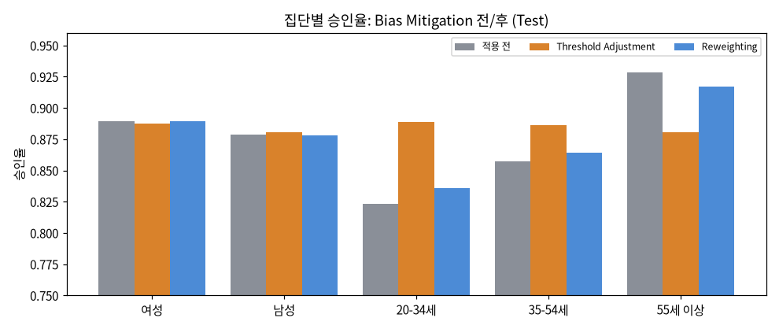

| 지표 (Test) | 적용 전 | Threshold Adjustment | Reweighting |
|---|---|---|---|
| DI Ratio (연령대) | 1.093 | 0.993 | 1.069 |
| DI Ratio (성별) | 1.012 | 1.008 | 1.013 |
| TPR 차이 | 0.031 | 0.051 | 0.012 |
| FPR 차이 | 0.042 | 0.067 | 0.023 |
| 승인율 20-34세 | 0.823 | 0.889 | 0.836 |
| 승인율 35-54세 | 0.857 | 0.886 | 0.864 |
| 승인율 55세 이상 | 0.929 | 0.881 | 0.917 |
| Test AUC | 0.9807 | 0.9807 (모델 그대로) | 0.9805 |

### 8.5 해석: 두 공정성 사이의 맞바꿈

- **Threshold Adjustment**는 연령대 승인율을 0.881~0.889로 거의 같게 만들었다(DI 0.993). 대신 TPR·FPR 차이가 0.031·0.042에서 0.051·0.067로 **커졌다**. 승인율을 맞추려고 20-34세의 기준값을 약 0.90, 55세 이상을 약 0.20으로 크게 다르게 잡았기 때문이다. 젊은 층은 연체 위험이 높아도 더 승인되고, 고령층은 위험이 낮아도 더 거절된다. 기준은 여전히 통과하지만, "승인율이 같다"와 "틀리는 비율이 같다"를 동시에 만족하기는 어렵다는 것을 보여 준다.
- **Reweighting**은 승인율 차이를 조금만 줄였지만(DI 1.093 → 1.069), TPR·FPR 차이는 절반 정도로 **줄었고** AUC는 거의 그대로다(0.9807 → 0.9805).
- 집단별 실제 연체율이 다른 이 데이터에서는, 모델 성능을 지키면서 Equalized Odds도 좋아지는 **Reweighting**이 더 알맞다고 본다. 최종 모델은 바꾸지 않고, 두 방법의 결과를 기록으로 남긴다 (부록).

### 8.6 Fairlearn 교차 확인

과제 노션은 「AIF360/Fairlearn 기반 공정성 검증 및 Bias Mitigation 모듈을 구현한다.」고 하고, 개발 환경에 「공정성 라이브러리: Fairlearn 또는 AIF360」을 둔다. 우리는 DI Ratio와 Equalized Odds를 과제 노션 정의대로 직접 계산하고(`src/fairness/metrics.py`), 같은 값을 **Fairlearn으로 다시 계산해 일치하는지 확인**한다 (`src/fairness/library_check.py`, 이슈 #87).

Fairlearn에는 승인을 좋은 결과로 보도록 정답 = `1 - 연체 여부`, 예측 = 승인 여부를 넣는다. 그러면 Fairlearn의 `selection_rate`는 승인율, `true_positive_rate`는 정상 상환자 중 승인 비율(TPR), `false_positive_rate`는 연체자 중 승인 비율(FPR)이 되어 우리 정의와 같아진다. DI Ratio는 보호 집단 방향이 있어야 하므로 집단별 `selection_rate`를 나눠 구한다.

| Test 결과 | DI (직접 계산) | DI (Fairlearn) | Equalized Odds 차이 (Fairlearn) | 일치 |
|---|---|---|---|---|
| 적용 전 · 성별 | 1.012296 | 1.012296 | 0.015935 | ✅ |
| 적용 전 · 연령대 | 1.092853 | 1.092853 | 0.041753 | ✅ |
| Reweighting 후 · 성별 | 1.013119 | 1.013119 | 0.022785 | ✅ |
| Reweighting 후 · 연령대 | 1.069127 | 1.069127 | 0.016811 | ✅ |

TPR·FPR 차이와 집단별 승인율도 모두 소수점 아래 9자리까지 같다(Fairlearn 0.14.0). `main_step4.py`를 실행할 때마다 `outputs/fairness/fairlearn_check.json`에 이 비교가 저장되고, 값이 다르면 WARNING 로그가 남는다.

### 8.7 Fairlearn ThresholdOptimizer와 비교

Bias Mitigation도 라이브러리와 비교하기 위해, 우리 Threshold Adjustment를 Fairlearn `ThresholdOptimizer`와 **같은 조건**에서 비교했다 (이슈 #91). 집단은 성별 × 연령대 6개, 기준값은 Validation으로 정하고 Test에는 적용만 한다. Fairlearn은 두 가지 목표로 돌렸다.

- `demographic_parity`: 집단별 승인율을 같게 (우리 Threshold Adjustment와 같은 목표)
- `equalized_odds`: 집단별 TPR·FPR을 같게

| Test 결과 | 적용 전 | 우리 Threshold Adjustment | Fairlearn 승인율 맞추기 | Fairlearn TPR·FPR 맞추기 |
|---|---|---|---|---|
| 연령대 DI | 1.093 | 0.993 | 0.991 | 1.056 |
| 연령대 TPR 차이 | 0.031 | 0.051 | 0.055 | 0.001 |
| 연령대 FPR 차이 | 0.042 | 0.067 | 0.039 | 0.027 |
| 성별 DI | 1.012 | 1.008 | 1.008 | 1.011 |
| 승인율 20-34 / 35-54 / 55+ | 0.823 / 0.857 / 0.929 | 0.889 / 0.886 / 0.881 | 0.871 / 0.862 / 0.857 | 0.830 / 0.845 / 0.888 |
| 전체 승인율 | 0.884 | 약 0.88 | 0.861 | 0.862 |
| 연체자 승인 비율 | 8.5% | - | 8.4% | 7.6% |

읽는 법:

- **같은 목표에서는 결과가 거의 같다.** 승인율을 맞추는 Fairlearn도 연령대 DI 0.991(우리 0.993), TPR 차이 0.055(우리 0.051)로, 우리 Threshold Adjustment가 라이브러리와 같은 방식으로 동작함을 확인했다. 8.5의 맞바꿈(승인율을 맞추면 TPR 차이가 커짐)도 똑같이 나타난다.
- **TPR·FPR을 맞추면** Equalized Odds 차이는 거의 0이 되지만(0.001 / 0.027), 나이대별 승인율 차이는 남는다(0.830 ~ 0.888). 두 종류의 공정성을 한 번에 맞출 수 없다는 8.5의 결론과 같다.
- **목표 함수 선택이 중요하다.** Fairlearn 기본값(정확도 최대)으로 고르면 연체자가 6.7%뿐이라 거의 모두 승인하는 쪽이 정확도가 높아져, 연체자 승인 비율이 8.5%에서 37.4%로 늘었다. 그래서 정상 고객과 연체자를 똑같이 중요하게 보는 `balanced_accuracy_score`를 썼다. 불균형 데이터에서는 공정성 방법을 고를 때도 6장의 Precision-Recall 맞바꿈을 함께 봐야 한다.
- 최종 모델과 `/fairness/mitigation` 응답은 바꾸지 않았다. 결과는 `outputs/fairness/fairness_mitigation_threshold_optimizer_*.json`에 저장되고 MLflow `final_test` run에도 올렸다.

## 9. ANOVA 통계 검증 (2쪽) ✅

> 코드: `main_step5.py`, `src/statistics/`. 데이터: MLflow에 기록된 18개 모델의 폴드별 AUC (`fold_k_roc_auc`). 결과: `outputs/statistics/anova.json`.

### 9.1 방법

6장의 AUC 차이가 우연히 생긴 것인지 확인하기 위해 One-way ANOVA를 두 번 했다.

| | 검증 1: 피처 그룹 | 검증 2: 알고리즘 |
|---|---|---|
| 질문 | 데이터 종류에 따라 AUC가 다른가? | 알고리즘에 따라 AUC가 다른가? |
| 집단 | 금융만 / 대안만 / 통합 | LR / XGBoost / LightGBM (통합 데이터) |
| 집단별 값 | 30개 (모델 6개 × 5-Fold) | 10개 (불균형 처리 2개 × 5-Fold) |

- 유의수준 α = 0.05. p < 0.05이면 Tukey HSD로 어느 집단끼리 다른지 확인한다.
- 효과 크기 η²는 0.01 이상 작음, 0.06 이상 중간, 0.14 이상 큼으로 본다.

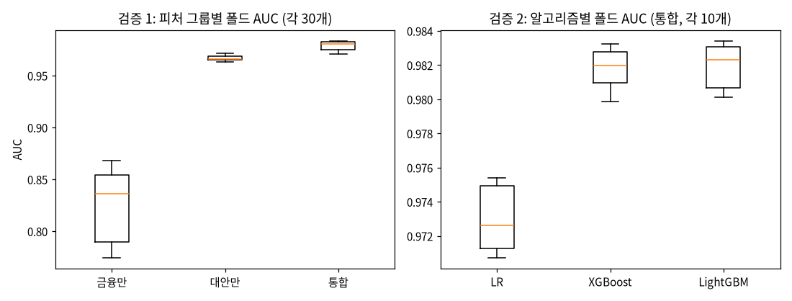

### 9.2 결과

| 검증 | 집단 평균 AUC | F | p | η² |
|---|---|---|---|---|
| 1. 피처 그룹 | 금융 0.828 · 대안 0.967 · 통합 0.979 | 583.42 | 3.94 × 10⁻⁵¹ | 0.931 (큼) |
| 2. 알고리즘 | LR 0.973 · XGBoost 0.982 · LightGBM 0.982 | 116.75 | 5.13 × 10⁻¹⁴ | 0.896 (큼) |

Tukey HSD:

| 검증 | 비교 | 평균 차이 | p_adj | 유의 |
|---|---|---|---|---|
| 1 | 금융 vs 대안 | 0.139 | 3.04 × 10⁻¹⁴ | ✅ |
| 1 | 금융 vs 통합 | 0.151 | 3.04 × 10⁻¹⁴ | ✅ |
| 1 | 대안 vs 통합 | 0.012 | 0.039 | ✅ |
| 2 | LR vs XGBoost | 0.009 | 9.98 × 10⁻¹³ | ✅ |
| 2 | LR vs LightGBM | 0.009 | 5.88 × 10⁻¹³ | ✅ |
| 2 | XGBoost vs LightGBM | 0.0002 | 0.953 | ❌ |

### 9.3 해석

**검증 1 (피처 그룹).** 피처 그룹에 따라 평균 AUC가 통계적으로 유의하게 달랐다(F = 583.42, p < 0.001, η² = 0.931). AUC 차이의 93%가 데이터 종류로 설명될 만큼 효과가 크다. 사후 검정 결과 통합 모델(M = 0.979)이 금융 모델(M = 0.828)보다 유의하게 높은 AUC를 보였고(차이 0.151, p_adj < 0.001), 대안 모델(M = 0.967)도 금융 모델보다 유의하게 높았다(차이 0.139, p_adj < 0.001). 통합 모델과 대안 모델의 차이(0.012)도 유의했지만(p_adj = 0.039), 크기는 금융 모델과의 차이의 10분의 1 수준이다. 즉 성능 향상의 대부분은 대안 데이터를 더한 데서 오고, 금융 데이터는 대안 데이터 위에 작은 개선을 더한다. 이는 6.4의 씬파일러 uplift(+0.174)와 같은 방향의 결과다.

**검증 2 (알고리즘).** 통합 데이터에서 알고리즘에 따라 평균 AUC가 유의하게 달랐다(F = 116.75, p < 0.001, η² = 0.896). XGBoost(M = 0.982)와 LightGBM(M = 0.982)은 모두 Logistic Regression(M = 0.973)보다 유의하게 높았다(차이 약 0.009, p_adj < 0.001). 반면 XGBoost와 LightGBM 사이에는 유의한 차이가 없었다(p_adj = 0.953). 따라서 최종 모델로 LightGBM을 고른 것은 "XGBoost보다 낫기 때문"이 아니라 "Validation AUC가 근소하게 높고, 두 트리 모델 중 어느 것을 골라도 성능이 같기 때문"으로 설명하는 것이 정확하다. 차이가 0.009로 작아, 설명이 쉬운 Logistic Regression도 실무에서는 대안이 될 수 있다.

**과제 노션 예시와 다른 점.** 과제 노션의 해석 예시는 「대안 데이터가 단독으로는 전통 데이터와 유사한 예측력을 보이지만, 통합 시 시너지 효과가 발생함을 시사한다」이다. 우리 결과는 다르다. 대안 모델(M = 0.967)이 금융 모델(M = 0.828)보다 **훨씬** 높았고, 통합의 추가 효과는 작았다(+0.012). 이는 대안 변수 5개가 과제 노션 요구(상관 0.3~0.5)대로 정답을 이용해 만들어졌기 때문이다(3장, 6.6). 연체율이 6.68%인 데이터에서 정답과 상관 0.4인 변수 다섯 개를 함께 쓰면, 금융 이력 10개보다 연체자를 더 잘 가려낸다. 따라서 검증 1의 결과는 "실제 대안 데이터가 금융 데이터보다 강하다"는 증거가 아니라, "**이 시뮬레이션 설정에서** 대안 데이터를 넣으면 성능이 오른다"는 증거로 읽어야 한다. 실제 대안 데이터라면 대안 단독 성능은 이보다 낮고, 과제 노션 예시처럼 통합 모델의 시너지가 더 중요해질 것이다.

**효과 크기로 본 의미.** p 값은 "차이가 있는가"만 알려 주고, 표본이 크면 아주 작은 차이도 유의하게 나온다. 그래서 η²와 평균 차이를 함께 본다. 두 검증 모두 η²가 0.14를 크게 넘는 큰 효과지만, 실제 AUC 차이의 크기는 다르다. 검증 1의 금융 → 통합 차이(0.151)는 연체자 구분 능력이 눈에 띄게 달라지는 크기다. 검증 2의 LR → 트리 모델 차이(0.009)는 통계적으로는 분명하지만, 실무에서는 설명 용이성·학습 시간과 함께 따져 볼 만큼 작은 차이다. 집단 안의 폴드 점수가 매우 고르게 나와(그림, 통합 모델 AUC 0.971~0.983) 작은 평균 차이도 F가 커졌다.

**씬파일러와의 연결.** 과제 노션의 목적은 「대안 데이터 포함 모델 vs 미포함 모델의 AUC uplift」로 씬파일러에게 대안 데이터가 도움이 되는지 보는 것이다. 검증 1은 전체 고객에서 대안 데이터의 효과가 우연이 아님을 보이고, 6.4는 씬파일러 625명에서도 같은 방향(+0.174, 95% 구간 +0.117 ~ +0.237)임을 보인다. 두 결과가 같은 결론을 가리킨다. 씬파일러 × 모델 구성의 교호작용을 직접 검정하는 Two-way ANOVA는 과제 노션 보너스로 남겨 둔다.

**최종 모델 선택에 주는 근거.**

| 결정 | ANOVA 근거 |
|---|---|
| 대안 데이터를 넣은 통합 모델을 쓴다 | 검증 1: 통합 > 금융 (p_adj < 0.001), 통합 > 대안 (p_adj = 0.039) |
| 트리 모델(XGBoost 또는 LightGBM)을 쓴다 | 검증 2: 두 트리 모델 > LR (p_adj < 0.001) |
| 두 트리 모델 중 LightGBM | 검증 2: 차이 없음 (p_adj = 0.953) → Validation AUC가 근소하게 높은 쪽(0.9836 vs 0.9835) |

과제 노션 기준 「ANOVA 최소 1개 이상 검증에서 p < 0.05」는 두 검증 모두 만족한다 ✅.

### 9.4 한계

- 폴드 점수는 같은 Train 데이터를 다섯으로 나눠 얻은 값이라 서로 완전히 독립이 아니다. ANOVA의 독립성 가정을 일부 어기므로, p 값이 실제보다 작게 나올 수 있다.
- 검증 1의 큰 차이는 대안 변수가 정답으로 만들어진 영향도 함께 들어 있다 (6.6).
- 피처 그룹과 알고리즘을 함께 보는 Two-way ANOVA(보너스)는 하지 않았다.

## 10. 시스템 구성 (1.5쪽) ✍️

- FastAPI 7개 엔드포인트, Pydantic 스키마, Swagger (`localhost:8000/docs`), `/predict` 2초 이내
- Streamlit 대시보드 5페이지, API만 호출(MSA), 위험도 색
- `docker-compose up` 한 번으로 API · 대시보드 · MLflow 실행
- ✍️ 쓸 것: 구성 그림, 화면 캡처

## 11. 한계와 결론 (1.5쪽) 🟡

### 11.1 과제 노션 성공 기준 결과

| 항목 | 기준 | 결과 | 장 |
|---|---|---|---|
| Test Set AUC-ROC | ≥ 0.78 | 0.9807 ✅ | 6.3 |
| Test Set KS Statistic | ≥ 0.28 | 0.8587 ✅ | 6.3 |
| 씬파일러 집단 AUC 향상 | ≥ +0.03 | +0.1737 (95% 구간 +0.117 ~ +0.237) ✅ | 6.4 |
| PSI | < 0.1 | 0.0005 (칸별 최대 0.0009) ✅ | 6.3 |
| DI Ratio | 0.8 ~ 1.25 | 성별 1.012, 연령대 1.093 ✅ | 8.2 |
| Equalized Odds | ≤ 0.10 | TPR 차이 0.031, FPR 차이 0.042 ✅ | 8.2 |
| ANOVA | 1개 이상 p < 0.05 | 두 검증 모두 p < 0.001 ✅ | 9.2 |
| API 응답 시간 | `/predict` 2초 이내 | ⏳ API(#80) 반영 후 측정 | 10 |

### 11.2 한계

1. **시뮬레이션 데이터**: 대안 변수 5개는 과제 노션 요구(상관 0.3~0.5)대로 정답을 이용해 만들었다. 그래서 대안 데이터가 들어간 모델의 AUC(0.97~0.98)와 SHAP 중요도는 실제보다 높게 나온다. 실제 데이터에 가까운 성능은 금융만 모델의 약 0.87로 본다 (이슈 #26).
2. **씬파일러 기준**: 과제 노션 정의로는 이 데이터에서 0명이라, 보유 계좌 수·담보대출·연체 기록으로 대신했다. 카드 사용 기간 조건은 칸이 없어 쓰지 못했고, Test 씬파일러가 625명(연체 42명)으로 적어 구간과 함께 보고했다 (4장).
3. **보호 속성**: 성별은 원본에 없어 시뮬레이터가 만든 값이다. 실제 성별에 따른 차별 여부는 이 데이터로 판단할 수 없고, `bias_ratio` 실험으로 "편향이 있으면 지표가 잡아내는지"만 확인했다 (8.3).
4. **나이를 입력으로 사용**: 나이는 과제 노션의 금지 목록(「인종, 종교, 장애 여부 등」)에 없고 원본 데이터의 기본 칸이라 입력에 넣었다. 다만 연령대는 공정성 보호 속성이기도 하므로, 연령대 승인율 차이를 8장에서 따로 검사하고 완화 방법을 비교했다.
5. **전처리 기준**: 중앙값과 StandardScaler를 나누기 전 전체 데이터로 계산한다. Train만으로 계산하도록 고치는 중이며(#82), 숫자 변화는 작을 것으로 본다 (5.3).
6. **이상값**: 연체 칸의 96·98 코드, 나이 0세 등은 정리하지 않았다 (2장).
7. **통계 검정**: ANOVA의 폴드 점수는 서로 완전히 독립이 아니다 (9.4).

### 11.3 결론

Kaggle 신용 데이터에 대안 데이터 5개를 더한 통합 LightGBM 모델은 과제 노션의 성능 기준을 모두 넘었고(Test AUC 0.981, KS 0.859, PSI 0.0005), 씬파일러 집단에서 대안 데이터를 더하면 AUC가 0.807에서 0.981로 올랐다. ANOVA로 이 차이가 우연이 아님을 확인했다. 모든 거절 결과에는 SHAP 기반 거절 사유 5개를 「통신비 정상납부율이 78%로, 동일 연령대 평균(92%) 대비 낮습니다」 형식으로 만들고, 성별·연령대 공정성 지표는 기준 안에 있으며 Fairlearn으로 다시 계산해도 같다.

다만 이 숫자들은 정답으로 만든 시뮬레이션 대안 데이터에서 나온 것이다. 이 프로젝트가 보여 주는 것은 "대안 데이터가 실제로 이만큼 좋다"가 아니라, **대안 데이터를 넣었을 때 성능 향상을 씬파일러 집단에서 측정하고, 그 판단을 설명하고, 공정성을 검사하고, 통계로 확인하는 전체 과정**이다. 실제 대안 데이터를 쓰면 같은 파이프라인을 그대로 다시 돌려 검증할 수 있다.

### 11.4 앞으로 할 일

- 실제 대안 데이터(또는 정답과 직접 연결하지 않은 시뮬레이션)로 다시 학습해 성능과 SHAP 중요도 비교
- 과제 노션 보너스: 씬파일러 × 모델 구성 Two-way ANOVA, Counterfactual Explanation("무엇이 바뀌면 승인되는지")

## 부록. 팀 결정 기록 (1쪽) ✅

| 날짜 | 결정 | 근거 | 이슈 |
|---|---|---|---|
| 10/8 | 씬파일러 기준: 계좌 1개 이하 + 담보대출 0 + 연체 0 | 원본 정의로는 0명, Experian, 데이터 연체율 | #15 |
| 10/8 | 기본 데이터 thin_filer_ratio=None, bias_ratio=0 | 무작위 채움·편향이 기본 데이터를 망가뜨림 | #16 |
| 10/10 | 대안 변수 방향 A안 (연체자일수록 낮게) | 원본 예시 코드·거절 사유 예시 | #36 |
| 10/10 | 정답으로 대안 변수를 만드는 방식 유지 | 원본 0.3-0.5 요구 | #26 |
| 10/10 | 편향 실험에 성별 대리 변수 추가 | 정답만 바꾸면 모델 승인율에 성별 편향이 안 나타남 | #41 |

재현 방법: `python main_step1.py` → `main_step2.py` → `main_step3.py --model ...` → `main_step4.py --model ...` (환경 변수는 `.env.example`)
