# XAI 기반 대안신용평가 시스템 - 실험 리포트 (초안 뼈대)

> 신용불량단 (이윤아 · 이재희 · 이하늘 · 남궁명진) · Codyssey 과제 37
> 최종 제출: `docs/experiment_report.pdf`, 20페이지 이상
> 과제 노션 요구 내용: 「문제 정의, EDA, 모델 비교, XAI 분석, 공정성 검증, ANOVA 통계 검증, 결론」
> 표시: ✅ 본문 작성 · 🟡 재료 있음 · ⏳ 최종 숫자로 교체 필요 · ✍️ 아직 없음
> 진행: 이슈 #44 · 작성 남궁명진 · 주 1회 반영 (중간 PR은 `Refs #44`, PDF 완성 PR만 `Closes #44`)
> 마지막 반영: 2026-11-01 (develop f7bb350) · #26 재학습(PR #108, 잠재 상환 성실도 요인 모델) 결과로 3 · 5~11장 숫자와 그림 06~09 교체
> 그림: 1~5번 `notebooks/figures/` (EDA 노트북), 6~9번 `docs/figures/` (최종 모델 결과)

본 시스템은 교육 목적으로 개발되었으며, 실제 금융 의사결정에 사용할 수 없습니다.

---

## 페이지 계획 (합계 22쪽 목표)

| 장 | 제목 | 쪽수 | 팀원에게 받을 것 | 상태 |
|---|---|---|---|---|
| 1 | 문제 정의 | 1 | - | ✅ |
| 2 | 데이터와 EDA | 3 | - | ✅ |
| 3 | 대안 데이터 시뮬레이터 | 2 | - | ✅ |
| 4 | 씬파일러 판정 기준 | 1.5 | - | ✅ |
| 5 | 전처리와 분할 | 1 | - | ✅ |
| 6 | 모델 학습과 비교 (MLflow) | 3 | - | ✅ |
| 7 | XAI 분석 (SHAP, 거절 사유) | 3 | - | ✅ |
| 8 | 공정성 검증과 Bias Mitigation | 3 | - | ✅ |
| 9 | ANOVA 통계 검증 | 2 | - | ✅ |
| 10 | 시스템 구성 (API · 대시보드 · Docker) | 1.5 | 화면 캡처 5장 (이윤아, 공정성 · 통계 검증 페이지 완성 후) | 🟡 본문 작성, 캡처 남음 |
| 11 | 한계와 결론 | 1.5 | - | ✅ |
| 부록 | 팀 결정 기록, 재현 방법 | 1 | - | ✅ |

---

## 1. 문제 정의 (1쪽) ✅

### 1.1 배경

금융 거래 기록이 적은 사람은 기존 신용평가(CB) 모델로 신용도를 판단하기 어렵다. 과제 노션은 이런 사람을 씬파일러(Thin-filer)로 정의한다: 「금융 이력이 부족하여 기존 CB(신용평가) 모델로는 적절한 신용평가가 어려운 개인. 사회초년생, 프리랜서, 주부 등이 해당된다.」 과제 노션에 따르면 국내 금융이력부족자는 약 1,100만 명이며, 일부 인터넷은행은 이미 통신비·공과금 납부 같은 비금융 기록으로 이들을 심사하고 있다.

대안신용평가는 이런 비금융 기록(대안 데이터)으로 신용을 평가하는 방법이다. 다만 금융 의사결정에 AI를 쓰려면 결과를 설명할 수 있어야 하고(설명가능성), 특정 집단을 차별하지 않아야 한다(공정성). 과제 노션은 금융위원회 금융분야 AI 가이드라인과 대출 거절 사유 고지 의무를 그 근거로 든다.

### 1.2 목표와 범위

이 프로젝트는 다음을 하나의 시스템으로 만든다.

1. Kaggle 신용 데이터에 대안 데이터 5개를 시뮬레이션으로 더해 신용평가 모델을 학습한다.
2. 대안 데이터가 씬파일러 평가에 실제로 도움이 되는지 측정한다.
3. SHAP으로 모델 판단을 설명하고, 거절 사유를 문장으로 만든다.
4. 성별·연령대에 대한 공정성을 검증하고, 편향을 줄이는 방법을 적용한다.
5. 모델 간 성능 차이가 통계적으로 의미 있는지 ANOVA로 확인한다.
6. 결과를 FastAPI(심사 API)와 Streamlit(대출 심사 담당자용 대시보드)으로 제공하고, 모든 학습을 MLflow로 기록한다.

### 1.3 성공 기준 (과제 노션)

| 항목 | 기준 |
|---|---|
| Test Set AUC-ROC | ≥ 0.78 |
| Test Set KS Statistic | ≥ 0.28 |
| 씬파일러 집단 AUC 향상 (대안 데이터 포함 vs 미포함) | ≥ +0.03 |
| PSI (Train/Test 분포 안정성) | < 0.1 |
| DI Ratio | 0.8 ~ 1.25 (벗어나면 WARNING) |
| Equalized Odds (TPR 차이, FPR 차이) | ≤ 0.10 |
| ANOVA | 최소 1개 이상 검증에서 p < 0.05 |
| API 응답 시간 | `/predict` 2초 이내 |

각 기준의 결과는 6~10장에서 보이고, 11장에서 한 번에 정리한다.

## 2. 데이터와 EDA (3쪽) ✅

> 재료: `notebooks/01_eda.ipynb` (이슈 #83). 그림은 `notebooks/figures/`.

### 2.1 데이터

과제 노션의 기본 데이터셋인 Kaggle **Give Me Some Credit**(`data/raw/cs-training.csv`)을 쓴다. 150,000명, 입력 10개 칸과 정답 1개 칸으로 이루어진다.

| 칸 | 뜻 |
|---|---|
| `SeriousDlqin2yrs` (정답) | 2년 안에 90일 이상 연체했으면 1 |
| `RevolvingUtilizationOfUnsecuredLines` | 신용카드·신용한도 사용 비율 |
| `age` | 나이 |
| `NumberOfTime30-59DaysPastDueNotWorse` | 최근 2년 30~59일 연체 횟수 |
| `NumberOfTime60-89DaysPastDueNotWorse` | 최근 2년 60~89일 연체 횟수 |
| `NumberOfTimes90DaysLate` | 90일 이상 연체 횟수 |
| `DebtRatio` | 월 부채 상환액 ÷ 월소득 |
| `MonthlyIncome` | 월소득 |
| `NumberOfOpenCreditLinesAndLoans` | 보유 대출·신용 한도 개수 |
| `NumberRealEstateLoansOrLines` | 부동산 담보대출 개수 |
| `NumberOfDependents` | 부양가족 수 |

### 2.2 정답 분포: 불균형 데이터

연체자는 10,026명(**6.68%**)이다. 모든 사람을 "상환한다"고만 예측해도 정확도가 93%가 되므로, 정확도 대신 AUC·KS로 평가하고 학습할 때 불균형 처리(class_weight, SMOTE 등)를 한다 (6장).

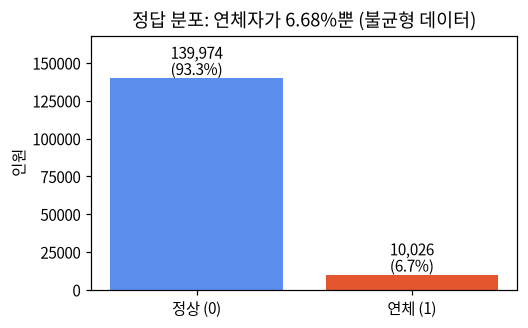

### 2.3 결측치: 월소득은 "소득 없음"이 아니라 "소득 모름"

과제 노션은 「결측치 처리 로직이 구현되어 있다 (중앙값/평균값 대체 또는 삭제)」를 요구한다. 빈칸은 두 칸에만 있다: `MonthlyIncome` 29,731명(19.82%), `NumberOfDependents` 3,924명(2.62%).

| 월소득 | 인원 | 비율 | 연체율 | DebtRatio 중앙값 |
|---|---|---|---|---|
| 빈칸 | 29,731 | 19.8% | 5.61% | 1,159.00 |
| 0 | 1,634 | 1.1% | 4.04% | 930.00 |
| 1~100 | 667 | 0.4% | 2.70% | 455.50 |
| 101 이상 | 117,968 | 78.6% | 7.01% | 0.29 |

- 소득이 0인 사람이 따로 있으므로, 빈칸은 소득이 없는 사람이 아니라 **소득을 적지 않은 사람**으로 본다. 빈칸인 사람은 연체율이 오히려 낮다(5.61%).
- 빈칸 행을 지우면 데이터의 20%가 사라지고 연체율이 다른 집단이 빠져 치우치므로, **중앙값으로 채운다**. 월소득은 일부 고소득자 때문에 평균(6,670)이 중앙값(5,400)보다 커서, "보통 사람"에 가까운 중앙값을 쓴다.
- 한계: 중앙값으로 채우면 "모름"이라는 정보가 사라진다 (11장).

### 2.4 부채비율 단위 문제

월소득이 빈 사람은 `DebtRatio` 칸에 비율이 아니라 **금액**이 들어 있다(중앙값 1,159). 나눌 소득이 없기 때문이다. 전처리에서 이 행만 월소득 중앙값으로 나눠 비율로 바꾼다(이슈 #29). 바꾼 뒤 `DebtRatio` 99% 지점이 4,979에서 266으로 줄었다.

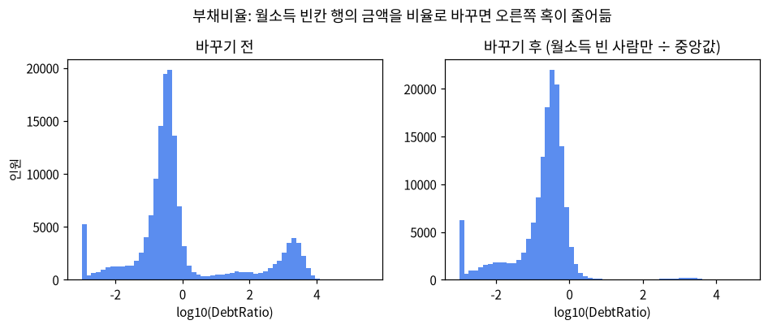

월소득이 0이거나 아주 작은 사람도 같은 이유로 금액이 남아 있으며(월소득 0~100이면서 `DebtRatio` 10 초과 2,020명), 현재 전처리는 빈칸인 사람만 바꾸므로 그대로 둔다 (11장).

### 2.5 이상값

과제 노션에 이상값 정리 요구는 없으며, 팀 결정으로 **지우거나 고치지 않고** 그대로 학습한다.

| 이상값 | 인원 |
|---|---|
| 연체 칸에 96·98 코드 (자료 오류로 보이는 값) | 269 |
| 신용한도 사용 비율 10 초과 | 241 |
| 월소득 0 또는 1 | 2,239 |
| 나이 0세 / 100세 초과 | 1 / 13 |

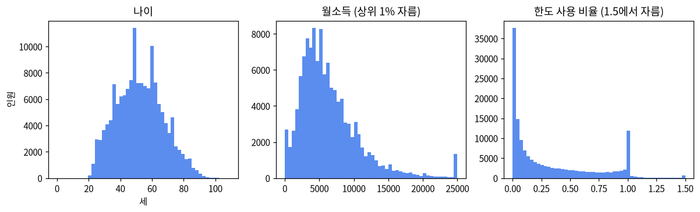

### 2.6 이 데이터의 특징

Give Me Some Credit은 이미 대출을 가진 사람들의 데이터라 금융 기록이 완전히 없는 사람이 거의 없다. 그래서 과제 노션의 씬파일러 정의를 그대로 쓰면 0명이 되며, 4장에서 이 데이터에 맞는 기준을 따로 정했다. 또 연령대별 연체율 차이가 크다(20-34세 11.18%, 35-54세 8.32%, 55세 이상 3.73%). 이 차이는 8장 공정성 검증에서 연령대 승인율 차이의 원인이 된다.

## 3. 대안 데이터 시뮬레이터 (2쪽) ✅

### 3.1 요구 사항 (과제 노션)

- 「시뮬레이터가 다음 5개 대안 변수를 생성한다: `telecom_payment_rate`(통신비 정상납부율), `utility_payment_rate`(공과금 납부율), `spending_consistency`(소비 일관성 점수), `regular_payment_count`(정기결제 건수), `app_login_frequency`(앱 로그인 빈도)」
- 「생성된 대안 변수와 Target 변수 간 상관계수가 0.3 ~ 0.5 범위 내에 있음을 `df.corr()` 또는 리포트에서 확인할 수 있다.」
- 「시뮬레이터 함수에 `thin_filer_ratio` 파라미터가 존재하고, 이 값을 조정하면 씬파일러 비율이 변경된다.」
- 「시뮬레이터 함수에 `bias_ratio` 파라미터가 존재하고, 이 값을 조정하면 성별/연령대별 승인율 편향이 변경된다.」

### 3.2 만드는 방법

과제 노션이 제시한 접근 방법 중 **방법 1(공분산 행렬 기반 생성)**을 쓰고, 그 안에서 **잠재 상환 성실도 요인 모델**로 만든다 (`src/data/simulator.py`, 이슈 #26, PR #108). 자세한 근거는 `docs/alt_data_simulation.md`에 있다.

다섯 변수가 보이지 않는 하나의 요인 "상환 성실도" L에서 나온다고 본다.

```
L   = z( w·X + (1−w)·S )
A_i = −k·L + √(1−k²) · ( √ρ·F + √(1−ρ)·Z_i )
```

1. **X**는 표준화한 정답(연체 여부), **S**는 정답을 쓰지 않고 금융 칸만으로 만든 위험 지표다. S는 연체 이력과 한도 사용 비율을 FICO 공개 구성비(납부 이력 35 : 부채 사용 30)로 더한다.
2. **w = 0.3**: 성실도에서 정답 신호의 비중. 나머지 70%는 금융 위험 지표에서 온다.
3. **F**는 다섯 변수가 함께 갖는 공통 성향(비중 **ρ = 0.8**), **Z_i**는 변수별 잡음이다. 통신비를 밀리는 사람이 공과금도 밀리듯, 다섯 변수가 함께 움직인다.
4. **k**는 범위로 자른 **최종 값**의 상관이 −0.32가 되도록 변수마다 이분법으로 찾는다. 범위: 납부율 2개는 0~1, 소비 일관성 0~100, 정기결제 건수 0~20, 앱 로그인 빈도 0~30. 목표를 0.30이 아니라 0.32로 둔 것은 분할에 따라 0.30 아래로 내려가지 않게 하려는 것이다.
5. 무작위 값은 모두 시드 42 하나로 만들어, 누가 실행해도 같은 데이터가 나온다 (이슈 #75, PR #76).

**바꾼 이유 (이슈 #26).** 처음 방식은 다섯 변수가 **각자 정답에서 따로 신호를 받고** 잡음은 서로 독립이었다. 변수 하나는 약해도 다섯 개를 합치면 잡음이 상쇄되어, 대안 데이터만으로 Validation AUC 0.969, 통합 모델 Test AUC 0.981이 나왔다. 금융 데이터만 쓴 모델(0.87)과 비교하면 현실과 거리가 멀었다. 새 방식은 공통 성향과 금융 정보 연결로 이 과장을 줄였다(통합 Test AUC 0.889, 6장). w와 ρ는 이론값이 아니라 보정값이고, w는 Test가 아니라 Train+Validation 교차검증 결과로 골랐다.

**방향 결정 (팀 결정 A안, 이슈 #36)**: 과제 노션 예시 코드 `np.clip(0.85 - 0.2 * target + noise, 0, 1)`와 거절 사유 예시 「통신비 정상납부율이 78%로, 동일 연령대 평균(92%) 대비 낮습니다」처럼 **연체자일수록 값이 낮게** 만든다. 그래서 상관계수의 부호는 음수이고, 과제 노션의 0.3~0.5는 **크기(절댓값)**로 맞춘다. 정상 상환자의 납부율 평균이 0.9 근처가 되도록 수준도 현실에 맞췄다.

### 3.3 결과 (`df.corr()`, 시드 42)

| 변수 | 상관계수 | 크기 0.3~0.5 | 정상 평균 | 연체 평균 |
|---|---|---|---|---|
| 통신비 정상납부율 | -0.320 | ✅ | 0.904 | 0.829 |
| 공과금 납부율 | -0.320 | ✅ | 0.856 | 0.755 |
| 소비 일관성 | -0.320 | ✅ | 89.709 | 86.414 |
| 정기결제 건수 | -0.320 | ✅ | 11.389 | 10.509 |
| 앱 로그인 빈도 | -0.320 | ✅ | 20.677 | 19.316 |

5개 모두 과제 노션 기준 안에 있고, 모두 연체자 평균이 더 낮다. 분할별로도 Train −0.319 ~ −0.320, Validation −0.320 ~ −0.326, Test −0.314 ~ −0.319로 기준 안이다. 대안 변수끼리의 상관은 0.743 ~ 0.844로, 공통 성향 때문에 함께 움직인다.

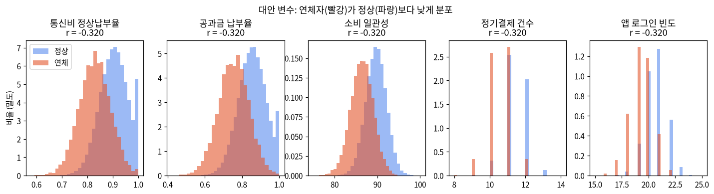

⏳ 이 그림은 #26 이전 데이터로 만든 것이라, EDA 노트북(`notebooks/01_eda.ipynb`)을 다시 실행해 바꿔야 한다.

### 3.4 두 가지 실험 설정 (손잡이)

| 설정 | 기본값 | 값을 주면 | 과제 노션 |
|---|---|---|---|
| `thin_filer_ratio` | `None` (판정 기준대로만) | 연체 기록이 0인 일반 고객 일부의 연체 칸 3개를 지워, 과제 노션 판정식(연체 칸 2개 이상 결측)으로 씬파일러가 되게 함. 0.1 → 15,000명, 0.3 → 45,000명 (이슈 #61, PR #77) | ✅ 비율이 바뀜 |
| `bias_ratio` | `0` (편향 없음) | 남성·55세 이상 일부의 연체 표시를 1로 바꾸고, 남성의 앱 로그인 빈도를 `round(30 × bias_ratio)`만큼 높임(성별을 짐작하게 하는 대리 변수). 모델 성별 승인율 차이 0.003 → 0.145(0.1) → 0.326(0.2) (이슈 #41, PR #78, 8.3) | ✅ 승인율 편향이 바뀜 |

본 결과(6~9장)는 **기본값(None, 0)**으로 만든 데이터를 쓰고, 두 설정은 실험에서만 바꾼다. `bias_ratio`를 0보다 크게 하면 연체율이 6.7%에서 13.4%(0.1), 20.2%(0.2)로 늘고 대안 변수 상관계수가 0.3 아래로 내려가므로(0.1에서 −0.06 ~ −0.21), 공정성 검사용으로 **일부러 기준을 벗어난 데이터**임을 밝혀 둔다.

### 3.5 한계

- **변수 하나의 AUC가 약 0.8이다.** 연체율 6.7%인 데이터에서 정답과 상관 0.3 이상인 변수는 그 자체로 강한 신호라, Test에서 변수 하나만 써도 AUC가 0.80~0.82 나온다. 이 값은 상관 조건에서 수학적으로 정해진다. 그래서 대안 데이터만 쓴 모델(Validation 0.846)이 금융 데이터만 쓴 모델(0.870)과 비슷하게 나온다. 실제 통신비·공과금 기록이 신용 기록만큼 예측한다는 뜻은 아니다.
- **정답 의존이 남아 있다.** 성실도의 30%는 정답 신호다. 시뮬레이션에서 금융 정보에 없는 새 정보의 출처는 정답뿐이라 완전히 뺄 수는 없다.
- **w와 ρ는 보정값이다.** 실제 대안 데이터로 검증하지 않았다 (11장).

## 4. 씬파일러 판정 기준 (1.5쪽) ✅

### 4.1 과제 노션 정의와 이 데이터의 문제

과제 노션 정의: 「금융 연체 관련 컬럼 2개 이상 결측치이거나 신용카드 거래 이력이 12개월 미만인 고객」

- 연체 칸 3개에 결측이 있는 사람이 **0명**이다.
- 카드 사용 기간 칸이 데이터에 없다.

따라서 이 정의를 그대로 적용하면 씬파일러가 0명이라 「대안 데이터 포함 모델 vs 미포함 모델의 AUC uplift」를 측정할 수 없다. 팀은 과제 노션 정의의 취지(「금융 이력이 부족하여 … 적절한 신용평가가 어려운 개인」)를 이 데이터에서 **대신하는** 기준을 정했다 (이슈 #15). 과제 노션 정의와 같다고 주장하지 않는다.

### 4.2 팀 기준

다음 세 조건을 **모두** 만족하면 씬파일러로 본다 (`label_thin_filer`, 과제 노션 「씨파일러 판정 함수가 명시적으로 구현되어 있어야 한다」).

1. 보유 대출·신용 한도 1개 이하 (`NumberOfOpenCreditLinesAndLoans` ≤ 1)
2. 부동산 담보대출 0개 (`NumberRealEstateLoansOrLines` = 0)
3. 연체 기록 0 (연체 칸 3개 합 = 0)

과제 노션 판정식(연체 칸 2개 이상 결측)도 코드에 그대로 두어, `thin_filer_ratio`로 연체 칸을 지우면 그 판정식이 실제로 작동한다 (3.4).

### 4.3 근거

연체 기록과 담보대출이 없는 사람만 놓고, 보유 계좌 수에 따른 연체율을 보면 계좌가 적을수록 연체율이 뚜렷하게 높고 2개부터는 거의 평평하다.

| 보유 대출·신용 한도 | 인원 | 연체율 |
|---|---|---|
| 0개 | 992 | 13.0% |
| 1개 | 3,118 | 5.3% |
| 2개 | 4,296 | 2.9% |
| 3개 이상 | 35,504 | 2.6% |

즉 1개 이하인 사람은 금융 기록만으로 위험을 가늠하기 어려운 집단이다. 업계에서도 활성 계좌 수가 적은 사람을 씬파일러로 분류한다(예: Experian은 활성 계좌가 몇 개 이하인 고객을 thin file로 봄).

### 4.4 결과

| | 씬파일러 | 일반 |
|---|---|---|
| 인원 | 4,110 (2.74%) | 145,890 (97.26%) |
| 연체율 | 7.18% | 6.67% |
| 35세 미만 비율 | 38.7% | 12.1% |
| Train / Validation / Test | 2,892 / 593 / 625 | |

씬파일러는 일반 고객보다 연체율이 높고 젊은 층이 많아, 과제 노션이 예로 든 「사회초년생」과 성격이 비슷하다. Test의 씬파일러 625명(그중 연체 42명)으로 대안 데이터 효과를 측정한다 (6장).

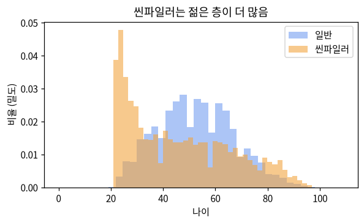

### 4.5 바뀐 과정

초기 시뮬레이터는 `thin_filer_ratio=0.3`으로 전체의 30%를 무작위로 씬파일러로 표시해, 씬파일러의 약 86%가 금융 기록이 충분한 일반인이었다. 이 상태로는 대안 데이터 효과를 제대로 잴 수 없어 기본값을 `None`(판정 기준대로만)으로 바꿨고(이슈 #16), 이후 손잡이를 쓸 때도 표시만 붙이는 대신 실제로 연체 칸을 지우도록 고쳤다(이슈 #61).

### 4.6 한계

- 카드 사용 기간 조건은 데이터에 칸이 없어 쓰지 못했다.
- 씬파일러가 4,110명(Test 625명, 연체 42명)으로 적어, 대안 데이터 효과는 부트스트랩 95% 구간과 함께 보고한다 (6장).

## 5. 전처리와 분할 (1쪽) ✅

> 코드: `src/data/preprocessor.py`, `main_step1.py`. 숫자는 시드 42 기준.

### 5.1 전처리 순서

1. **부채비율 고치기**: 월소득이 빈칸인 사람의 `DebtRatio`는 비율이 아니라 금액이므로, Train의 월소득 중앙값(5,382)으로 나눠 비율로 바꾼다 (2장).
2. **결측치 처리**: 과제 노션 「결측치 처리 로직이 구현되어 있다 (중앙값/평균값 대체 또는 삭제)」에 따라 중앙값으로 채운다. 월소득 29,731명(19.82%)은 Train 중앙값 5,382, 부양가족 수 3,924명(2.62%)은 Train 중앙값 0으로 채운다. 행은 지우지 않는다.
3. **글자 칸 처리**: 입력 칸이 모두 숫자라 One-Hot Encoding을 적용할 칸은 없다. 코드는 글자 칸이 생길 때를 대비해 남겨 둔다.
4. **StandardScaler**: 입력 15개 칸을 평균 0, 표준편차 1로 맞춘다. 학습에 쓴 StandardScaler는 `models/preprocess_scaler_v1.0.joblib`에 저장해, API가 새 고객을 같은 기준으로 바꾸게 한다.

### 5.2 분할

| | Train | Validation | Test |
|---|---|---|---|
| 비율 | 70% | 15% | 15% |
| 인원 | 105,000 | 22,500 | 22,500 |
| 연체율 | 6.68% | 6.68% | 6.68% |
| 씬파일러 | 2,892 | 593 | 625 |

`stratify=y`로 나눠 세 묶음의 연체율이 같다. 역할은 다음과 같이 나눈다 (이슈 #25).

- **Train**: 모델 학습과 5-Fold 교차검증
- **Validation**: 18개 모델 중 최종 모델 고르기, 공정성 기준값(Threshold Adjustment) 정하기
- **Test**: 최종 모델 성능을 **마지막에 한 번만** 잰다. 과제 노션 「테스트 데이터의 라벨을 학습에 사용하는 것을 금지한다.」

분할 파일에는 성별·연령대·씬파일러 표시·고객 번호 칸도 남겨 공정성 검증과 씬파일러 분석에 쓴다. 이 칸들은 **모델 입력 15개에는 넣지 않는다** (이슈 #33).

### 5.3 전처리 기준은 Train으로만

중앙값과 StandardScaler는 **Train 행으로만** 계산한다 (PR #82). 처음에는 나누기 전 전체 데이터로 계산해 Validation · Test의 값이 기준에 조금 섞였는데, 이를 고쳤다. 월소득 중앙값은 전체 기준 5,400에서 Train 기준 5,382로 바뀌었다. 같은 기준은 `models/model_metadata.json`에 남겨, API와 거절 사유("동일 연령대 평균")도 같은 기준으로 값을 바꾼다 (PR #99).

## 6. 모델 학습과 비교 (3쪽) ✅

> 코드: `main_step2.py`, `src/models/train.py`. 기록: 팀 MLflow 서버, Model Registry `xai-credit-model`.

### 6.1 실험 설계

과제 노션은 「대안 데이터 포함 모델 vs 미포함 모델」을 비교하라고 한다. 이를 위해 세 가지 조건을 모두 조합해 **18개 모델**을 학습했다.

| 조건 | 선택지 |
|---|---|
| 데이터 | 금융만(10칸) / 대안만(5칸) / 통합(15칸) |
| 알고리즘 | Logistic Regression / XGBoost / LightGBM |
| 불균형 처리 | 가중치(`class_weight`, `scale_pos_weight`, `is_unbalance`) / SMOTE |

연체자가 6.68%뿐이라(2장) 아무 처리 없이 학습하면 모델이 대부분을 "정상"으로 답한다. 그래서 연체자에 가중치를 주는 방법과, 연체자 데이터를 늘리는 SMOTE를 비교했다. SMOTE는 교차검증의 학습 부분에만 적용해 검증 부분에 가짜 데이터가 섞이지 않게 했다.

각 모델은 Train에서 5-Fold Stratified 교차검증을 하고, AUC·KS·Precision·Recall·F1을 MLflow에 기록했다 (폴드별 값 `fold_k_roc_auc` 포함, 9장 ANOVA에 사용).

### 6.2 결과: 18개 모델 비교

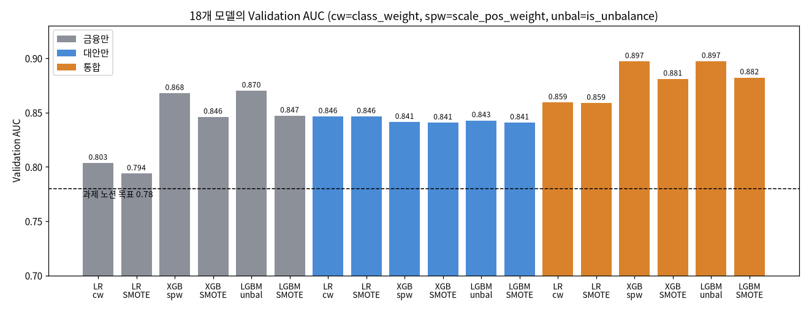

| 데이터 | 알고리즘 | 불균형 처리 | CV AUC | CV KS | Val AUC | Val KS |
|---|---|---|---|---|---|---|
| 금융만 | LR | class_weight | 0.790 | 0.436 | 0.804 | 0.463 |
| 금융만 | LR | SMOTE | 0.781 | 0.417 | 0.794 | 0.442 |
| 금융만 | XGBoost | scale_pos_weight | 0.859 | 0.564 | 0.868 | 0.583 |
| 금융만 | XGBoost | SMOTE | 0.837 | 0.524 | 0.846 | 0.545 |
| 금융만 | LightGBM | is_unbalance | 0.862 | 0.570 | 0.870 | 0.594 |
| 금융만 | LightGBM | SMOTE | 0.838 | 0.524 | 0.847 | 0.547 |
| 대안만 | LR | class_weight | 0.842 | 0.521 | 0.846 | 0.535 |
| 대안만 | LR | SMOTE | 0.842 | 0.521 | 0.846 | 0.535 |
| 대안만 | XGBoost | scale_pos_weight | 0.836 | 0.508 | 0.841 | 0.530 |
| 대안만 | XGBoost | SMOTE | 0.835 | 0.510 | 0.841 | 0.526 |
| 대안만 | LightGBM | is_unbalance | 0.837 | 0.513 | 0.843 | 0.531 |
| 대안만 | LightGBM | SMOTE | 0.836 | 0.511 | 0.841 | 0.530 |
| 통합 | LR | class_weight | 0.855 | 0.546 | 0.859 | 0.561 |
| 통합 | LR | SMOTE | 0.854 | 0.546 | 0.859 | 0.559 |
| 통합 | XGBoost | scale_pos_weight | 0.888 | 0.620 | 0.897 | 0.633 |
| 통합 | XGBoost | SMOTE | 0.876 | 0.591 | 0.881 | 0.599 |
| **통합** | **LightGBM** | **is_unbalance** | **0.890** | **0.624** | **0.897** | **0.637** |
| 통합 | LightGBM | SMOTE | 0.877 | 0.589 | 0.882 | 0.595 |

읽는 법:

- **통합 데이터가 가장 높다.** 금융만 0.79~0.87, 대안만 0.84~0.85, 통합 0.86~0.90이다. 대안만은 금융만 트리 모델(0.87)과 비슷하고, 둘을 합치면 0.03 정도 오른다.
- **알고리즘**: 금융 · 통합 데이터에서는 트리 모델(XGBoost, LightGBM)이 LR보다 0.04~0.07 높다. 대안만에서는 LR이 가장 높은데(0.846), 대안 변수가 성실도 하나에서 직선 관계로 만들어졌기 때문이다(3.2).
- **불균형 처리**: 트리 모델에서는 가중치 방식이 SMOTE보다 AUC가 0.02 정도 높다. SMOTE는 Precision이 높고 Recall이 낮은 쪽으로 기울었다(통합 LightGBM 기준 CV Precision 0.51 / Recall 0.42, 가중치 방식 0.26 / 0.78).
- CV와 Validation 값의 차이가 0.01 안팎이라, 특정 데이터에만 맞춘 모델(과적합)은 보이지 않는다.

### 6.3 최종 모델 선택과 Test 결과

Validation AUC가 가장 높은 **통합 · LightGBM · is_unbalance**(0.8972)를 최종 모델로 골랐다. 2위 XGBoost(0.8970)와의 차이는 매우 작고, 9장에서 두 알고리즘 차이가 통계적으로 의미 없음을 확인했다. 이 모델로 Test를 **한 번** 평가한 결과는 다음과 같다.

| 과제 노션 기준 | 목표 | 결과 | 통과 |
|---|---|---|---|
| Test AUC-ROC | ≥ 0.78 | **0.8894** | ✅ |
| Test KS Statistic | ≥ 0.28 | **0.6129** | ✅ |
| PSI (점수 분포, Train vs Test) | < 0.1 | **0.0004** | ✅ |
| PSI (칸별 최댓값) | < 0.1 | 0.0009 (통신비 정상납부율) | ✅ |

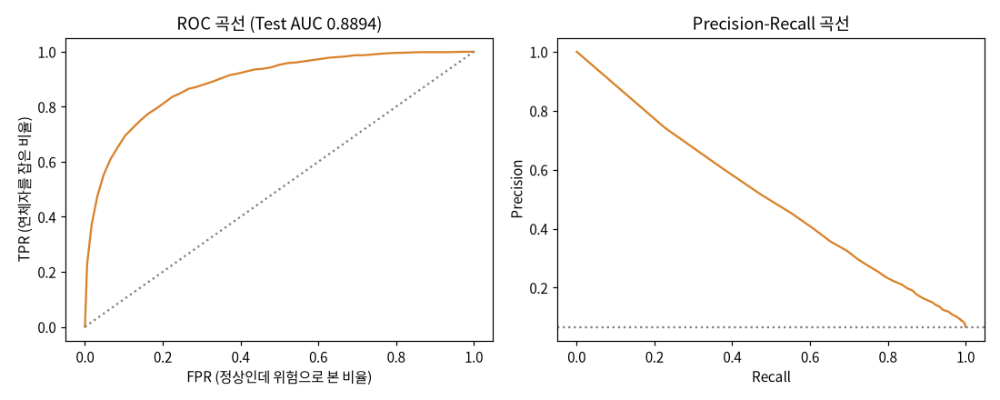

기준값 0.5에서의 혼동행렬 (Test 22,500명, 연체 1,504명):

| | 연체로 예측 (거절) | 정상으로 예측 (승인) |
|---|---|---|
| 실제 연체 | 1,166 | 338 |
| 실제 정상 | 3,439 | 17,557 |

Recall 0.775(연체자 4명 중 3명을 거절), Precision 0.253(거절한 사람 4명 중 1명이 실제 연체)이다. 연체자를 놓치는 비용이 더 크다고 보고 Recall이 높은 쪽(`is_unbalance`)을 그대로 두었다. 대신 정상 고객 3,439명(16.4%)이 거절되어 전체 승인율은 79.5%이다. 승인 기준값(0.5)은 `APPROVAL_THRESHOLD`로 바꿀 수 있다.

### 6.4 씬파일러 AUC uplift

과제 노션 기준 「대안 데이터 포함 모델 vs 미포함 모델의 AUC uplift」(+0.03 이상)를 두 가지로 쟀다. 두 모델은 데이터만 다르고 알고리즘·불균형 처리는 같다(금융만 LightGBM vs 통합 LightGBM).

| 측정 | 씬파일러 (연체) | 미포함 AUC | 포함 AUC | uplift | 95% 구간 (부트스트랩 1,000회) |
|---|---|---|---|---|---|
| **Train+Validation 5-Fold 교차검증** (판정) | 3,485명 (253명) | 0.749 | 0.815 | **+0.066** | +0.042 ~ +0.089 |
| Test 1회 (참고) | 625명 (42명) | 0.814 | 0.815 | +0.001 | −0.051 ~ +0.053 |

- **판정은 교차검증 값으로 한다 ✅.** Test의 씬파일러 연체는 42명뿐이라 구간이 0을 포함할 만큼 넓다. 같은 데이터에서 분할 시드만 바꿔도 Test 향상이 크게 흔들렸다(`docs/alt_data_simulation.md`). 교차검증은 Train+Validation의 씬파일러 전체(연체 253명)로 계산해 구간이 좁고, 아래 끝(+0.042)도 목표 +0.03보다 크다.
- **Test는 쓰지 않는다.** 교차검증은 각 고객을 그 고객이 학습에 쓰이지 않은 모델로 예측하므로(out-of-fold), "Test는 마지막에 한 번만"(5.2)을 지킨다. Test 1회 값도 지우지 않고 함께 기록한다 (MLflow `thin_*` · `thin_cv_*`, `/metrics`).
- 이 Test 씬파일러 집단에서는 금융만 모델의 AUC가 0.814로 교차검증(0.749)보다 높아, 대안 데이터가 더할 여지가 작았다. 판정 기준을 교차검증 값으로 하자는 것은 #108 리뷰에서 제안했고 `main_step3.py`에 반영 중이다 (#110).

### 6.5 MLflow 기록

- 팀 MLflow 서버의 실험 하나에 run 20개: 모델 18개 + Validation 선택표(`model_selection_val`) + Test 1회 평가(`final_test`)
- 각 모델 run: params(데이터·알고리즘·불균형 처리), metrics(CV AUC·KS·F1과 폴드별 값), artifacts(모델 파일)
- `final_test` run: Test AUC·KS, PSI(점수·칸별), 씬파일러 uplift와 구간(Test 1회 `thin_*`, 교차검증 `thin_cv_*`)
- 최종 모델은 Model Registry `xai-credit-model`에 등록하고 Staging 단계로 두었다 (이슈 #32)
- ⏳ 이 장의 숫자는 #26 재학습을 로컬 MLflow로 재현한 값이다. 팀 MLflow 서버의 기록과 Registry 새 버전은 팀 확인 뒤 갱신한다

### 6.6 주의할 점

- **AUC가 0.98에서 0.89로 내려간 이유**: 처음 방식의 대안 변수는 다섯 개를 합치면 잡음이 상쇄되어, 통합 모델 Test AUC가 0.981까지 올라갔다. 잠재 상환 성실도 요인 모델로 바꾼 뒤(3.2, 이슈 #26) 0.889가 되었다. 금융만 모델(0.870)보다 0.02~0.03 높은 정도로, 대안 데이터가 금융 정보를 보완하는 모양이다. 다만 대안 변수는 여전히 정답을 일부 써서 만들었으므로(3.5), 실제 대안 데이터에서도 이만큼 오른다는 보장은 없다.
- **배운 점**: 10/8~10/9 기록은 옛 설정(`bias_ratio=0.1`)으로 만든 데이터로 학습되어, 금융만 LightGBM AUC가 0.69까지 떨어졌다(깨끗한 데이터에서는 0.87). 편향 실험용 설정이 기본 데이터를 망가뜨린 것이라 기본값을 0으로 바꿨다 (이슈 #16).

## 7. XAI 분석 (3쪽) ✅

> 코드: `main_step3.py`, `src/explainer/`. 그림은 `outputs/evaluation/shap/`를 `docs/figures/`에 복사해 썼다(한도 사용 비율 Dependence Plot만 원래 단위로 다시 그림, 7.3).

### 7.1 방법

최종 모델이 트리 모델(LightGBM)이므로 SHAP **TreeExplainer**를 쓴다. SHAP 값은 "이 칸 때문에 연체 쪽으로 얼마나 기울었는가"를 나타낸다. **양수면 연체 위험을 높이고, 음수면 낮춘다.** 그림의 칸 값은 StandardScaler를 적용한 값(평균 0, 표준편차 1)이다.

### 7.2 전체 중요도 (Summary Plot)

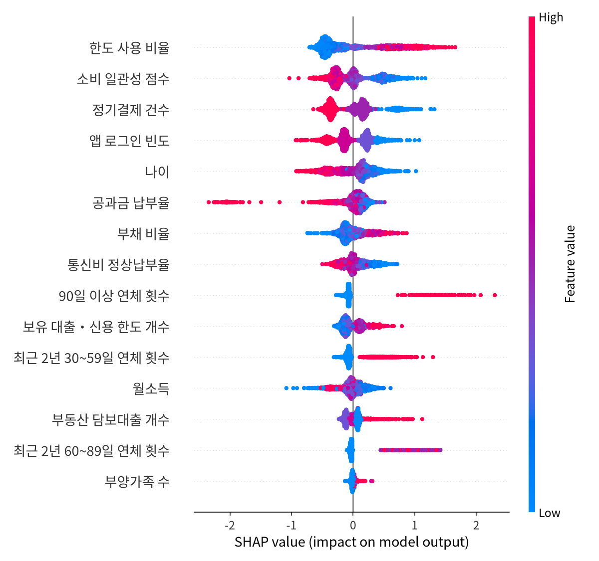

Test 표본 2,000명의 평균 |SHAP| 순위:

| 순위 | 칸 | 평균 \|SHAP\| | 종류 |
|---|---|---|---|
| 1 | 한도 사용 비율 | 0.495 | 금융 |
| 2 | 소비 일관성 점수 | 0.285 | 대안 |
| 3 | 정기결제 건수 | 0.284 | 대안 |
| 4 | 앱 로그인 빈도 | 0.260 | 대안 |
| 5 | 나이 | 0.260 | 금융 |
| 6 | 공과금 납부율 | 0.179 | 대안 |
| 7 | 부채 비율 | 0.171 | 금융 |
| 8 | 통신비 정상납부율 | 0.153 | 대안 |
| 9 | 90일 이상 연체 횟수 | 0.148 | 금융 |
| 10 | 보유 대출·신용 한도 개수 | 0.147 | 금융 |

읽는 법:

- **1위는 금융 변수인 한도 사용 비율**이고(0.495), 2위의 약 1.7배다. 대안 변수는 2~4위, 6위, 8위에 고르게 있다. 처음 방식(#26 이전)에서는 상위 4개가 모두 대안 변수였는데, 대안 변수가 성실도 하나를 함께 나눠 갖게 되면서(3.2) 한 변수의 몫이 줄었다.
- 대안 변수는 **빨간 점(값이 큼)이 왼쪽(위험 낮춤)**에 있다. 납부율·소비 일관성이 높을수록 위험이 낮다는 뜻으로, 팀 결정 A안(연체자일수록 값이 낮게, 이슈 #36)과 같은 방향이다.
- 금융 변수는 한도 사용 비율과 연체 횟수가 **클수록 위험이 높다**. 신용평가 상식과 맞는다. 90일 이상 연체는 평균 순위는 9위지만, 연체가 있는 사람에게는 SHAP 값이 +1~+2로 가장 크게 작용한다.
- 나이는 많을수록 위험이 낮다. 2장의 연령대별 연체율(20-34세 11.18% → 55세 이상 3.73%)과 같은 방향이다.

### 7.3 칸 하나의 영향 (Dependence Plot)

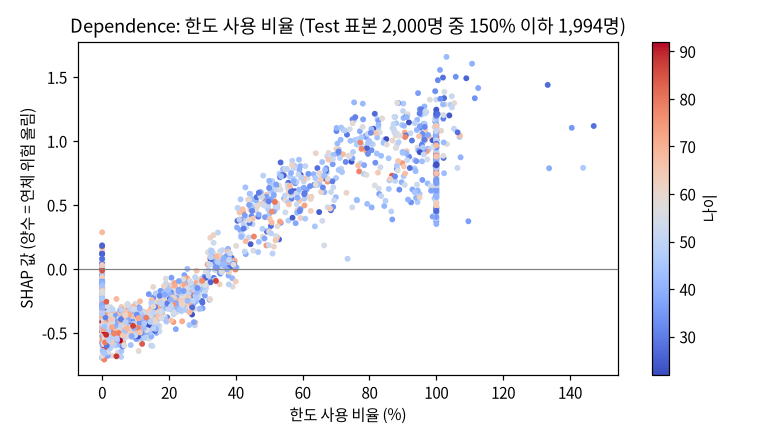

한도 사용 비율은 원래 단위(%)로 그렸다. 30% 아래에서는 위험을 낮추고(SHAP 평균 −0.38), 30~60%에서 +0.31, 60~100%에서 +0.86, 100%를 넘으면 +1.18로 **쓸수록 위험이 계단처럼 오른다**. `main_step3.py`가 그리는 기본 그림은 이 칸의 극단값(최댓값 50,708) 때문에 표준화한 값이 0 근처에 몰려 읽기 어려워, Test 표본 2,000명 중 150% 이하인 1,994명만 원래 단위로 다시 그렸다. 나이(색)와는 뚜렷한 관계가 보이지 않는다.

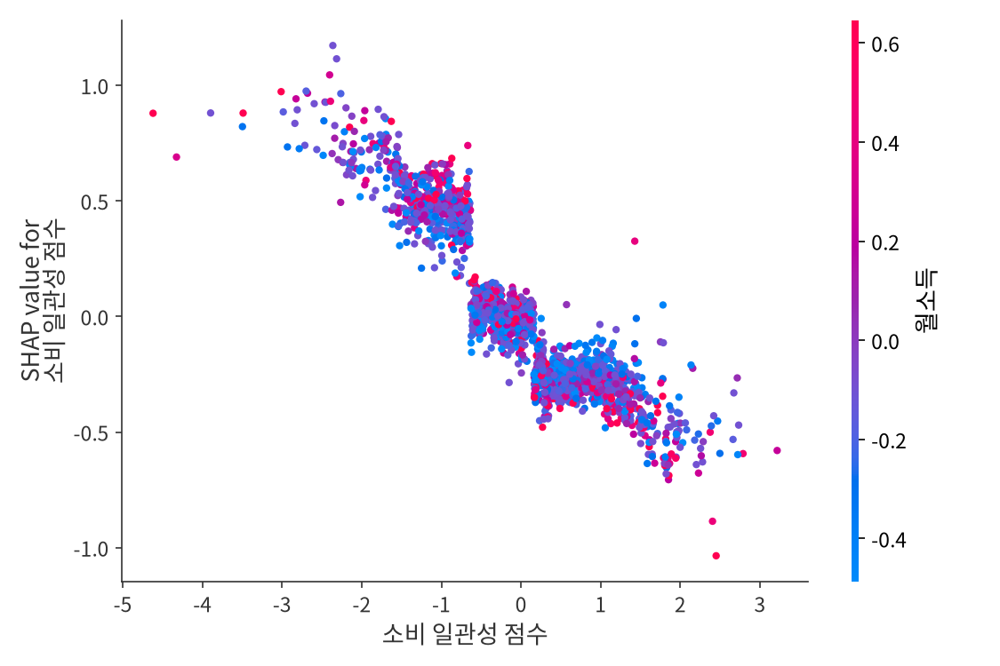

소비 일관성 점수는 값과 SHAP 값이 거의 직선으로 반비례한다(낮으면 최대 약 +1.0, 높으면 약 −0.6). 점들이 몇 덩어리로 끊어져 보이는 것은 LightGBM이 값을 구간으로 나눠 판단하기 때문이다. 색(월소득)이 섞여 있어 두 칸이 서로의 효과를 크게 바꾸지는 않는다.

### 7.4 한 사람의 설명 (Waterfall Plot)과 거절 사유

Test에서 거절된 고객 한 명의 Waterfall Plot이다.

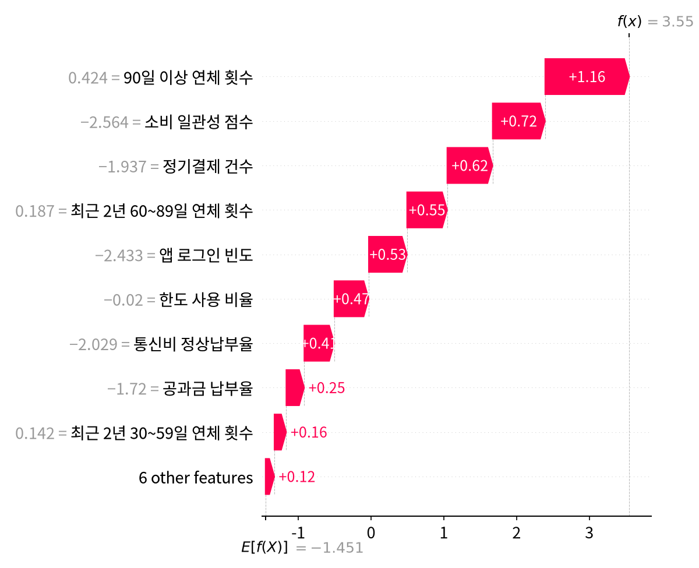

기준값 E[f(X)] = −1.451(부도 확률 약 19%)에서 시작해, 칸별 SHAP 값을 더한 결과가 f(x) = 3.55(부도 확률 약 97%)이다. 90일 이상 연체 횟수(+1.16), 소비 일관성 점수(+0.72), 정기결제 건수(+0.62)가 위험을 가장 많이 올렸다. 금융 변수(연체 기록)와 대안 변수(낮은 소비 일관성 · 정기결제 · 앱 로그인)가 함께 거절 쪽으로 기울였다. 기준값의 부도 확률(19%)이 실제 부도율(6.7%)보다 높은 것은 `is_unbalance`가 연체자에 가중치를 주어 모델 점수 전체가 위험 쪽으로 옮겨졌기 때문이다.

이 SHAP 값으로 과제 노션 형식 「통신비 정상납부율이 78%로, 동일 연령대 평균(92%) 대비 낮습니다」의 거절 사유 Top 5를 만든다.

| 순위 | 거절 사유 (`explain_example.json`) |
|---|---|
| 1 | 90일 이상 연체 횟수가 2회로, 동일 연령대 평균(0.1회) 대비 높습니다 (기여도: -1.16) |
| 2 | 소비 일관성 점수가 82.9점으로, 동일 연령대 평균(89.3점) 대비 낮습니다 (기여도: -0.72) |
| 3 | 정기결제 건수가 10건으로, 동일 연령대 평균(11.3건) 대비 낮습니다 (기여도: -0.62) |
| 4 | 최근 2년 60~89일 연체 횟수가 1회로, 동일 연령대 평균(0.1회) 대비 높습니다 (기여도: -0.55) |
| 5 | 앱 로그인 빈도가 18회로, 동일 연령대 평균(20.5회) 대비 낮습니다 (기여도: -0.53) |

만드는 규칙:

1. 위험을 올린 칸(SHAP 양수)만 큰 순서로 5개 고른다.
2. 고객 값은 StandardScaler를 되돌려 **원래 단위**(%, 건, 회)로 보여 준다.
3. "동일 연령대 평균"은 Train에서 같은 연령대(20-34 / 35-54 / 55+)의 평균이다. 극단값에 끌리지 않도록 위아래 1%를 뺀 평균을 쓴다.
4. 기여도는 **승인 점수 기준**으로 표시해 부호를 SHAP 값과 반대로 쓴다(승인에 불리하면 음수). Waterfall의 +1.16과 사유의 −1.16은 같은 값이다.

각 사유에는 과제 노션이 요구한 4개 항목(칸 이름, 고객 값, 비교 기준값, 기여도)이 모두 들어 있다.

### 7.5 한계

- SHAP 값은 "모델이 이렇게 판단했다"는 설명이지 "이 칸이 연체의 원인이다"라는 뜻이 아니다.
- 대안 변수는 정답 신호를 일부(30%) 써서 만들어, 대안 변수의 중요도가 실제 데이터보다 크게 나올 수 있다 (3.5).
- 대안 변수 다섯 개가 서로 강하게 함께 움직여(상관 0.74~0.84), 중요도가 다섯 칸에 나뉘어 보인다. 칸 하나의 순위보다 대안 변수 전체의 몫으로 읽는 것이 맞다.

## 8. 공정성 검증과 Bias Mitigation (3쪽) ✅

> 코드: `main_step4.py`, `src/fairness/`. 결과: `outputs/fairness/`.

### 8.1 기준

- **보호 속성**: 성별(female / male), 연령대(20-34 / 35-54 / 55+). 성별은 원본 데이터에 없어 시뮬레이터가 만든 값이다.
- **DI Ratio** = 보호 집단 승인율 ÷ 비교 집단 승인율. 0.8 ~ 1.25를 벗어나면 WARNING.
- **Equalized Odds**: 집단 간 TPR 차이와 FPR 차이가 각각 0.10 이하. 승인율만 같은 것이 아니라 **틀리는 비율도 비슷해야** 공정하다고 본다.
- 성별·연령대 칸은 모델 입력에 넣지 않았다 (5.2). 그래도 다른 칸을 통해 간접적으로 차이가 생길 수 있어 결과로 확인한다.

### 8.2 기본 데이터 결과 (Test, 기준값 0.5)

| 속성 | 집단별 승인율 | DI Ratio | TPR 차이 | FPR 차이 | 판정 |
|---|---|---|---|---|---|
| 성별 | 여성 0.794 · 남성 0.797 | 0.996 | 0.004 | 0.006 | ✅ |
| 연령대 | 20-34세 0.640 · 35-54세 0.738 · 55세 이상 0.898 | **1.254** | **0.148** | **0.176** | ❌ WARNING |

- **성별**은 승인율 · 틀리는 비율 모두 차이가 거의 없다.
- **연령대는 과제 노션 기준을 넘는다.** DI Ratio가 1.25를 조금 넘고(1.254), TPR 차이(0.148)와 FPR 차이(0.176)가 0.10을 넘는다. `main_step4.py`가 `[공정성 경고] age_group DI Ratio 1.254`를 남긴다. 55세 이상은 연체자도 많이 승인되고(FPR이 높음), 20-34세는 정상 고객도 많이 거절된다(TPR이 낮음).
- 원인은 실제 연체율 차이다. 20-34세 11.18%, 55세 이상 3.73%로 3배 차이 난다(2장). 처음 방식(#26 이전)의 모델은 AUC가 0.98이라 틀리는 경우 자체가 적어 이 차이가 잘 드러나지 않았다(DI 1.093, TPR · FPR 차이 0.031 · 0.042). AUC가 현실적인 0.89로 내려가자 틀리는 경우가 늘고, 그 오류가 연령대에 따라 다르게 나타났다.
- 그래서 8.4의 Bias Mitigation이 **선택이 아니라 필요한 단계**가 되었다.

### 8.3 편향 실험 (`bias_ratio`)

과제 노션의 `bias_ratio`로 일부러 편향을 넣었을 때 시스템이 이를 잡아내는지 확인했다 (이슈 #41, PR #78).

| `bias_ratio` | 0 | 0.1 | 0.2 |
|---|---|---|---|
| 성별 승인율 차이 | 0.003 | 0.145 | 0.326 |
| 승인율 여성 / 남성 | 0.794 / 0.797 | 0.833 / 0.688 | 0.625 / 0.299 |
| Test AUC | 0.889 | 0.720 | 0.697 |
| 연체율 | 6.7% | 13.4% | 20.2% |

(최종 모델과 같은 설정의 통합 LightGBM `is_unbalance`를 각 데이터로 학습해 Test 기준값 0.5에서 잼)

- 값을 키울수록 성별 승인율 차이가 커져, 공정성 지표가 편향을 감지함을 확인했다. 0.1만 넣어도 차이가 0.003에서 0.145로 커져, 성별 DI(0.688 ÷ 0.833 = 0.83)가 기준 아래 끝 0.8에 가까워진다.
- 처음에는 연체 표시만 바꿨는데, 성별이 입력 칸이 아니라 모델 승인율에 차이가 전달되지 않았다. 그래서 남성의 앱 로그인 빈도를 높이는 **대리 변수**를 추가했다. 실제 금융에서도 입력에 성별이 없어도 성별과 관련된 다른 칸을 통해 차별이 생길 수 있다는 점을 보여 준다.
- `bias_ratio`를 0보다 크게 하면 대안 변수 상관계수가 0.3 아래로 내려가, 실험 전용 데이터임을 밝혀 둔다 (3.4). 0.2에서는 남성의 앱 로그인 빈도를 높인 효과가 커서 이 칸의 상관 부호가 양수(+0.06)로 바뀐다.

### 8.4 Bias Mitigation 전/후

연령대가 기준을 넘었으므로(8.2), 연령대 승인율 차이(0.640 vs 0.898)와 틀리는 비율 차이를 줄이는 두 방법을 적용해 비교했다. 과제 노션 「공정성 분석 결과를 문서화하고 편향 완화 조치를 기록해야 한다.」

1. **Threshold Adjustment**: 집단(성별 × 연령대 6개)마다 승인 기준값을 따로 정해 승인율을 맞춘다. 기준값은 **Validation**으로 정하고 Test에는 적용만 한다 (Test는 한 번만 평가).
2. **Reweighting**: Train에서 집단 × 연체 여부 조합마다 가중치를 줘서, 집단과 연체 여부가 서로 관계없어 보이도록 다시 학습한다.

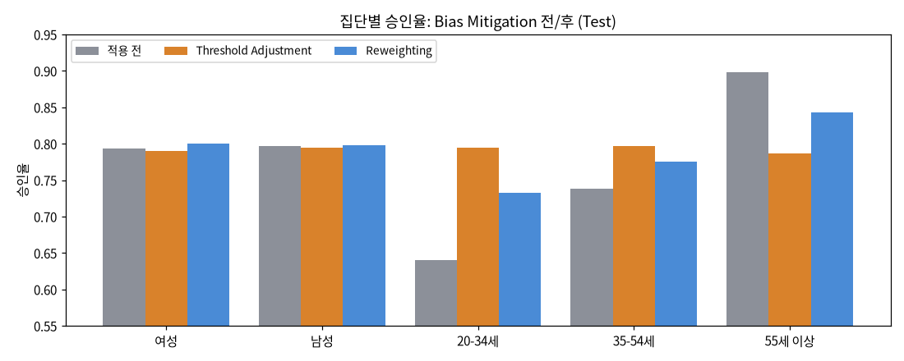

| 지표 (Test) | 적용 전 | Threshold Adjustment | Reweighting |
|---|---|---|---|
| DI Ratio (연령대) | 1.254 ❌ | 0.988 ✅ | 1.100 ✅ |
| DI Ratio (성별) | 0.996 | 0.994 | 1.003 |
| TPR 차이 (연령대) | 0.148 ❌ | 0.041 ✅ | 0.045 ✅ |
| FPR 차이 (연령대) | 0.176 ❌ | 0.064 ✅ | 0.022 ✅ |
| 승인율 20-34세 | 0.640 | 0.795 | 0.733 |
| 승인율 35-54세 | 0.738 | 0.797 | 0.775 |
| 승인율 55세 이상 | 0.898 | 0.787 | 0.843 |
| 전체 승인율 | 0.795 | 0.792 | 0.799 |
| Test AUC | 0.8894 | 0.8894 (모델 그대로) | 0.8829 |

### 8.5 해석: 두 방법 모두 기준 안으로

- **두 방법 모두 연령대를 기준 안으로 되돌렸다.** 적용 전에는 DI · TPR · FPR 세 지표가 모두 기준을 넘었지만, 두 방법 모두 세 지표를 통과시켰다. 전체 승인율은 0.79~0.80으로 거의 그대로다.
- **Threshold Adjustment**는 연령대 승인율을 0.787~0.797로 거의 같게 만들었다(DI 0.988). 20-34세의 기준값을 약 0.69~0.70, 55세 이상을 약 0.29로 다르게 잡았다. 모델은 그대로라 AUC도 같다. 다만 FPR 차이(0.064)가 Reweighting(0.022)보다 크다. 승인율을 맞추려고 고령층은 위험이 낮아도 더 거절하기 때문이다.
- **Reweighting**은 승인율 차이를 덜 줄였지만(DI 1.100), FPR 차이가 가장 작다(0.022). 대신 다시 학습하므로 AUC가 0.007 내려갔다(0.8894 → 0.8829).
- **처음 모델(#26 이전)과 다른 점.** 처음 모델은 적용 전부터 기준을 통과했고, Threshold Adjustment가 오히려 TPR · FPR 차이를 키웠다(0.031 · 0.042 → 0.051 · 0.067). 지금은 적용 전 차이가 커서 Threshold Adjustment도 TPR · FPR 차이를 줄인다. 그래도 "승인율이 같다"(Threshold Adjustment가 유리)와 "틀리는 비율이 같다"(Reweighting이 유리)는 여전히 다른 방법이 더 잘 맞춘다.
- **어느 쪽을 쓸까.** 심사할 때 연령대마다 다른 기준값을 쓰는 것은 나이로 사람을 다르게 대하는 것이라 설명하기 어렵다. Reweighting은 학습할 때만 가중치를 쓰고 심사 기준값은 모두 같아서, 이 데이터에서는 **Reweighting**이 더 알맞다고 본다. 최종 모델과 `/fairness` 응답은 아직 적용 전 모델 기준이고(WARNING 표시), 두 방법의 결과는 `/fairness/mitigation`과 `outputs/fairness/`에 남긴다 (부록).

### 8.6 Fairlearn 교차 확인

과제 노션은 「AIF360/Fairlearn 기반 공정성 검증 및 Bias Mitigation 모듈을 구현한다.」고 하고, 개발 환경에 「공정성 라이브러리: Fairlearn 또는 AIF360」을 둔다. 우리는 DI Ratio와 Equalized Odds를 과제 노션 정의대로 직접 계산하고(`src/fairness/metrics.py`), 같은 값을 **Fairlearn으로 다시 계산해 일치하는지 확인**한다 (`src/fairness/library_check.py`, 이슈 #87).

Fairlearn에는 승인을 좋은 결과로 보도록 정답 = `1 - 연체 여부`, 예측 = 승인 여부를 넣는다. 그러면 Fairlearn의 `selection_rate`는 승인율, `true_positive_rate`는 정상 상환자 중 승인 비율(TPR), `false_positive_rate`는 연체자 중 승인 비율(FPR)이 되어 우리 정의와 같아진다. DI Ratio는 보호 집단 방향이 있어야 하므로 집단별 `selection_rate`를 나눠 구한다.

| Test 결과 | DI (직접 계산) | DI (Fairlearn) | Equalized Odds 차이 (Fairlearn) | 일치 |
|---|---|---|---|---|
| 적용 전 · 성별 | 0.996100 | 0.996100 | 0.005529 | ✅ |
| 적용 전 · 연령대 | 1.253527 | 1.253527 | 0.176291 | ✅ |
| Reweighting 후 · 성별 | 1.002711 | 1.002711 | 0.016972 | ✅ |
| Reweighting 후 · 연령대 | 1.100479 | 1.100479 | 0.045499 | ✅ |

(일치 = 두 계산이 같은 값인지. 기준 통과 여부는 8.2 · 8.4)

TPR·FPR 차이와 집단별 승인율도 모두 소수점 아래 9자리까지 같다(Fairlearn 0.14.0). `main_step4.py`를 실행할 때마다 `outputs/fairness/fairlearn_check.json`에 이 비교가 저장되고, 값이 다르면 WARNING 로그가 남는다.

### 8.7 Fairlearn ThresholdOptimizer와 비교

Bias Mitigation도 라이브러리와 비교하기 위해, 우리 Threshold Adjustment를 Fairlearn `ThresholdOptimizer`와 **같은 조건**에서 비교했다 (이슈 #91). 집단은 성별 × 연령대 6개, 기준값은 Validation으로 정하고 Test에는 적용만 한다. Fairlearn은 두 가지 목표로 돌렸다.

- `demographic_parity`: 집단별 승인율을 같게 (우리 Threshold Adjustment와 같은 목표)
- `equalized_odds`: 집단별 TPR·FPR을 같게

| Test 결과 | 적용 전 | 우리 Threshold Adjustment | Fairlearn 승인율 맞추기 | Fairlearn TPR·FPR 맞추기 |
|---|---|---|---|---|
| 연령대 DI | 1.254 | 0.988 | 0.990 | 1.039 |
| 연령대 TPR 차이 | 0.148 | 0.041 | 0.039 | 0.001 |
| 연령대 FPR 차이 | 0.176 | 0.064 | 0.073 | 0.013 |
| 성별 DI | 0.996 | 0.994 | 0.996 | 1.002 |
| 승인율 20-34 / 35-54 / 55+ | 0.640 / 0.738 / 0.898 | 0.795 / 0.797 / 0.787 | 0.783 / 0.790 / 0.780 | 0.745 / 0.768 / 0.793 |
| 전체 승인율 | 0.795 | 0.792 | 0.785 | 0.776 |
| 연체자 승인 비율 | 22.5% | - | 24.2% | 25.3% |

읽는 법:

- **같은 목표에서는 결과가 거의 같다.** 승인율을 맞추는 Fairlearn도 연령대 DI 0.990(우리 0.988), TPR 차이 0.039(우리 0.041)로, 우리 Threshold Adjustment가 라이브러리와 같은 방식으로 동작함을 확인했다.
- **TPR·FPR을 맞추면** Equalized Odds 차이는 거의 0이 되지만(0.001 / 0.013), 나이대별 승인율 차이는 남는다(0.745 ~ 0.793). 두 종류의 공정성을 한 번에 완전히 맞출 수 없다는 8.5의 결론과 같다.
- **공정성을 맞추면 연체자 승인이 조금 늘어난다.** Fairlearn 두 방법 모두 연체자 승인 비율이 22.5%에서 24~25%로 늘었다. 위험이 높게 나온 집단(20-34세)의 승인을 늘리기 때문이다.
- **목표 함수 선택이 중요하다.** Fairlearn 기본값(정확도 최대)으로 고르면 연체자가 6.7%뿐이라 거의 모두 승인하는 쪽이 정확도가 높아진다. 처음 모델로 확인했을 때 연체자 승인 비율이 8.5%에서 37.4%로 늘었다(#91). 그래서 정상 고객과 연체자를 똑같이 중요하게 보는 `balanced_accuracy_score`를 썼다. 불균형 데이터에서는 공정성 방법을 고를 때도 6장의 Precision-Recall 맞바꿈을 함께 봐야 한다.
- 최종 모델과 `/fairness/mitigation` 응답은 바꾸지 않았다. 결과는 `outputs/fairness/fairness_mitigation_threshold_optimizer_*.json`에 저장되고 MLflow `final_test` run에도 올렸다.

## 9. ANOVA 통계 검증 (2쪽) ✅

> 코드: `main_step5.py`, `src/statistics/`. 데이터: MLflow에 기록된 18개 모델의 폴드별 AUC (`fold_k_roc_auc`). 결과: `outputs/statistics/anova.json`.

### 9.1 방법

6장의 AUC 차이가 우연히 생긴 것인지 확인하기 위해 One-way ANOVA를 두 번 했다.

| | 검증 1: 피처 그룹 | 검증 2: 알고리즘 |
|---|---|---|
| 질문 | 데이터 종류에 따라 AUC가 다른가? | 알고리즘에 따라 AUC가 다른가? |
| 집단 | 금융만 / 대안만 / 통합 | LR / XGBoost / LightGBM (통합 데이터) |
| 집단별 값 | 30개 (모델 6개 × 5-Fold) | 10개 (불균형 처리 2개 × 5-Fold) |

- 유의수준 α = 0.05. p < 0.05이면 Tukey HSD로 어느 집단끼리 다른지 확인한다.
- 효과 크기 η²는 0.01 이상 작음, 0.06 이상 중간, 0.14 이상 큼으로 본다.

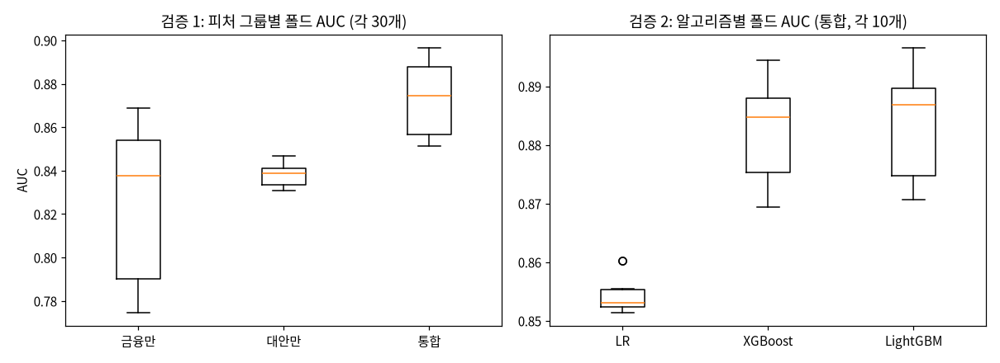

### 9.2 결과

| 검증 | 집단 평균 AUC | F | p | η² |
|---|---|---|---|---|
| 1. 피처 그룹 | 금융 0.828 · 대안 0.838 · 통합 0.873 | 39.20 | 7.28 × 10⁻¹³ | 0.474 (큼) |
| 2. 알고리즘 | LR 0.855 · XGBoost 0.882 · LightGBM 0.884 | 51.23 | 6.45 × 10⁻¹⁰ | 0.791 (큼) |

Tukey HSD:

| 검증 | 비교 | 평균 차이 | p_adj | 유의 |
|---|---|---|---|---|
| 1 | 금융 vs 대안 | 0.010 | 0.147 | ❌ |
| 1 | 금융 vs 통합 | 0.046 | 1.93 × 10⁻¹² | ✅ |
| 1 | 대안 vs 통합 | 0.035 | 1.19 × 10⁻⁸ | ✅ |
| 2 | LR vs XGBoost | 0.028 | 1.10 × 10⁻⁸ | ✅ |
| 2 | LR vs LightGBM | 0.029 | 4.06 × 10⁻⁹ | ✅ |
| 2 | XGBoost vs LightGBM | 0.001 | 0.902 | ❌ |

### 9.3 해석

**검증 1 (피처 그룹).** 피처 그룹에 따라 평균 AUC가 통계적으로 유의하게 달랐다(F = 39.20, p < 0.001, η² = 0.474). AUC 차이의 약 47%가 데이터 종류로 설명된다. 사후 검정 결과 통합 모델(M = 0.873)이 금융 모델(M = 0.828)보다 유의하게 높은 AUC를 보였고(차이 0.046, p_adj < 0.001), 대안 모델(M = 0.838)보다도 유의하게 높았다(차이 0.035, p_adj < 0.001). 반면 금융 모델과 대안 모델 사이에는 유의한 차이가 없었다(차이 0.010, p_adj = 0.147). 즉 어느 한 데이터만으로는 비슷한 수준이고, **두 데이터를 합쳤을 때 성능이 오른다.**

**검증 2 (알고리즘).** 통합 데이터에서 알고리즘에 따라 평균 AUC가 유의하게 달랐다(F = 51.23, p < 0.001, η² = 0.791). XGBoost(M = 0.882)와 LightGBM(M = 0.884)은 모두 Logistic Regression(M = 0.855)보다 유의하게 높았다(차이 약 0.028, p_adj < 0.001). 반면 XGBoost와 LightGBM 사이에는 유의한 차이가 없었다(p_adj = 0.902). 따라서 최종 모델로 LightGBM을 고른 것은 "XGBoost보다 낫기 때문"이 아니라 "Validation AUC가 근소하게 높고, 두 트리 모델 중 어느 것을 골라도 성능이 같기 때문"으로 설명하는 것이 정확하다.

**과제 노션 예시와 같은 결론.** 과제 노션의 해석 예시는 「대안 데이터가 단독으로는 전통 데이터와 유사한 예측력을 보이지만, 통합 시 시너지 효과가 발생함을 시사한다」이다. 우리 결과도 같은 모양이다. 금융 모델과 대안 모델은 유의한 차이가 없고(p_adj = 0.147), 통합 모델은 둘보다 유의하게 높다. 처음 방식(#26 이전)에서는 대안 모델(M = 0.967)이 금융 모델(M = 0.828)보다 훨씬 높아 예시와 달랐다. 대안 변수 다섯 개가 각자 정답 신호를 받아 합치면 잡음이 상쇄되었기 때문이다(3.2). 다만 "비슷하다"는 것도 상관 조건 때문에 변수 하나의 AUC가 약 0.8로 정해진 결과이므로(3.5), 실제 대안 데이터가 금융 데이터만큼 강하다는 증거로 읽지 않는다.

**효과 크기로 본 의미.** p 값은 "차이가 있는가"만 알려 주고, 표본이 크면 아주 작은 차이도 유의하게 나온다. 그래서 η²와 평균 차이를 함께 본다. 두 검증 모두 η²가 0.14를 넘는 큰 효과다. 검증 1의 금융 → 통합 차이(0.046)는 6장의 Validation AUC 차이(금융만 0.870 → 통합 0.897)와 비슷한 크기다. 검증 2의 LR → 트리 모델 차이(0.028)도 작지 않아, 통합 데이터에서는 트리 모델이 확실히 낫다. 금융 모델은 폴드 점수가 LR(약 0.78)부터 트리 모델(약 0.87)까지 넓게 퍼져(그림), 검증 1의 η²가 검증 2보다 작게 나왔다.

**씬파일러와의 연결.** 과제 노션의 목적은 「대안 데이터 포함 모델 vs 미포함 모델의 AUC uplift」로 씬파일러에게 대안 데이터가 도움이 되는지 보는 것이다. 검증 1은 전체 고객에서 통합의 효과가 우연이 아님을 보이고, 6.4는 씬파일러에서도 같은 방향(교차검증 +0.066, 95% 구간 +0.042 ~ +0.089)임을 보인다. 두 결과가 같은 결론을 가리킨다. 씬파일러 × 모델 구성의 교호작용을 직접 검정하는 Two-way ANOVA는 과제 노션 보너스로 남겨 둔다.

**최종 모델 선택에 주는 근거.**

| 결정 | ANOVA 근거 |
|---|---|
| 대안 데이터를 넣은 통합 모델을 쓴다 | 검증 1: 통합 > 금융 (p_adj < 0.001), 통합 > 대안 (p_adj < 0.001) |
| 트리 모델(XGBoost 또는 LightGBM)을 쓴다 | 검증 2: 두 트리 모델 > LR (p_adj < 0.001) |
| 두 트리 모델 중 LightGBM | 검증 2: 차이 없음 (p_adj = 0.902) → Validation AUC가 근소하게 높은 쪽(0.8972 vs 0.8970) |

과제 노션 기준 「ANOVA 최소 1개 이상 검증에서 p < 0.05」는 두 검증 모두 만족한다 ✅.

### 9.4 한계

- 폴드 점수는 같은 Train 데이터를 다섯으로 나눠 얻은 값이라 서로 완전히 독립이 아니다. ANOVA의 독립성 가정을 일부 어기므로, p 값이 실제보다 작게 나올 수 있다.
- 대안 변수는 정답 신호를 일부 써서 만들었으므로, 검증 1의 결과에는 그 영향도 함께 들어 있다 (3.5).
- 검증 1의 금융 그룹은 폴드 점수의 퍼짐(표준편차 0.033)이 대안 그룹(0.005)보다 훨씬 커서, 집단 분산이 같다는 ANOVA 가정을 일부 어긴다.
- 피처 그룹과 알고리즘을 함께 보는 Two-way ANOVA(보너스)는 하지 않았다.

## 10. 시스템 구성 (1.5쪽) 🟡

> 코드: `src/api/`(FastAPI), `src/dashboard/`(Streamlit), `docker-compose.yml`. PR #80 · #94 · #95 · #96 · #97 (10/29 병합).

### 10.1 전체 구성

과제 노션 제약 「Streamlit 코드에서 모델 파일(.pkl)을 직접 로드하는 것을 금지한다」에 따라, 모델을 쓰는 곳은 API 하나로 모으고 대시보드는 API만 부르는 구조(MSA)로 만들었다.

```
[학습 · 검증 파이프라인]                    [서비스]
main_step1~2 ──▶ models/ (최종 모델 · 스케일러) ──▶ FastAPI :8000 ◀── HTTP ── Streamlit :8501
main_step3~5 ──▶ outputs/ (검증 결과 JSON)    ──▶   (/predict · /explain 즉시 계산,
      │                                              나머지는 결과 JSON 반환)
      └──────▶ MLflow :5000 (실험 기록 · Model Registry)
```

- **API**는 `/predict` · `/explain`을 최종 모델로 바로 계산하고, 성능 · 공정성 · ANOVA처럼 미리 계산한 결과는 `main_step3~5`가 만든 JSON을 그대로 돌려준다. 그래서 검증 결과가 바뀌어도 API 코드는 고치지 않는다.
- **대시보드**는 `api_client.py`로 HTTP 요청만 보낸다. 모델 파일을 읽는 코드가 없다.
- 세 서비스는 `docker compose up` 한 번으로 함께 뜬다 (10.4).

### 10.2 API (FastAPI)

과제 노션 「다음 7개 엔드포인트가 구현되어 있다」의 7개에, 대시보드 화면에 필요한 5개를 더해 12개를 만들었다. Swagger(`localhost:8000/docs`)에서는 대시보드 화면 순서대로 태그를 묶어, 어느 화면이 어느 엔드포인트를 쓰는지 바로 보이게 했다.

| 화면 | 엔드포인트 | 응답 | 데이터 출처 |
|---|---|---|---|
| 공통 | `GET /health` | 상태, 모델 버전 · 단계(Staging), Test AUC, 결과 JSON 출처 | 모델 파일 |
| 고객 심사 | `POST /predict` | 신용점수, 등급, 승인 여부, 부도 확률, 씬파일러 여부 | 최종 모델 즉시 계산 |
| 고객 심사 | `GET /customers/{customer_id}` ➕ | 고객 한 명의 입력값 15칸 | `data/customers.json` (Test 고객 1,000명) |
| 고객 심사 | `POST /screenings` ➕ | 심사 결과 저장 | SQLite (`data/screenings.db`) |
| 고객 심사 | `GET /screenings` ➕ | 최근 심사 목록 | SQLite (`data/screenings.db`) |
| XAI 분석 | `POST /explain` | 거절 사유 Top 5(문장 포함), 칸별 SHAP 값 | SHAP 즉시 계산 |
| XAI 분석 | `GET /explain/summary` ➕ | 전역 중요도 상위 칸 | `shap_summary.json` |
| 공정성 | `GET /fairness` | DI Ratio, TPR · FPR 차이, 집단별 승인율 | `fairness.json` |
| 공정성 | `GET /fairness/mitigation` | 완화 전 · 후 비교 | `fairness_mitigation.json` |
| 모델 성능 | `GET /metrics` | AUC, KS, Precision, Recall, F1, 혼동행렬, ROC · PR 곡선 | `metrics_<모델>.json` |
| 모델 성능 | `GET /metrics/comparison` ➕ | 후보 모델 18개의 5-Fold 결과 | `model_metadata.json` |
| 통계 검증 | `GET /anova` | 검증 1 · 2의 F, p, η², Tukey HSD | `anova.json` |

➕ 과제 노션 7개 외에 추가한 것.

**입력과 계산 규칙**

- 모든 엔드포인트에 Pydantic 요청 · 응답 스키마를 두고, 값의 범위를 검사한다(예: 나이 18~120, 납부율 0~100). 과제 노션 「모든 엔드포인트에 Pydantic Request/Response Schema가 정의되어 있다」.
- 입력은 고객 15칸(금융 10 + 대안 5)이다. 성별 · 연령대 같은 보호 속성은 받지 않는다 (8.1).
- 부채비율 · 통신비 정상납부율 · 공과금 납부율은 화면에서 이해하기 쉽게 **%로 받고**, 서버가 100으로 나눠 모델 단위로 바꾼다 (#70, PR #94).
- 월소득은 **원으로 받고**, 서버가 1000(`INCOME_KRW_PER_UNIT`)으로 나눠 모델 단위로 바꾼다. 고객 조회와 거절 사유 문장도 원으로 보여 준다 (#116, PR #118).
- 받은 값은 학습 때 저장한 StandardScaler로 똑같이 변환한 뒤 모델에 넣는다 (5장). 이 스케일러는 Train으로만 계산한 기준이다 (#82).
- **신용점수** = (1 − 부도 확률) × 1000을 반올림한 0~1000점. **등급**은 300 · 500 · 650 · 800점을 경계로 E · D · C · B · A, **승인**은 부도 확률이 0.5(`APPROVAL_THRESHOLD`) 미만일 때다.
- 모든 응답에 면책 조항(`disclaimer`)이 들어 있다.

**확인 결과** (10/29, 남궁명진 PC)

| 확인 | 결과 |
|---|---|
| 엔드포인트 호출 | 처음 9개 모두 200 ✅ (10/29). 고객 조회 · 심사 저장 3개는 #116 · #118에서 추가 |
| `/predict` 응답 시간 | 첫 호출 0.92초(모델 불러오기 포함), 이후 0.1초 이하. 과제 노션 「`/predict` API 응답 시간이 2초 이내이다」 ✅ |
| Swagger 예시 고객 (C-10482) | 268점 · E등급 · 부도 확률 73% · 거절 (11/5, #118 월소득 원 단위 반영 후). 거절 사유 1위 「정기결제 건수가 5건으로, 동일 연령대 평균(11.3건) 대비 낮습니다」 |
| API 테스트 (`tests/test_api.py`) | 통과 (전체 pytest 120 통과 · 7 건너뜀 · 실패 0, 11/5) |

### 10.3 대시보드 (Streamlit)

과제 노션 「대시보드에 다음 5개 탭(또는 페이지)이 존재한다」에 맞춰 5페이지를 만들었다.

| 페이지 | 과제 노션 「필수 구성 요소」 | 구현 | 쓰는 API |
|---|---|---|---|
| 고객 심사 | 입력 폼(나이, 소득, 부채비율 등), 승인/거절 결과, 신용 점수, 리스크 등급 | 입력 15칸, 승인/거절, 점수 막대와 등급 눈금, 씬파일러 표시 ✅ | `/predict` |
| XAI 분석 | SHAP Summary Plot 이미지, 개별 고객 Waterfall Plot, 거절 사유 Top 5 텍스트 | 전역 중요도(금융 · 대안 색 구분), 심사한 고객의 Waterfall과 가법성 검증, 거절 사유 카드 5개 ✅ | `/explain`, `/explain/summary` |
| 공정성 | 집단별 승인율 막대 차트, DI Ratio 수치, Mitigation 전/후 비교 차트 | 집단별 승인율 막대, DI Ratio · Equalized Odds 수치와 통과 표시, 완화 전/후 비교 ✅ | `/fairness`, `/fairness/mitigation` |
| 모델 성능 | ROC Curve, Precision-Recall Curve, 혼동행렬 히트맵 | 지표 카드(AUC · KS · PSI 통과 표시), ROC · PR 곡선, 혼동행렬, 후보 모델 비교, 씬파일러 AUC 향상 ✅ | `/metrics`, `/metrics/comparison` |
| 통계 검증 | ANOVA 검증 결과 테이블 (F값, p값, η²), Tukey HSD 결과 | 검증 1 · 2의 F · p · η² 표, Tukey HSD 쌍별 비교 표 ✅ | `/anova` |

- **위험도 색**: A · B 저위험(초록), C 중위험(노랑), D · E 고위험(빨강). 과제 노션 「위험도에 따라 색상이 구분된다」.
- **가법성 검증**: Waterfall의 기준값 + SHAP 값 합을 확률로 바꾼 값이 `/predict`의 부도 확률과 같은지(오차 0.005 이내) 화면에 표시해, 설명이 실제 예측과 맞는지 보여 준다.
- **면책 조항**: 모든 페이지 사이드바 아래에 원문 그대로 표시한다 (#97). 과제 노션 「모든 결과물에 다음 면책 조항(Disclaimer)을 명시해야 한다」.
- **API가 꺼졌을 때**: 화면이 멈추지 않고 오류 안내를 보여 준다. API 없이 화면만 볼 때는 `USE_MOCK=true`로 예시 응답을 쓴다.
- ✍️ 화면 캡처: 새 화면 시안(PR #124)과 공정성 완화 비교 차트(#119)가 들어간 뒤 5페이지를 한 장씩 넣는다 (`docs/figures/10_*.png`).

### 10.4 Docker Compose

과제 노션 「`docker-compose up` 명령 한 번으로 다음 3개 서비스가 동시에 실행된다」.

| 서비스 | 주소 | 내용 |
|---|---|---|
| api | `localhost:8000` | `uvicorn src.api.main:app` |
| dashboard | `localhost:8501` | `streamlit run src/dashboard/app.py`, 컨테이너 안에서는 `API_BASE_URL=http://api:8000`으로 API를 찾는다 |
| mlflow | `localhost:5000` | MLflow 2.22.0 공식 이미지, 기록은 `./mlruns` |

- `.env` 없이도 뜨고, 포트는 `API_PORT` · `DASHBOARD_PORT` · `MLFLOW_PORT`로 바꾼다. 과제 노션 「설정값(포트, 경로, 임계값)은 환경 변수 또는 config 파일로 분리한다」.
- 최종 모델과 스케일러는 저장소에 들어 있어 clone 직후 `/predict` · `/explain`이 동작한다.

### 10.5 한계

- **clone 직후의 MLflow**: compose의 MLflow는 그 PC의 `./mlruns`만 보여 줘서, clone 직후에는 실험 기록이 없다. 팀 기록은 팀 MLflow 서버에 있고, clone 후에도 기록이 보이게 하는 작업이 진행 중이다 (#102, PR #115). 검증 결과 JSON 6개는 저장소에 넣어 clone 직후에도 실제 값이 나온다 (#103, PR #109).
- **신용점수 식**: 부도 확률을 1000점으로 바꾼 단순한 식이라, 실제 신용평가사의 점수 체계(로그 오즈 기반 스코어카드)와 다르다.
- **월소득 단위**: 학습 데이터(GMSC)의 월소득은 미국 달러 기준이고 화면 입력은 원이다. "1000원 = 모델 단위 1"로 바꾸는 것은 환율과 두 나라의 소득 수준 차이를 반영하지 않은 단순화다 (#116, PR #118). 실제로 쓰려면 국내 소득 분포로 다시 학습해야 한다.
- **첫 호출 시간**: PC가 바쁠 때 API를 켠 뒤 첫 `/predict`가 6.2초 걸려 대시보드 대기 시간(5초)을 넘은 적이 있다. 두 번째부터는 0.1초다.

## 11. 한계와 결론 (1.5쪽) 🟡

### 11.1 과제 노션 성공 기준 결과

| 항목 | 기준 | 결과 | 장 |
|---|---|---|---|
| Test Set AUC-ROC | ≥ 0.78 | 0.8894 ✅ | 6.3 |
| Test Set KS Statistic | ≥ 0.28 | 0.6129 ✅ | 6.3 |
| 씬파일러 집단 AUC 향상 | ≥ +0.03 | Train+Validation 교차검증 +0.066 (95% 구간 +0.042 ~ +0.089) ✅. Test 1회 +0.001(연체 42명, 참고) | 6.4 |
| PSI | < 0.1 | 0.0004 (칸별 최대 0.0009) ✅ | 6.3 |
| DI Ratio | 0.8 ~ 1.25 | 성별 0.996 ✅. 연령대 1.254 ⚠️ WARNING → 완화 후 0.988(Threshold Adjustment) · 1.100(Reweighting) ✅ | 8.2, 8.4 |
| Equalized Odds | ≤ 0.10 | 성별 0.004 / 0.006 ✅. 연령대 0.148 / 0.176 ❌ → 완화 후 0.041 / 0.064 · 0.045 / 0.022 ✅ | 8.2, 8.4 |
| ANOVA | 1개 이상 p < 0.05 | 두 검증 모두 p < 0.001 ✅ | 9.2 |
| API 응답 시간 | `/predict` 2초 이내 | 첫 호출 0.92초, 이후 0.1초 이하 ✅ | 10.2 |

### 11.2 한계

1. **시뮬레이션 데이터**: 대안 변수 5개는 과제 노션 요구(상관 0.3~0.5)를 맞추려고 정답 신호(30%)와 금융 위험 지표(70%)를 섞은 성실도에서 만들었다(이슈 #26). 처음 방식의 과장(통합 AUC 0.98)은 줄였지만, 상관 조건 때문에 변수 하나의 AUC가 약 0.8로 정해지고, w · ρ는 실제 데이터로 검증하지 않은 보정값이다 (3.5).
2. **씬파일러 기준**: 과제 노션 정의로는 이 데이터에서 0명이라, 보유 계좌 수·담보대출·연체 기록으로 대신했다. 카드 사용 기간 조건은 칸이 없어 쓰지 못했다. Test 씬파일러가 625명(연체 42명)으로 적어 Test 1회 향상은 구간이 0을 포함하므로, Train+Validation 교차검증 값으로 판정했다 (4장, 6.4).
3. **보호 속성**: 성별은 원본에 없어 시뮬레이터가 만든 값이다. 실제 성별에 따른 차별 여부는 이 데이터로 판단할 수 없고, `bias_ratio` 실험으로 "편향이 있으면 지표가 잡아내는지"만 확인했다 (8.3).
4. **나이를 입력으로 사용**: 나이는 과제 노션의 금지 목록(「인종, 종교, 장애 여부 등」)에 없고 원본 데이터의 기본 칸이라 입력에 넣었다. 다만 연령대는 공정성 보호 속성이기도 하고, 실제로 완화 전 모델은 연령대 기준을 넘었다(8.2). 완화하면 기준 안으로 들어오지만(8.4), 최종 모델에는 아직 적용하지 않았다.
5. **승인 기준**: 연체자를 놓치지 않도록 Recall을 우선해(0.775), 정상 고객의 16.4%가 거절된다(6.3). 실제로 쓰려면 기준값을 비용에 맞춰 다시 정해야 한다.
6. **이상값**: 연체 칸의 96·98 코드, 나이 0세 등은 정리하지 않았다 (2장).
7. **통계 검정**: ANOVA의 폴드 점수는 서로 완전히 독립이 아니다 (9.4).
8. **월소득 단위**: 미국 달러 기준 학습 데이터에 원 단위 입력을 "1000원 = 모델 단위 1"로 맞췄다. 환율과 소득 수준 차이를 반영하지 않은 단순화라, 국내 고객에게 그대로 쓸 수 없다 (10.5).

### 11.3 결론

Kaggle 신용 데이터에 대안 데이터 5개를 더한 통합 LightGBM 모델은 과제 노션의 성능 기준을 모두 넘었고(Test AUC 0.889, KS 0.613, PSI 0.0004), 씬파일러 집단에서 대안 데이터를 더하면 AUC가 0.749에서 0.815로 올랐다(Train+Validation 교차검증, +0.066). ANOVA에서는 금융 데이터와 대안 데이터가 단독으로는 비슷하고 합쳤을 때 유의하게 높아, 과제 노션 예시와 같은 결론을 얻었다. 모든 거절 결과에는 SHAP 기반 거절 사유 5개를 「통신비 정상납부율이 78%로, 동일 연령대 평균(92%) 대비 낮습니다」 형식으로 만든다. 공정성은 성별은 기준 안이지만 연령대는 완화 전 기준을 넘었고(DI 1.254), Threshold Adjustment와 Reweighting 모두 기준 안으로 되돌렸다. 공정성 지표는 Fairlearn으로 다시 계산해도 같다.

처음에는 대안 변수 다섯 개가 각자 정답 신호를 받아 AUC가 0.98까지 나왔고, 연령대 공정성 문제도 드러나지 않았다. 대안 데이터 생성 방식을 고쳐 AUC를 현실적인 수준으로 낮추자 모델의 오류가 늘고, 그 오류가 연령대마다 다르다는 것이 보였다. **성능이 지나치게 좋으면 공정성 문제도 가려질 수 있다**는 점이 이 프로젝트의 중요한 배운 점이다.

다만 이 숫자들은 정답 신호를 일부 써서 만든 시뮬레이션 대안 데이터에서 나온 것이다. 이 프로젝트가 보여 주는 것은 "대안 데이터가 실제로 이만큼 좋다"가 아니라, **대안 데이터를 넣었을 때 성능 향상을 씬파일러 집단에서 측정하고, 그 판단을 설명하고, 공정성을 검사하고, 통계로 확인하는 전체 과정**이다. 실제 대안 데이터를 쓰면 같은 파이프라인을 그대로 다시 돌려 검증할 수 있다.

### 11.4 앞으로 할 일

- 실제 대안 데이터로 다시 학습해 성능과 SHAP 중요도 비교
- 연령대 Bias Mitigation(Reweighting)을 최종 모델에 적용할지 팀에서 결정
- 과제 노션 보너스: 씬파일러 × 모델 구성 Two-way ANOVA, Counterfactual Explanation("무엇이 바뀌면 승인되는지")

## 부록. 팀 결정 기록 (1쪽) ✅

| 날짜 | 결정 | 근거 | 이슈 |
|---|---|---|---|
| 10/8 | 씬파일러 기준: 계좌 1개 이하 + 담보대출 0 + 연체 0 | 원본 정의로는 0명, Experian, 데이터 연체율 | #15 |
| 10/8 | 기본 데이터 thin_filer_ratio=None, bias_ratio=0 | 무작위 채움·편향이 기본 데이터를 망가뜨림 | #16 |
| 10/10 | 대안 변수 방향 A안 (연체자일수록 낮게) | 원본 예시 코드·거절 사유 예시 | #36 |
| 10/10 | 정답으로 대안 변수를 만드는 방식 유지 | 원본 0.3-0.5 요구 | #26 |
| 10/10 | 편향 실험에 성별 대리 변수 추가 | 정답만 바꾸면 모델 승인율에 성별 편향이 안 나타남 | #41 |
| 11/1 | 대안 변수를 잠재 상환 성실도 요인 모델로 생성 (w=0.3, ρ=0.8, 목표 상관 0.32) | 각자 정답 신호를 받는 방식은 AUC 0.98로 과장. w는 교차검증 향상으로 선택 | #26, PR #108 |
| 11/1 | 씬파일러 향상 판정은 Train+Validation 교차검증 값, Test 1회 값은 함께 기록 | Test 씬파일러 연체 42명으로 구간이 0을 포함 | #108 리뷰, #110 |

재현 방법: `python main_step1.py` → `main_step2.py` → `main_step3.py --model ...` → `main_step4.py --model ...` (환경 변수는 `.env.example`)
